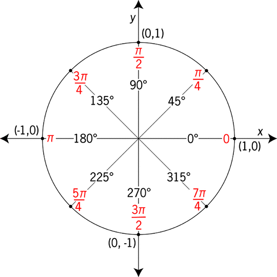
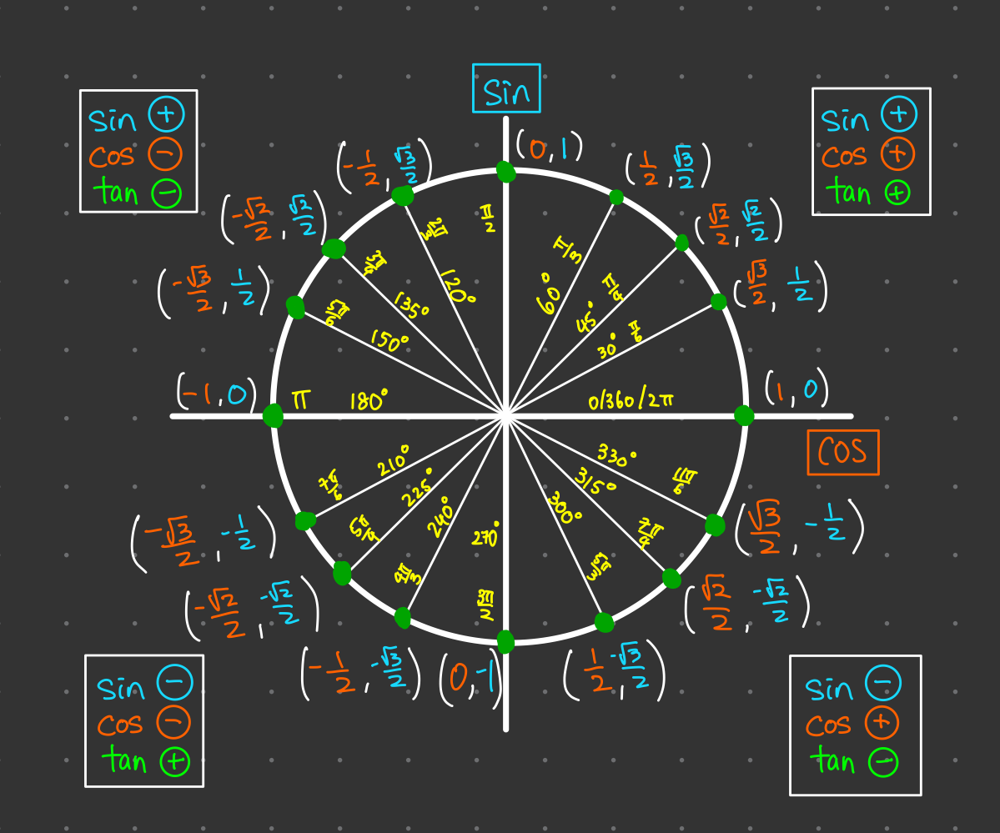
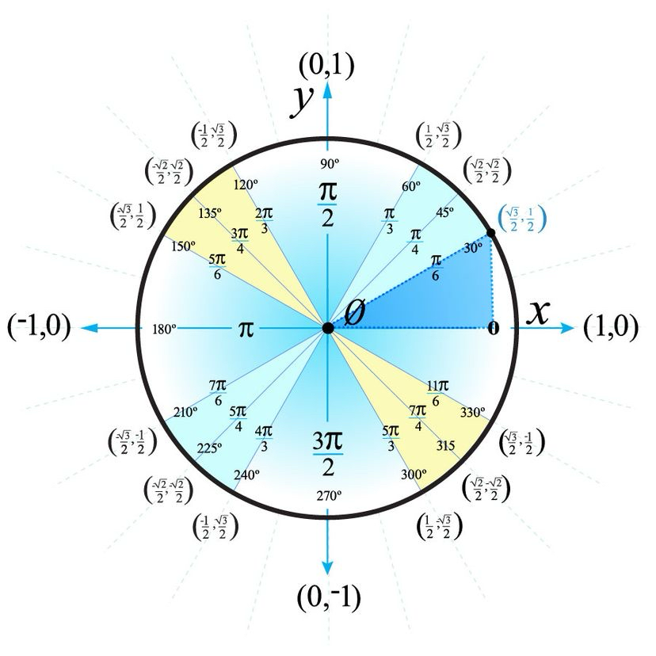

## **🤓 什么是弧度（radian）？**

**定义**：弧度是一个“基于圆”的角度单位。

- 想象一个圆，截取一段弧线，**这段弧线的长度恰好等于圆的半径**，那么该弧所对的圆心角就是 **1 弧度**。  

为什么这样定义？

- 因为不同大小的圆，其“半径”自然不同，但“弧长 = 半径”这个比例却一致。
- 所以 1 弧度对应的“角”在任意圆中都一样，具有通用性。 



## **🎯 弧度 vs. 度 — 场景比喻**

- **度（°）**：像岁数一样，人类习惯的一种“分割360份”的方法，很直观，但有点“人为设定”。 
- **弧度（rad）**：更像“绕圈走了多少距离”，是把弧长和半径相比的一种自然描述。你走了多少米？你绕了多少弧长？相对半径又是多少圈？这才是“弧度”的精髓。  

一个 reddit 用户说得特别好：

> “Radians are an alternative unit of measure… but their definition is ‘natural’. … angle subtended by an arc of length equal to the radius.” 

## **🔄 数学里怎么换算？**

弧度和度之间的换算关系：

**θ 是弧度（rad）**：一个无量纲的角度单位，表示“弧长 ÷ 半径”。

- **2π 弧度 = 360°**（一整圈）
- 所以：1 rad = 180°／π ≈ 57.3°，1° = π／180 rad ≈ 0.01745 rad。  

**举例**：

- π/2 rad = 90°
- π rad = 180°
- 3 rad ≈ 3×57.3° ≈ 171.9°

## “2π 弧度 = 360°” 是什么意思？

- 这里并不是说“2π × 弧度”，而是指：
  一个完整圆周的角度就是 **2π 弧度**，对应 **360°**。
- 换句话说：
  - **2π 弧度 = 360°**
  - π 弧度 = 180°
  - π / 2 弧度 = 90°

你也可以按下面的公式进行互换：

rad = deg × π / 180

deg = rad × 180 / π

---

## 为什么使用 “2π” 表示整圈？

- 圆的周长 = 2π × 半径（r）
- 弧度定义为弧长 ÷ 半径
- 当弧长等于圆周时：

2πr ÷ r = 2π （弧度）

- 因此，**整圈就是 2π 弧度**。

---

## 常见换算表

| 度（°） | 弧度（rad） |
| ------- | ----------- |
| 360°    | 2π          |
| 180°    | π           |
| 90°     | π / 2       |
| 1°      | π / 180     |
|         |             |

---

## ✅ 小结

- 正确表达是：“**2π 弧度 = 360°**”，用于描述一整圈。

| **θ（rad）** | **弧长 s = θ × r** | **解释**             |
| ------------ | ------------------ | -------------------- |
| 1 rad        | = 1 × r            | 行进弧长等于半径长度 |
| π rad        | = π × r            | 半圈对应的弧长       |
| 2π rad       | = 2π × r           | 一整圈，对应圆的周长 |

- 使用下面公式可以方便地在角度和弧度之间互转：

rad = deg × π / 180

deg = rad × 180 / π

- **θ × r = 弧长**（任意弧度下都成立）；

## **🧮 为什么很多场景（尤其编程、科学计算）都喜欢用弧度？**

1. **定义天然**：弧度直接关联圆的弧长与半径，无需人为拆分，公式更简洁。  
2. **三角函数更友好**：sin、cos、tan 等函数在弧度制下，计算导数、积分、泰勒展开都更自然、没有多余系数干扰。  
3. **物理学中也普遍用**：角速度、周率等等直接用弧度制更符合连续变化、单位统一的需求。 

## **🧩 小结：从“走多远”理解弧度更贴切**

- **弧度 = 弧长 ÷ 半径**：当你绕着圆走弧线时，走了多长？对应就在圆心处出现了多少角度。
- **度只是人设定的分段**：360° 因为数字好分，但和弧长关系不直观。  

## **📌 回到 Three.js 的应用**

- Three.js 中所有 rotation、angle 类（如 Euler、Spherical）都 **默认采用弧度**。
- 因为底层的 Math.sin(), Math.cos() 等函数全用弧度。
- 如果你记得一个角度，比如想让物体转 90°，只需转换：

```js
const rad = THREE.MathUtils.degToRad(90); // = π/2
mesh.rotation.y = rad;
```

### 实例讲解

```typescript
const geometry = new THREE.SphereGeometry(0.2);
const material = new THREE.MeshBasicMaterial({color:0xff0000});
const sphere = new THREE.Mesh(geometry, material);
scene.add(sphere);

let time = 0;
function animate() {
  requestAnimationFrame(animate);
  time += 0.01;
  sphere.position.x = 5 * Math.cos(time);
  sphere.position.z = 5 * Math.sin(time);
  renderer.render(scene, camera);
}
animate();
```



```typescript
time += 0.01;
sphere.position.x = 5 * Math.cos(time);
sphere.position.z = 5 * Math.sin(time);
```

这段代码使用 time 变量作为“弧度”，让球体绕着圆周运动。下面我一步步帮你理解其中的数学基础：

## **1. 为什么**time表示弧度？

- 你把球体放在 x–z 平面，并希望它沿一个圆周运动，中心在原点，半径为 5。
- 如果我们用一个角度 θ（弧度），圆上点的坐标可以表示为：

```typescript
x = r * cos(θ)
z = r * sin(θ)
```

- 所以，每帧增加 time，就相当于角度 θ 在不停递增。于是，球在圆上顺时针（或逆时针）不断移动。

## **2. 数学里的 cos ／ sin 是什么？**

这和 **单位圆** 有关：

### **👉 单位圆 & 三角函数：**

- 单位圆是半径为 1 的圆（中心在原点）。
- 一个角度 θ 对应圆上一点 (x, y)，满足：

```typescript
x = cos(θ)
y = sin(θ)
```

- 这意味着：
  - cos(θ) 是角度终点在 x 轴上的投影；
  - sin(θ) 是 y 轴上的投影。   

图中的坐标解释了 cos/sin 如何通过“相邻边/斜边”定义。  



## **3. 为什么**cos(time)会得到 x 坐标？

- 你用不了半径为 1 的单位圆，而是半径为 5 的圆；
- ⁣从单位圆公式扩展为：

```typescript
x = 5 * cos(time)
z = 5 * sin(time)
```

- 这样球体就在 x–z 平面上，半径为 5 的圆周上运动。

## **4. 为什么这样能形成圆周运动？**

你每帧让 time 增加一个小量（0.01 rad），形成一个连续旋转：

- 当 time = 0 时，cos(0)=1，sin(0)=0 → 点在 (5,0)
- 当 time ≈ π/2（1.57 rad）时，cos≈0，sin≈1 → 点在 (0,5)
- 当 time ≈ π 时 → 点在 (–5,0)
- …如此类推，直到 time 达到 2π（≈6.28 rad）再回到原点。

这样球就完成一整圈旋转。  

## **🧠 总结：几个关键点**

- **time** 当作角度 θ（单位：弧度）在变化；
- Math.cos(θ) / Math.sin(θ) 分别给出圆上点在 x / z 方向的坐标；
- 乘以 5 就是调整半径；
- 每帧 time 增加，就实现了“沿圆绕圈行走”的效果。
- 在 **Three.js 场景中**，这种模式特别常见：不断增加 θ，使物体沿圆形路径移动——**θ 是一个辅助变量，为三角函数提供输入，最终产出的是位置**。

### **💡 数学角度进一步解释**

- 弧度的定义：

  > θ (弧度) = 弧长 s ÷ 半径 r 

- 三角函数解析：

  在单位圆（r = 1）中：

  - cos(θ) = x 坐标

  - sin(θ) = y 坐标

    在任意半径 r 的圆中：

  - x = r cos(θ)，z = r sin(θ) 

- 在编程中使用弧度是因为它能**让三角函数直接、准确地反映角度变换**，而不用额外换算(scale) 后消费   。


