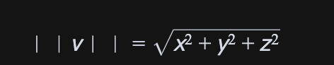
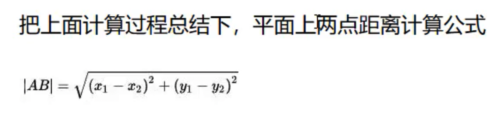
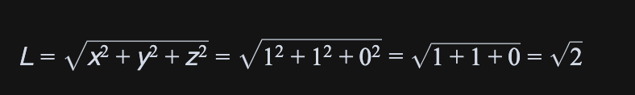
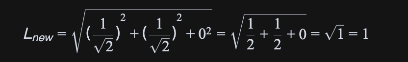

#  三维向量Vector3

THREE.Vector3 在 Three.js 中是一个非常核心和基础的类，它最主要的功能就是用来表示三维向量。这在3D图形学中通常有两种应用场景：

1. 表示坐标 (Position):

- 一个三维向量可以看作是空间中的一个点。比如你代码中的 A 和 B 就是用来定义空间中的两个具体位置。

- 所有三维物体 (Object3D) 都有一个 .position 属性，它就是一个 Vector3 实例，用来确定物体在场景中的位置。你的代码 mesh1.position.copy(B) 就是把 mesh1 的位置设置成 B 点的坐标。

1. 表示方向和大小 (Direction and Magnitude):

- 一个三维向量也可以表示一个从原点 (0,0,0) 指向 (x,y,z) 的箭头。这个箭头既有方向，也有长度（大小）。

- 在你的代码中，const walk = new THREE.Vector3(100, 50, 0) 就是一个典型的例子。它不代表一个具体的坐标点，而是代表一个位移：在 X 轴方向移动 100 个单位，在 Y 轴方向移动 50 个单位。

在你代码中的体现：

- const A = new THREE.Vector3(30, 30, 0): 这是一个起始坐标。

- const walk = new THREE.Vector3(100, 50, 0): 这是一个位移向量。

- B.x = A.x + walk.x: 这里就是向量的加法运算，将一个位置和一个位移相加，得到一个新的位置 B。

小提示：

Three.js 的 Vector3 类提供了很多便捷的方法来进行向量运算。你代码中的这部分：

```typescript
// 计算结束点xyz
B.x=A.x+walk.x
B.y=A.y+walk.y
B.z=A.z+walk.z
```

可以被一个更简洁的方法替代：

```typescript
// B = A + walk
B.addVectors(A, walk);
```

或者这样写，会更常见：

```typescript
// B = A的克隆 + walk
const B = A.clone().add(walk);
```


## Vector3 向量大小(长度)的计算方法

在三维空间中，一个向量 v 如果由坐标 (x, y, z) 表示，那么它的大小（也称为长度或模），通常记作 ||v||，是根据三维空间中的勾股定理（也叫欧几里得距离公式）来计算的。

#### 数学公式

其计算公式如下：





简单来说，就是将向量的每个分量的平方相加 ，然后取其平方根。

#### 应用到你的代码

在你的代码中，定义了速度向量 v：

```typescript
const v = new THREE.Vector3(1, 1, 0);
```

我们将它的分量 x=1, y=1, z=0 代入上面的公式：

1. 各分量平方：

- x² = 1² = 1

- y² = 1² = 1

- z² = 0² = 0

1. 求和：

- x² + y² + z² = 1 + 1 + 0 = 2

1. 开平方根：

```typescript
||v|| = √2
```

所以，向量 v 的大小（长度）就是 √2。当这个向量被用作表示“速度”时，我们就可以说这个速度的大小是 √2 米/秒。

#### 几何意义

- 这个向量 (1, 1, 0) 在 xy 平面上的投影是 (1, 1)。因为 x 和 y 的分量相等，所以它的方向正好是 x 轴和 y 轴正半轴的角平分线（与x轴成45度角）。

#### Three.js 中的便捷方法

在 Three.js 中，你不需要自己手动计算。Vector3 对象自身就提供了一个便捷方法 .length() 来获取向量的长度。

```typescript
const v = new THREE.Vector3(1, 1, 0);
const length = v.length(); 

console.log(length); // 会输出 1.4142135623730951，这正是 √2 的近似值
```


## 用向量表示速度 (Velocity)

在物理学和3D图形学中，**速度 (Velocity)** 是一个矢量（Vector），因为它同时包含两个关键信息：

1.  **速率 (Speed)**：运动的快慢，是一个标量（普通数值）。
2.  **方向 (Direction)**：物体运动的方向。

`THREE.Vector3` 恰好可以完美地表示这两个信息，因此经常被用来表示速度向量。

-   **向量的方向** 代表了物体运动的 **方向**。
-   **向量的长度 (`.length()`)** 代表了物体的 **速率**。

#### 代码示例

让我们分析一下你代码中的例子：

```javascript
// v代表速度向量
const v = new THREE.Vector3(1, 1, 0);
```

1.  **方向**：这个向量从原点指向 `(1, 1, 0)`。在 XOY 平面上，它正好是第一象限的角平分线方向（与X轴正方向成45度角）。这就是物体运动的精确方向。

2.  **速率**：这个向量的长度是 `v.length()`，计算出来是 `√2 ≈ 1.414`。如果我们规定场景的单位是“米”，时间单位是“秒”，那么这就代表物体的速率是 **√2 米/秒**。

#### 速度、方向和速率的关系

在实际应用中，我们常常需要将“方向”和“速率”分开处理。比如，“让一个物体以 10 米/秒的速度朝某个方向移动”。

这就引出了 **单位向量 (Unit Vector)** 的概念。

**单位向量** 是一个长度为 `1` 的向量，它只包含方向信息，不包含速率信息。我们可以通过 `.normalize()` 方法将任何向量转换为单位向量。

```javascript
const v = new THREE.Vector3(1, 1, 0);

// 1. 获取纯方向 (归一化)
v.normalize(); // v现在变成了(0.707, 0.707, 0), 但它的长度 .length() 变成了 1

// 2. 设定速率
const speed = 10; // 假设我们想要的速度是 10 米/秒

// 3. 计算最终的速度向量
const velocity = v.clone().multiplyScalar(speed); // (7.07, 7.07, 0)

console.log(velocity.length()); // 输出会非常接近 10
```

通过这种方式，你可以精确地控制物体的运动方向和速率。

#### 应用：计算位移

一旦你有了速度向量 `velocity`，计算物体在一段时间 `t` 内的位移就变得非常简单，只需使用向量乘法：

`位移 = 速度 × 时间`

```javascript
const velocity = new THREE.Vector3(1, 1, 0); // 速度：√2米/秒，方向为(1,1,0)
const time = 50; // 时间：50秒

// 计算50秒内的总位移向量
const displacement = velocity.clone().multiplyScalar(time); // (50, 50, 0)

// 更新物体位置
// newPosition = oldPosition + displacement
const startPosition = new THREE.Vector3(30, 30, 0);
const endPosition = startPosition.clone().add(displacement);
```

这正是你之前代码中 `const walk=v.clone().multiplyScalar(50)` 的含义。


## 理解单位向量 (Unit Vector) 与归一化 (Normalization)

### 核心概念：单位向量 (Unit Vector)

想象一下，一个普通向量 `v` 包含了两个信息：
1.  **方向**：它指向哪里。
2.  **大小/长度**：它的“劲儿”有多大（比如速度是 50m/s 还是 100m/s）。

在很多情况下，我们只想用它的 **方向**，而暂时忽略它的大小。比如，“我想让一个物体朝着 A 点的方向移动，但是速度由我来定”。

**单位向量** 就是为了这个目的而生的。它是一个 **长度恒为 1** 的特殊向量。

> **一句话总结：单位向量是一个只保留了“方向”，而将“大小”统一为 1 的向量。**

---

### 什么是“归一化” (Normalization)？

“归一化”就是将一个普通向量转换成单位向量的过程。在 Three.js 中，这个操作就是通过 `.normalize()` 方法完成的。

**它的计算方法很简单：**

> **将向量的每个分量（x, y, z）都除以它自身的总长度。**

---

### 实例拆解：`v = (1, 1, 0)`

现在我们来一步步看你的例子：

#### 1. 原始向量
我们有一个向量 `v = new THREE.Vector3(1, 1, 0)`。

#### 2. 计算它的原始长度
这个向量的长度 `L` 是：

`√2` 的近似值大约是 `1.414`。
所以，这个原始向量的 **方向** 是 `(1, 1, 0)`，**大小** 是 `√2`。

#### 3. 执行归一化 (`v.normalize()`)
根据归一化的规则，我们需要把每个分量都除以它的总长度 `√2`。
-   新的 x 值： `x' = x / L = 1 / √2 ≈ 0.707`
-   新的 y 值： `y' = y / L = 1 / √2 ≈ 0.707`
-   新的 z 值： `z' = z / L = 0 / √2 = 0`

所以，`v.normalize()` 之后，向量 `v` 就变成了 `(0.707, 0.707, 0)`。

#### 4. 验证新向量的长度
现在我们来计算这个新向量的长度，看看它是不是 1：


因为 0.707 其实是 1/√2，我们用分数来计算会更精确：



**结果正确！** 经过归一化之后，向量的长度确实变成了 1。

---

### 

## 理解 `position.add(vector)`：坐标 vs. 位移向量

```typescript
// 案例二：利用单位向量确定两个点对应的方向，并计算模型基于这个值的位移量
const BoxGeometry=new THREE.BoxGeometry(10,10,10)
const BoxMaterial=new THREE.MeshLambertMaterial({color:0x00ffff})
const BoxMesh=new THREE.Mesh(BoxGeometry,BoxMaterial)
BoxMesh.position.set(-50,0,-50)
const C=new THREE.Vector3(-50,0,-50)
const D=new THREE.Vector3(100,0,100)
const CD=D.clone().sub(C)
CD.normalize() //CD归一化，得到CD的单位向量，获取它的方向
const CDVelocity=CD.clone().multiplyScalar(100) //CDVelocity是CD的单位向量乘以速度10,沿着CD反向平移100个单位
console.log('CDVelocity的位移长度',CDVelocity.length());
// 用一个向量表示模型平移的过程，沿着CD方向平移100长度
BoxMesh.position.add(CDVelocity)
group.add(BoxMesh)

```

`CDVelocity` 更准确的身份是**“位移向量”或“速度向量”**，而不是一个“坐标”。但是，利用这个向量通过 `.add()` 方法，确实实现了模型的平移。

我们来详细分解这行代码：`BoxMesh.position.add(CDVelocity)`

### 1. `BoxMesh.position`
-   **身份**：**坐标 (Position / Coordinate)**
-   **类型**：`THREE.Vector3`
-   **作用**：它描述的是 `BoxMesh` 这个物体当前在3D世界中的**绝对位置**。例如，它可能的值是 `(10, 50, 20)`，代表一个明确的点。

### 2. `CDVelocity`
-   **身份**：**位移或速度 (Displacement / Velocity)**
-   **类型**：`THREE.Vector3`
-   **作用**：它描述的**不是一个具体位置**，而是一个**方向和大小**。例如，值 `(1, 0, 0)` 代表一个“沿X轴正方向移动1个单位”的动作。它本身不代表世界中的任何一个点。

### 3. `.add()` 方法
-   **作用**：执行向量加法。
-   **数学意义**：`新位置 = 当前位置 + 位移`
-   **代码解读**：`BoxMesh.position.add(CDVelocity)` 的完整意思是：“获取 `BoxMesh` 的当前位置坐标，将 `CDVelocity` 这个位移向量加到它上面，然后用得到的新坐标来更新 `BoxMesh` 的位置。”

---

### 一个生动的比喻

> -   `BoxMesh.position` 是你现在所在的地址（比如“人民广场”）。
> -   `CDVelocity` 是一个指令（比如“向东走5米”）。这个指令本身不是一个新地址。
> -   `.add()` 就是你执行这个指令的动作。
> -   执行后，你的新位置就变成了“人民广场东边5米处”。

---

### 动画的实现

如果 `BoxMesh.position.add(CDVelocity)` 这行代码是在一个动画循环（如 `requestAnimationFrame`）中被反复执行的，那么在每一帧，模型都会在上一帧的位置基础上再增加一个 `CDVelocity` 的位移，从而产生了连续、平滑的平移运动效果。

### 总结
你说的很对，它确实实现了平移。但要精确理解，`CDVelocity` 的角色是提供移动的“方向”和“距离”，而不是一个最终的“目标坐标”。通过向量加法，它作用于物体的当前坐标，从而产生位移。

### 总结与应用

-   **`v.normalize()` 做了什么？** 它缩放了向量 `v`，在**不改变其方向**的前提下，使它的**长度变为 1**。
-   **为什么 `(1, 1, 0)` 会变成 `(0.707, 0.707, 0)`？** 因为原始向量的长度是 `√2`，为了让长度变为 `1`，必须将每个分量都除以 `√2`，而 `1/√2` 正好约等于 `0.707`。
-   **这有什么用？**
    现在我们得到了一个纯方向的单位向量 `(0.707, 0.707, 0)`。如果我们想让一个物体以 **10米/秒** 的速度朝这个方向运动，我们就可以这样做：

    ```javascript
    const direction = new THREE.Vector3(1, 1, 0);
    direction.normalize(); // direction 现在是 (0.707, 0.707, 0)，长度为1
    
    const speed = 10;
    
    // 用纯方向乘以你想要的速度
    const velocity = direction.multiplyScalar(speed); 
    // velocity 现在是 (7.07, 7.07, 0)
    
    // 这个最终的速度向量，它的方向和 (1,1,0) 完全一样，
    // 但它的长度 .length() 恰好就是 10！
    console.log(velocity.length()); // 输出约等于 10
    ```

这样，我们就实现了方向和速度的分离控制，非常灵活。


