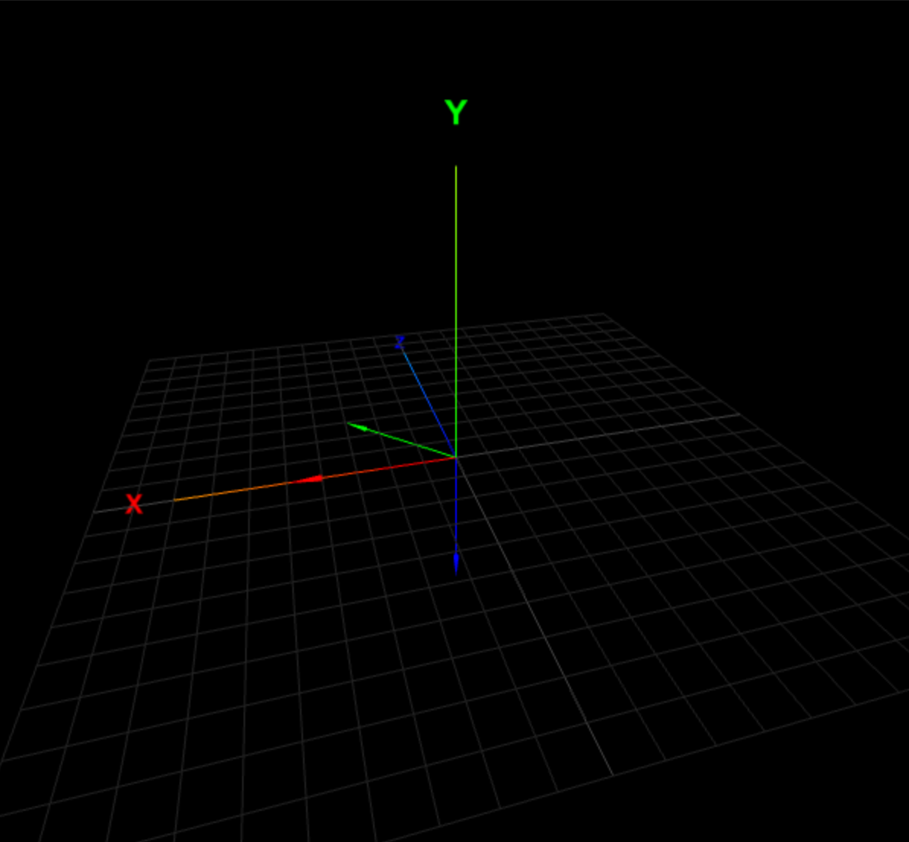
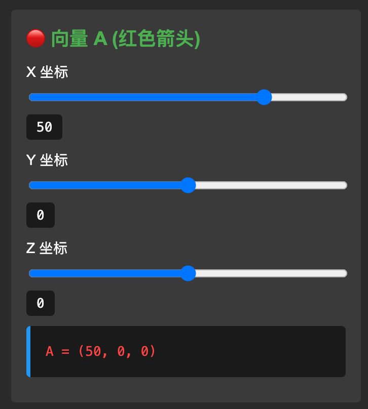
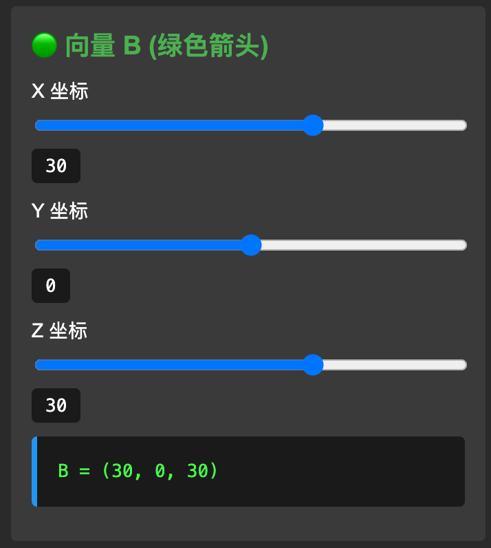
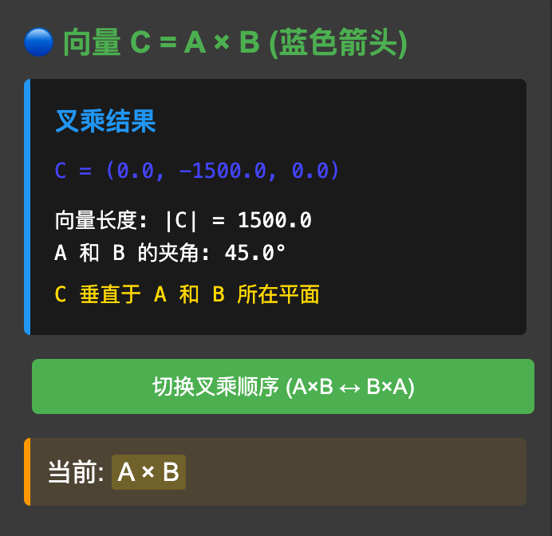
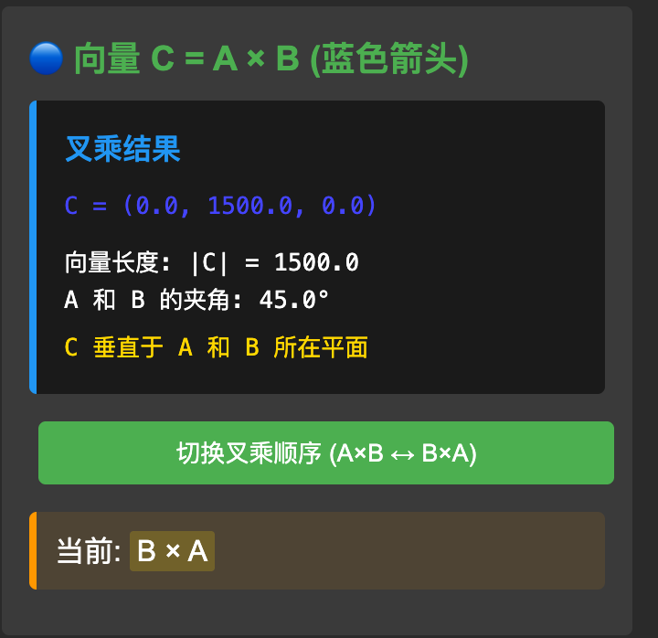
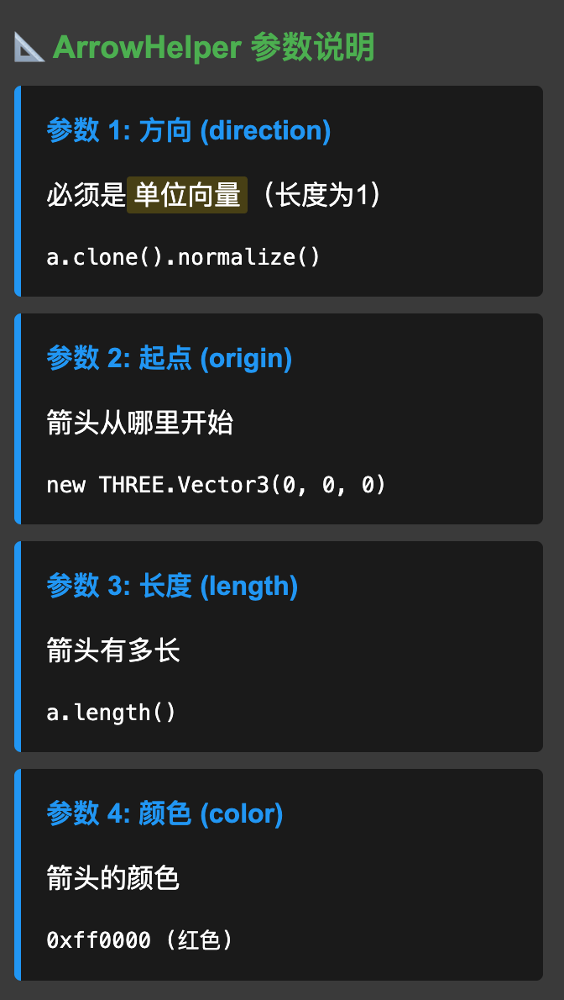
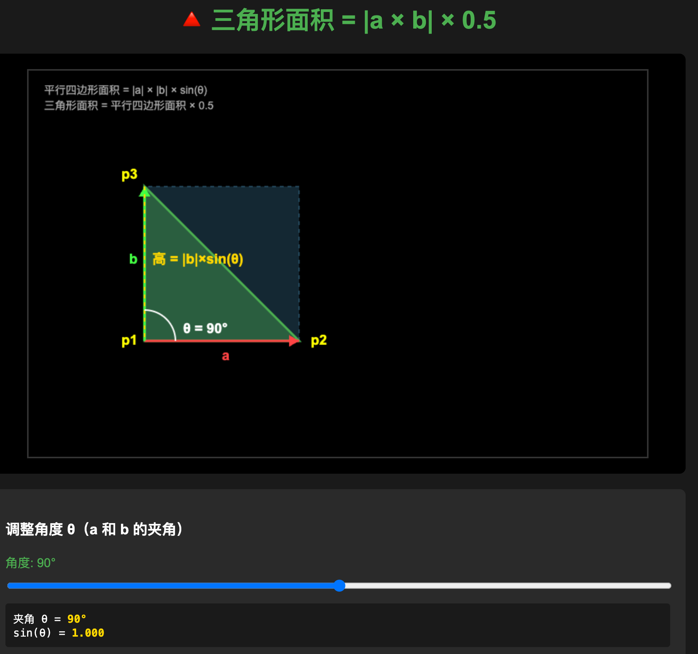
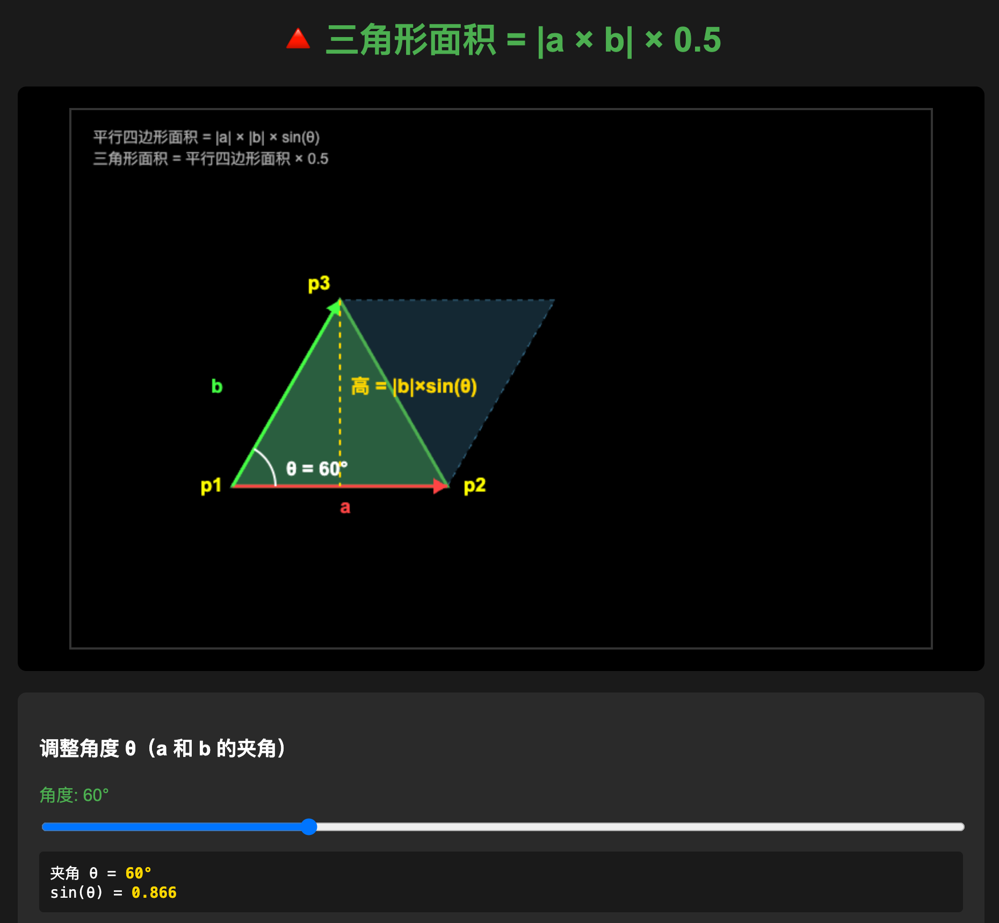
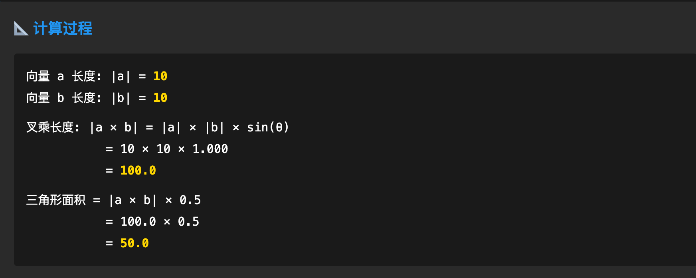

# 计算和绘制扇形区域

## 1. currentAngle 的计算逻辑

```javascript
const currentAngle = -halfAngleRad + (halfAngleRad * 2 * i) / segments;
```

这是一个**从左到右均匀分布角度**的公式。让我拆解：

**假设扇形角度是 60°，那么：**

- `halfAngleRad` = 30° 的弧度值 ≈ 0.524
- 扇形范围：从 -30° 到 +30°

**计算过程：**

```javascript
// 当 i = 0（第一个点）
currentAngle = -0.524 + (0.524 * 2 * 0) / 32 = -0.524  // 左边界 -30°

// 当 i = 16（中间点）
currentAngle = -0.524 + (0.524 * 2 * 16) / 32 = 0  // 中间 0°

// 当 i = 32（最后一个点）
currentAngle = -0.524 + (0.524 * 2 * 32) / 32 = 0.524  // 右边界 +30°
```

**简化理解：**

```javascript
// 公式可以改写为：
起始角度 = -halfAngleRad  // 左边界
结束角度 = +halfAngleRad  // 右边界
总角度范围 = halfAngleRad * 2

currentAngle = 起始角度 + (总角度范围 * i / segments)
```

------

## 2. halfAngleRad 是弧度转换

```javascript
const halfAngleRad = THREE.MathUtils.degToRad(angle / 2);
```

**是的！** 这是把角度转换为弧度：

- 输入：`angle = 60°`（度数）
- 计算：`angle / 2 = 30°`
- 转换：`30° × π / 180 ≈ 0.524` 弧度

------

## 3. 添加扇形可视化的作用

```javascript
const sectorVisualization = createPreciseSector();
model.add(sectorVisualization);
```

**作用：让你能在 3D 场景中看到扇形范围！**

- `createPreciseSector()` 创建了一个黄色半透明的扇形网格
- `model.add()` 把这个扇形添加到场景中显示
- **没有这两行代码，扇形只是数学计算，你看不到它**

就像这样：
```
有这两行代码：你能看到黄色的扇形区域 🟡
没有这两行：只有逻辑判断，屏幕上什么都看不到
```

---

## 4. sector 是扇形还是三角形？

**sector 是扇形，但它是用很多小三角形拼接而成的！**

想象一下：

扇形 = 中心点 + 一圈顶点

    * --- * --- * --- *  (圆弧上的点)
     \   / \   / \   /
      \ /   \ /   \ /
       *-----●-----*     (中心点)

每个小块都是三角形：
  中心点 → 圆弧点1 → 圆弧点2

**为什么用三角形？**

- 因为 GPU 只能渲染三角形
- 所有复杂的 3D 形状（圆、球、人体）都是由三角形拼成的
- `segments = 32` 意味着用 32 个三角形来模拟圆弧（越多越平滑）

------

## 5. computeVertexNormals() 的作用

```javascript
sectorGeometry.computeVertexNormals();
```

**法向量（Normal）** 用于光照计算：

没有法向量：
  扇形看起来平平的，没有光影效果

有法向量：
  光照射时，扇形会有明暗变化，看起来更真实

**具体作用：**

- 告诉 Three.js 每个顶点的"朝向"
- 让光照效果正确显示（虽然这里用的是 `MeshBasicMaterial` 不受光照影响）
- 是一个好习惯，确保几何体完整

------

## 6. 真实计算扇形有这么复杂吗？

**分两部分：**

### 数学判断（简单）

```javascript
// 判断物体是否在扇形内（只需几行代码）
const distance = b.length();  // 距离
const cos = a.dot(b);         // 角度余弦
if (distance < R && cos > rangeCos) {
  console.log('在扇形内');
}
```

**这部分很简单！**

### 可视化绘制（复杂）

```javascript
// 为了让你"看到"扇形，需要：
1. 生成圆弧上的 32 个点
2. 创建 32 个三角形
3. 设置顶点、索引、法向量
4. 创建材质和网格
```

**这部分复杂，但不是必需的！**

------

## 简化版本

如果你只想判断，不需要绘制扇形，代码可以超级简单：

```javascript
// 只判断，不绘制
const a = new THREE.Vector3(0, 0, -1);
const b = mesh.position.clone().sub(person.position);
const distance = b.length();
b.normalize();
const cos = a.dot(b);
const rangeCos = Math.cos(THREE.MathUtils.degToRad(angle / 2));

if (distance < R && cos > rangeCos) {
  console.log('物体在扇形内');
  mesh.material.color.setHex(0x00ff00);
} else {
  console.log('物体在扇形外');
  mesh.material.color.setHex(0xff0000);
}
```

**只需 10 行代码！** 其他 100 多行都是为了"可视化调试"用的。

------

## 总结

1. **currentAngle 公式**：从左到右均匀分布角度
2. **halfAngleRad**：是弧度转换
3. **add 的作用**：让扇形显示在屏幕上（调试用）
4. **sector 是扇形**：由多个三角形拼成
5. **computeVertexNormals**：用于光照计算（可选）
6. **真实计算很简单**：复杂的部分只是为了可视化

核心逻辑只需要距离和角度判断，绘制部分可以完全省略！


# 叉乘计算

## 一、叉乘（Cross Product）的作用

### 1. 叉乘的几何意义

```javascript
const c = new THREE.Vector3();
c.crossVectors(a, b);  // c = a × b
```

**叉乘的目标是产生一个垂直于 a 和 b 所在平面的新向量 c，切记，这和点乘不同。**

可视化理解：

```
        c (垂直向上)
        ↑
        |
        |
    a   |   
   ──→  ●────→ b
       原点
       
a 和 b 在 XZ 平面上
c 垂直于这个平面（指向 Y 轴）
```

### 2. 叉乘的实际应用

**应用场景：**

- **判断左右关系**：物体在你左边还是右边
- **计算法向量**：3D 建模中计算面的朝向
- **判断旋转方向**：从 a 转到 b 是顺时针还是逆时针
- **计算面积**：|c| = |a| × |b| × sin(θ) = 平行四边形面积

### 3. 顺序很重要！

```javascript
c.crossVectors(a, b);  // c 指向上方
c.crossVectors(b, a);  // c 指向下方（方向相反）
```

**右手法则：**

```
伸出右手：
- 四指从 a 指向 b
- 大拇指指向 c 的方向

      大拇指 (c方向)
         ↑
         |
    a ──→ ● 手心
          ↓
          b
```

## 二、ArrowHelper 详解

### ArrowHelper 是什么？

**ArrowHelper 是一个箭头对象，用于可视化 3D 空间中的向量**

```javascript
new THREE.ArrowHelper(方向, 起点, 长度, 颜色)
```

### 参数详解

通过创建一个可视化示例来说明：













## 三、ArrowHelper 参数详细说明

```javascript
const arrowA = new THREE.ArrowHelper(
  a.clone().normalize(),  // 参数1: 方向（必须是单位向量）
  O,                       // 参数2: 起点位置
  a.length(),             // 参数3: 箭头长度
  0xff0000                // 参数4: 箭头颜色
);
```

### 参数 1：方向 (direction)

**必须是单位向量**（长度为 1 的向量）

```javascript
a.clone().normalize()  // 正确：先克隆再归一化
a.normalize()          // 错误：会修改原向量 a
```

**为什么要归一化？**

因为 ArrowHelper 需要知道"朝哪个方向"，而不是"有多长"。长度由参数 3 单独控制。

### 参数 2：起点 (origin)

箭头从哪里开始画

```javascript
new THREE.Vector3(0, 0, 0)    // 从原点开始
new THREE.Vector3(10, 5, 0)   // 从 (10, 5, 0) 开始
```

### 参数 3：长度 (length)

箭头画多长

```javascript
a.length()           // 用向量 a 的实际长度
50                   // 固定长度 50
c.length() / 30      // 缩小 30 倍（避免太长）
```

### 参数 4：颜色 (color)

```javascript
0xff0000  // 红色（16进制）
0x00ff00  // 绿色
0x0000ff  // 蓝色
```

------

## 叉乘的数学原理

对于两个三维向量：

- a = (ax, ay, az)

- b = (bx, by, bz)

它们的叉乘结果 c = a × b 的计算公式是：

cx = ay * bz - az * by

cy = az * bx - ax * bz

cz = ax * by - ay * bx

### Three.js 的实现

在 Three.js 的源码中，crossVectors 方法的实现大致如下：

```typescript
crossVectors(a, b) {
  const ax = a.x, ay = a.y, az = a.z;
  const bx = b.x, by = b.y, bz = b.z;
  this.x = ay * bz - az * by;
  this.y = az * bx - ax * bz;
  this.z = ax * by - ay * bx;
  return this;
}
```

### 具体步骤

在代码中：

- a = (50, 0, 0)

- b = (30, 0, 30)

计算过程：

cx = 0 * 30 - 0 * 0 = 0

cy = 0 * 30 - 50 * 30 = -1500

cz = 50 * 0 - 0 * 30 = 0

所以 c = (0, -1500, 0)，这是一个指向 负Y轴 方向的向量。

### 右手法则

叉乘的方向遵循右手法则：

1. 右手四指从向量 a 指向向量 b

1. 大拇指指向的方向就是叉乘结果 c 的方向

这就是为什么代码中注释说 /* 叉乘的顺序会影响c的方向 */，因为 a × b = -(b × a)。

## 四、代码中为什么 C 要除以 30？

~~~javascript
const arrowC = new THREE.ArrowHelper(
  c.clone().normalize(),
  O,
  c.length() / 30,    // 为什么除以 30？
  0x0000ff
);
```

**因为叉乘结果的长度通常很大！**

计算过程：
```
a = (50, 0, 0)   长度 = 50
b = (30, 0, 30)  长度 ≈ 42.4

c = a × b = (0, -1500, 0)
|c| = 1500  ← 太长了！

所以除以 30: 1500 / 30 = 50
~~~

不除以 30 的话，蓝色箭头会超级长，画面看不清楚。

------

## 五、实际应用示例

### 判断物体在左边还是右边

```javascript
const forward = new THREE.Vector3(0, 0, -1);  // 人的前方
const toObject = object.position.sub(person.position);  // 人指向物体

const cross = forward.cross(toObject);

if (cross.y > 0) {
  console.log('物体在右边');
} else if (cross.y < 0) {
  console.log('物体在左边');
}
```

### 计算三角形法向量

```javascript
const p1 = new THREE.Vector3(0, 0, 0);
const p2 = new THREE.Vector3(1, 0, 0);
const p3 = new THREE.Vector3(0, 1, 0);

const v1 = p2.sub(p1);
const v2 = p3.sub(p1);

const normal = v1.cross(v2).normalize();  // 三角形的法向量
```

------

## 总结

**ArrowHelper 生成的是：** 一个 3D 箭头对象，用于可视化向量

**叉乘的作用：** 生成垂直于两个向量的新向量，用于判断方向、计算法向量等

**四个参数：**

1. 方向（单位向量）
2. 起点
3. 长度
4. 颜色


# 利用叉乘计算面积

```typescript
// 引入Three.js
import * as THREE from 'three';
const group = new THREE.Group();

const geometry = new THREE.BoxGeometry(50, 50, 50);
const material = new THREE.MeshLambertMaterial({
  color: 0x00ffff,
});
const mesh = new THREE.Mesh(geometry, material);
// 已知三角形三个顶点的坐标，计算三角形的面积
const p1 = new THREE.Vector3(0, 0, 0);
const p2 = new THREE.Vector3(10, 0, 0);
const p3 = new THREE.Vector3(0, 10, 0);
const a = p2.clone().sub(p1);
const b = p3.clone().sub(p1);

const c = a.clone().cross(b);

const area = c.length() * 0.5;
console.log('area', area);
group.add(mesh);

export default group;

```







## 几何解释

### 平行四边形的高度

无论夹角是多少，平行四边形的面积公式都是：

**面积 = 底边 × 高**

关键是：**高 = |b| × sin(θ)**

让我画图说明（不用代码块）：

**情况1：夹角 = 90°（直角）**

从 p1 出发，向量 a 水平，向量 b 垂直：

p3 在正上方，高度就是 |b|

平行四边形是个矩形

面积 = |a| × |b| = 10 × 10 = 100

三角形面积 = 50

**情况2：夹角 = 60°（锐角）**

从 p1 出发，向量 a 水平，向量 b 倾斜 60°：

p3 的垂直高度 = |b| × sin(60°) ≈ |b| × 0.866

平行四边形是个斜的

面积 = |a| × (|b| × sin(60°)) = 10 × (10 × 0.866) = 86.6

三角形面积 = 43.3

**情况3：夹角 = 120°（钝角）**

向量 b 倾斜超过 90°：

高度 = |b| × sin(120°) = |b| × 0.866（sin(120°) = sin(60°)）

面积仍然正确计算