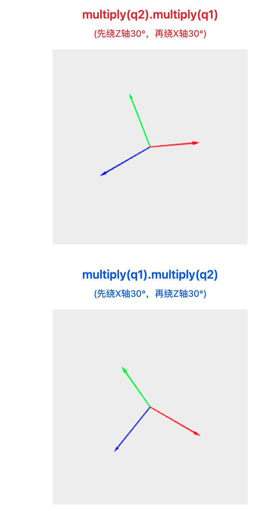
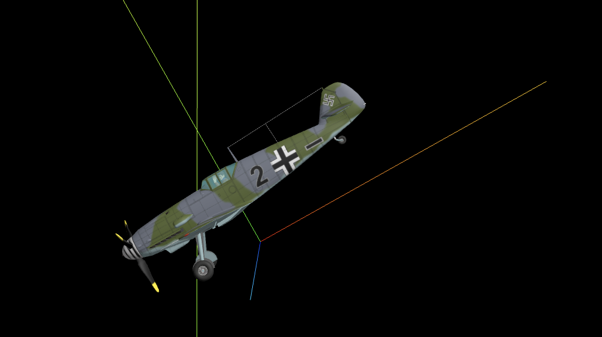
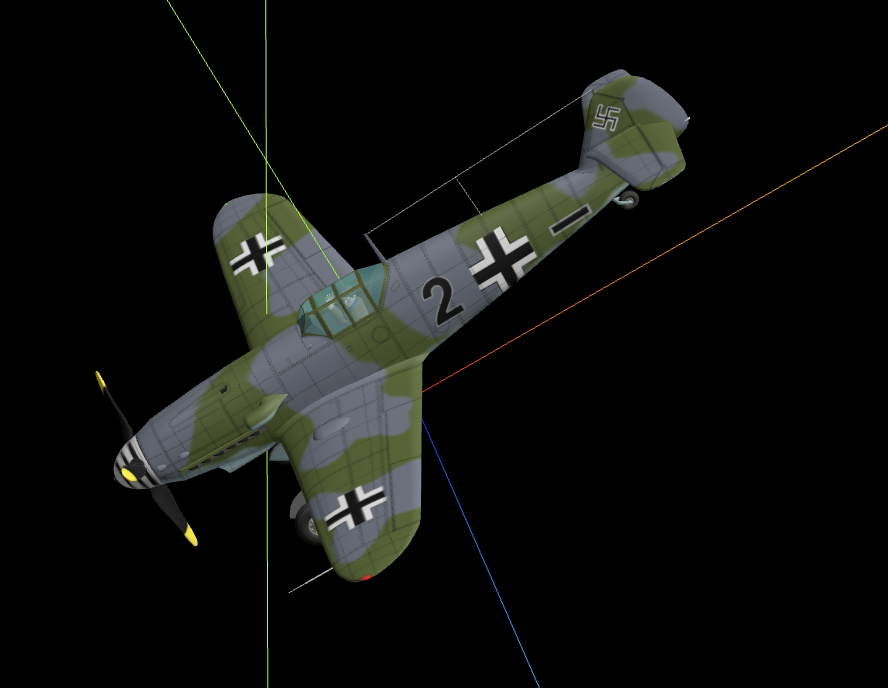
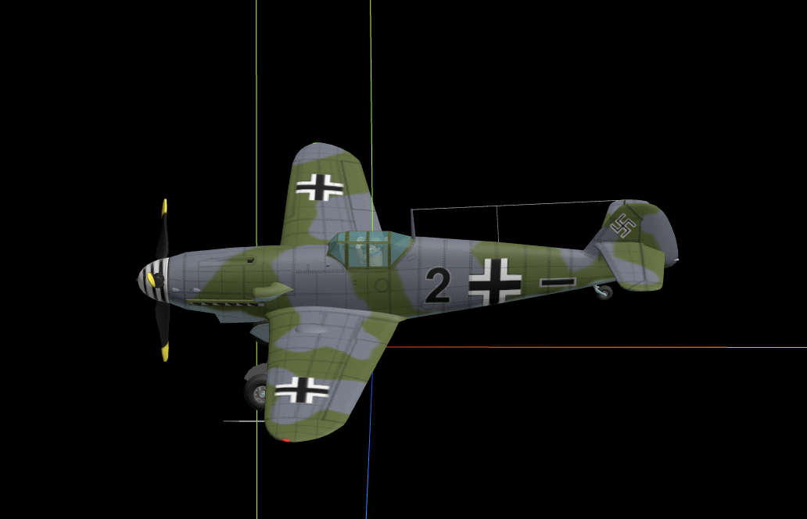
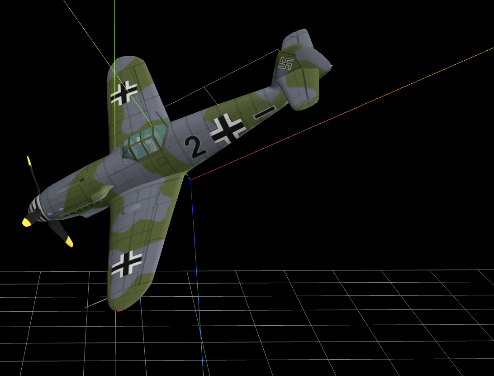

# 四元数（Quaternion）详解

## 什么是四元数？

四元数是一种数学概念，用于在3D空间中表示旋转。它由四个分量组成：一个实数部分（标量部分）和三个虚数部分（向量部分）。

**四元数的表示形式：**
```
q = w + xi + yj + zk
```
```
w = cos(θ/2)
x = ax * sin(θ/2)
y = ay * sin(θ/2)  
z = az * sin(θ/2)
```

在我们的例子中：

```typescript
import * as THREE from 'three';
// A表示3D空间一个点的位置坐标
const A = new THREE.Vector3(30, 0, 0);

const group = new THREE.Group();
// 黄色小球可视化坐标点A
const Amesh = createSphereMesh(0xffff00, 2);
Amesh.position.copy(A);
group.add(Amesh);
// 创建小球mesh
function createSphereMesh(color, R) {
  const geometry = new THREE.SphereGeometry(R);
  const material = new THREE.MeshLambertMaterial({
    color: color,
  });
  const mesh = new THREE.Mesh(geometry, material);
  return mesh;
}
// 创建一个四元素对象，表示姿态角度
const quaternion = new THREE.Quaternion();
// 旋转度数:Math.PI/2
quaternion.setFromAxisAngle(new THREE.Vector3(0, 0, 1), Math.PI / 2);
// a点坐标绕z轴旋转90度
const B = A.clone().applyQuaternion(quaternion);
console.log('B', B); //查看旋转后坐标

//红色小球可视化坐标点B
const Bmesh = createSphereMesh(0xff0000, 2);
Bmesh.position.copy(B);
group.add(Bmesh);
export default group;
```

- 旋转轴：`(0, 0, 1)` (z轴)
- 旋转角度：`π/2` (90度)

所以四元数为：
```
w = cos(π/4) = √2/2
x = 0 * sin(π/4) = 0
y = 0 * sin(π/4) = 0
z = 1 * sin(π/4) = √2/2
```

### 四元数旋转公式

对于点 `p` 和四元数 `q`，旋转后的点 `p'` 计算公式为：
```
p' = q * p * q⁻¹
```

其中 `q⁻¹` 是四元数的共轭。

## 可视化效果

在您的代码中：
- **黄色小球**：表示原始点A的位置 `(30, 0, 0)`
- **红色小球**：表示旋转后点B的位置 `(0, 30, 0)`

这个可视化清楚地展示了四元数旋转的效果。

## Three.js中的四元数常用方法

### 1. 创建四元数
```javascript
const q = new THREE.Quaternion();
```

### 2. 从轴角设置
```javascript
q.setFromAxisAngle(axis, angle);
```

### 3. 从欧拉角设置
```javascript
const euler = new THREE.Euler(x, y, z, 'XYZ');
q.setFromEuler(euler);
```

### 4. 应用旋转
```javascript
vector.applyQuaternion(quaternion);
```

### 5. 四元数乘法（组合旋转）
```javascript
q1.multiply(q2);
```

### 6. 插值
```javascript
q1.slerp(q2, t); // 球面线性插值
```

## 实践建议

1. **理解轴角概念**：掌握旋转轴和旋转角度的概念
2. **可视化验证**：像您的代码一样，用可视化方法验证旋转结果
3. **避免欧拉角陷阱**：在复杂旋转场景中优先使用四元数
4. **学会调试**：使用 `console.log` 输出四元数分量，理解数值含义

## 总结

四元数是3D图形学中处理旋转的强大工具。虽然初学时可能感觉抽象，但通过实际代码练习和可视化验证，能够很好地掌握其应用。您的代码示例很好地展示了四元数的基本用法：创建四元数、设置旋转、应用到点坐标，这是学习四元数的经典案例。
1. **基础概念**：什么是四元数及其数学表示
2. **优势分析**：相比欧拉角的优点
3. **代码分析**：逐行解释您代码中的四元数使用
4. **数学原理**：轴角到四元数的转换公式
5. **可视化说明**：解释黄色和红色小球的含义
6. **实用方法**：Three.js中四元数的常用API
7. **实践建议**：学习和使用四元数的建议

这样的讲解既有理论基础，又紧密结合您的实际代码，应该能帮助您更好地理解四元数的概念和应用。

其中：
- `w` 是实数部分（标量）
- `x, y, z` 是虚数部分（向量）
- `i, j, k` 是四元数的基本单位

## 为什么使用四元数？

### 相比欧拉角的优势：
1. **避免万向节锁（Gimbal Lock）**：欧拉角在某些情况下会失去一个自由度
2. **插值平滑**：四元数可以实现平滑的旋转插值
3. **计算效率**：旋转组合运算更高效
4. **数值稳定性**：避免三角函数计算误差累积

## 代码实例分析

让我们分析您提供的代码，看看四元数是如何工作的：

### 1. 创建初始点
```javascript
// A表示3D空间一个点的位置坐标
const A = new THREE.Vector3(30, 0, 0);
```
这里创建了一个位于x轴正方向距离原点30个单位的点A。

### 2. 创建四元数并设置旋转
```javascript
// 创建一个四元素对象，表示姿态角度
const quaternion = new THREE.Quaternion();
// 旋转度数:Math.PI/2
quaternion.setFromAxisAngle(new THREE.Vector3(0, 0, 1), Math.PI / 2);
```

这里的关键是 `setFromAxisAngle` 方法：
- **旋转轴**：`new THREE.Vector3(0, 0, 1)` 表示绕z轴旋转
- **旋转角度**：`Math.PI / 2` 表示旋转90度（π/2弧度）

### 3. 应用四元数旋转
```javascript
// a点坐标绕z轴旋转90度
const B = A.clone().applyQuaternion(quaternion);
```

这行代码将点A绕z轴旋转90度，得到新的点B。

### 4. 旋转结果分析

**原始点A：** `(30, 0, 0)`
**旋转后点B：** `(0, 30, 0)`

这个结果验证了我们的旋转：
- 点A在x轴正方向
- 绕z轴顺时针旋转90度后
- 点B移动到y轴正方向


# 四元数乘法顺序

四元数乘法的顺序确实会产生不同的效果，这是因为四元数乘法**不满足交换律**。



先绕Z轴旋转，后绕z轴旋转：




先绕x轴旋转，后绕z轴旋转:





# 向量旋转详解

## 当前代码分析

让我们分析您的 `mesh.js` 代码，深入理解向量旋转的实现：

```javascript
// 可视化飞机方向
const a = new THREE.Vector3(0, 0, -1);  // 原始方向向量
// 飞机旋转后的飞行方向
const b = new THREE.Vector3(-1, -1, -1).normalize();  // 目标方向向量

const quaternion = new THREE.Quaternion();
// 生成一个四元数，从a旋转到b
quaternion.setFromUnitVectors(a, b);
// 从a旋转到b的过程=>quaternion
model.quaternion.copy(quaternion);
```

## 核心概念：setFromUnitVectors

`quaternion.setFromUnitVectors(a, b)` 是 Three.js 中一个非常实用的方法，它能：

1. **计算最短旋转路径**：从向量 `a` 旋转到向量 `b` 的最短旋转
2. **自动生成四元数**：无需手动计算旋转轴和角度
3. **处理特殊情况**：自动处理向量平行、反向等边界情况

## 向量含义解析

### 原始向量 a：`(0, 0, -1)`
- 指向 Z 轴负方向
- 在飞机模型中通常表示"机头向前"
- 单位向量，长度为 1

### 目标向量 b：`(-1, -1, -1).normalize()`
- 原始值：`(-1, -1, -1)`
- 归一化后：`(-0.577, -0.577, -0.577)`
- 指向左下后方，与三个轴负方向成等角

## 旋转过程可视化

```tex
初始状态（向量a）：
Y
|
|
+---- X
/
/
Z ← a (0,0,-1)
旋转后状态（向量b）：
Y
|
b ↙ |
/ +---- X
/ /
/ /
/ Z
(-0.577, -0.577, -0.577)
```

## 数学原理

### 向量旋转的数学表示

对于两个单位向量 `a` 和 `b`，旋转四元数可以通过以下方式计算：

1. **旋转轴**：`axis = a × b`（叉积）
2. **旋转角度**：`angle = arccos(a · b)`（点积的反余弦）
3. **四元数**：`q = [cos(angle/2), axis * sin(angle/2)]`

但 `setFromUnitVectors` 已经为我们封装了这些计算。

### 具体计算过程

```javascript
const a = new THREE.Vector3(0, 0, -1);
const b = new THREE.Vector3(-1, -1, -1).normalize();

// 点积计算夹角
const dot = a.dot(b);  // cos(θ)
console.log('夹角余弦值:', dot);

// 叉积计算旋转轴
const cross = new THREE.Vector3().crossVectors(a, b);
console.log('旋转轴:', cross);
```

## 可视化效果

您的代码中使用 ArrowHelper 来可视化这两个向量：

```javascript
group.add(new THREE.ArrowHelper(a, model.position, 50, 0xff0000));  // 红色箭头：原始方向
group.add(new THREE.ArrowHelper(b, model.position, 50, 0x00ff00));  // 绿色箭头：目标方向
```

- **红色箭头**：显示原始向量 `a` 的方向
- **绿色箭头**：显示目标向量 `b` 的方向
- **模型旋转**：从红色箭头方向转到绿色箭头方向

## 实际应用场景

### 1. 飞机导航
```javascript
const currentHeading = new THREE.Vector3(0, 0, -1);  // 当前朝向
const targetHeading = new THREE.Vector3(1, 0, 0);    // 目标朝向
const rotationQ = new THREE.Quaternion().setFromUnitVectors(currentHeading, targetHeading);
aircraft.quaternion.copy(rotationQ);
```

### 2. 相机注视
```javascript
const cameraForward = new THREE.Vector3(0, 0, -1);   // 相机默认朝向
const lookAtDirection = target.position.clone().sub(camera.position).normalize();
const lookRotation = new THREE.Quaternion().setFromUnitVectors(cameraForward, lookAtDirection);
camera.quaternion.copy(lookRotation);
```

### 3. 物体对齐
```javascript
const objectUp = new THREE.Vector3(0, 1, 0);         // 物体当前上方向
const surfaceNormal = new THREE.Vector3(0.5, 0.8, 0.3).normalize();  // 表面法线
const alignRotation = new THREE.Quaternion().setFromUnitVectors(objectUp, surfaceNormal);
object.quaternion.copy(alignRotation);
```

## 优势总结

1. **简单易用**：一行代码实现复杂的向量旋转
2. **数学精确**：自动计算最短旋转路径
3. **性能优秀**：避免了手动的三角函数计算
4. **稳定可靠**：处理了各种边界情况

## 注意事项

1. **向量归一化**：确保输入向量是单位向量
2. **特殊情况**：当两向量平行或反向时，结果可能不唯一
3. **最短路径**：该方法总是选择最短的旋转路径

这种向量旋转方法在 3D 图形学中非常常用，特别适合需要平滑、自然旋转效果的场景。


# 实例讲解

## 数学原理：极坐标转直角坐标

这是极坐标系转换为直角坐标系的经典公式！

### 极坐标系概念

- R：距离原点的半径（您代码中是 100）

- angle：与X轴正方向的夹角（弧度制）

### 转换公式

```tex
x = R × cos(angle)
z = R × sin(angle)
```

### 可视化理解

以下图为例，以平面的Y轴角度向下看来计算圆周运动中x和z的值。

```tex
        Z轴
        |
        |
    •---+---•---- X轴
   /    |    \
  /     |     \
 /      |      \
•-------•-------•

从Y轴向下俯视（鸟瞰视角）：

       Z轴
       ↑
       |
       |
←------+------→ X轴
       |
       |
       ↓

飞机在这个水平面上做圆周运动
```

### 关键理解点

1. Y轴是"高度轴"：飞机始终保持在 y = H = 30 的高度

1. X-Z平面是"运动平面"：圆周运动发生在这个水平面上

1. 俯视角度：就像从天空往下看飞机绕圆飞行

想象一个半径为R的圆：

- 当 angle = 0 时：x = R×cos(0) = R，z = R×sin(0) = 0 → 点在X轴正方向

- 当 angle = π/2 时：x = R×cos(π/2) = 0，z = R×sin(π/2) = R → 点在Z轴正方向

- 当 angle = π 时：x = R×cos(π) = -R，z = R×sin(π) = 0 → 点在X轴负方向

- 当 angle = 3π/2 时：x = R×cos(3π/2) = 0，z = R×sin(3π/2) = -R → 点在Z轴负方向


## 四元数环绕飞行原理

详细解释这个Three.js代码中四元数实现飞行器环绕飞行的原理，以及为什么飞行器姿态没有完全指向中心的原因。

### 1. 基本设置

```javascript
// 战斗机加载进来默认方向
const a = new THREE.Vector3(-1, 0, 0);
// 绕转中心坐标
const target = new THREE.Vector3(0, H, 0);
// 姿态角度初始值
const q0 = plane.quaternion.clone();
```

- `a` 是飞机的初始朝向向量（向左）
- `target` 是环绕中心点
- `q0` 是飞机的初始四元数姿态

### 2. 位置更新

```javascript
const x = R * Math.cos(angle);
const z = R * Math.sin(angle);
plane.position.x = x;
plane.position.z = z;
```

这部分让飞机沿圆形轨道运动。

### 3. 朝向计算

```javascript
// 战斗机指向的方向
const b = target.clone().sub(plane.position).normalize();
// 生成一个四元数，使得飞机从a旋转到b
const q = new THREE.Quaternion();
q.setFromUnitVectors(a, b);
```

**这里是关键**：

- `b` 是从飞机当前位置指向中心点的单位向量
- `q` 是让飞机从初始方向 `a` 旋转到朝向中心方向 `b` 的四元数

### 4. 附加旋转

```javascript
// 创建向下侧偏45度的四元数
const rollQuaternion = new THREE.Quaternion();
rollQuaternion.setFromAxisAngle(new THREE.Vector3(1, 0, 0), -Math.PI / 6);
const roll2Quaternion = new THREE.Quaternion();
roll2Quaternion.setFromAxisAngle(new THREE.Vector3(0, 0, 1), Math.PI / 10);

// 组合旋转
const newQ = q0.clone().multiply(q).multiply(rollQuaternion).multiply(roll2Quaternion).multiply(roll2Quaternion);
```

## 为什么飞行器姿态没有完全指向中心？

这正是你观察到的关键问题！原因有以下几点：

### 1. **附加旋转的影响**

代码中添加了两个额外的旋转：

- `rollQuaternion`：绕X轴旋转-30度
- `roll2Quaternion`：绕Z轴旋转18度

这些附加旋转改变了最终的朝向，所以飞机不再完全指向中心。

### 2. **四元数乘法的顺序**

四元数乘法不满足交换律，顺序很重要：

```javascript
const newQ = q0.clone().multiply(q).multiply(rollQuaternion).multiply(roll2Quaternion).multiply(roll2Quaternion);
```

这个顺序意味着：

1. 先应用初始姿态 `q0`
2. 然后朝向中心 `q`
3. 接着应用各种附加旋转

### 3. **坐标系转换问题**

`rollQuaternion` 使用的是 `new THREE.Vector3(1, 0, 0)` 作为旋转轴，但这个轴是在**世界坐标系**中的，而不是飞机的**局部坐标系**。当飞机已经旋转后，世界坐标系的X轴不再是飞机的"前进方向"。

## 如何实现完全朝向中心？

如果你想让飞机完全朝向中心，应该这样修改：

```javascript
// 只使用朝向中心的四元数，不添加额外旋转
const newQ = q0.clone().multiply(q);
plane.quaternion.copy(newQ);
```

或者如果需要一些倾斜效果，应该在**局部坐标系**中应用旋转：

```javascript
// 先朝向中心
let newQ = q0.clone().multiply(q);
// 然后在飞机的局部坐标系中应用倾斜
const localRoll = new THREE.Quaternion();
localRoll.setFromAxisAngle(new THREE.Vector3(0, 0, 1), Math.PI / 6); // 绕局部Z轴倾斜
newQ.multiply(localRoll);
plane.quaternion.copy(newQ);
```

## 切线飞行方法

代码中注释掉的切线飞行方法更加直观：

```javascript
const x2 = R * Math.cos(angle + 0.001);
const z2 = R * Math.sin(angle + 0.001);
const b = new THREE.Vector3(x2 - x, 0, z2 - z).normalize();
```

这里的 `b` 是切线方向向量，让飞机始终沿着飞行方向前进，这样看起来更自然。

**总结**：你的观察是正确的！飞机没有完全朝向中心是因为代码添加了额外的旋转变换。如果要实现完全朝向中心的效果，需要移除或调整这些附加旋转。

我来详细讲解四元数是如何实现旋转角度始终保持朝向中心点target的原理。

让我详细解释四元数如何实现旋转角度始终保持朝向中心点target的数学原理：

## 🎯 核心数学原理

### 1. 方向向量计算

```javascript
const b = target.clone().sub(plane.position).normalize();
```

这一步的数学含义：

- `target - position` 得到从飞机当前位置指向目标的向量
- `normalize()` 将其转换为单位向量（长度为1）
- **b⃗** 就是我们希望飞机朝向的**目标方向**

### 2. 初始朝向定义

```javascript
const a = new THREE.Vector3(-1, 0, 0);
```

- **a⃗** 代表飞机模型在**默认状态下**的朝向
- 这个向量定义了"飞机正前方"在模型坐标系中的方向

### 3. 四元数旋转计算

```javascript
const q = new THREE.Quaternion();
q.setFromUnitVectors(a, b);
```

## 🔬 setFromUnitVectors 的数学推导

这个方法内部执行以下数学运算：

### 步骤1：计算旋转轴

```
旋转轴 = a⃗ × b⃗ (叉积)
```

叉积得到垂直于a⃗和b⃗所在平面的向量，这就是旋转轴。

### 步骤2：计算旋转角度

```
cos(θ) = a⃗ · b⃗ (点积)
θ = arccos(a⃗ · b⃗)
```

### 步骤3：构建四元数

四元数的形式为：**q = (w, x, y, z)**

```
w = cos(θ/2)
(x, y, z) = sin(θ/2) × 旋转轴的单位向量
```

## 💡 为什么四元数能实现精确朝向？

### 1. **数学保证**

四元数天然具有这样的性质：给定两个单位向量a⃗和b⃗，总能找到唯一的最短路径旋转，将a⃗旋转到b⃗。

### 2. **几何直观**

想象在球面上，从点A到点B的最短路径就是大圆弧。四元数计算的就是这个最短路径对应的旋转。

### 3. **代码实现的精确性**

javascript

```javascript
// 每一帧都重新计算目标方向
const b = target.clone().sub(plane.position).normalize();
// 然后立即计算对应的旋转四元数
const q = new THREE.Quaternion();
q.setFromUnitVectors(a, b);
```

这意味着：

- **实时性**：每帧都根据当前位置重新计算朝向
- **精确性**：数学上保证了从a⃗到b⃗的准确转换
- **一致性**：无论飞机在圆形轨道的哪个位置，都能准确朝向中心

## 🎮 完整的朝向流程

1. **计算当前位置**：`(x, y, z) = (R×cos(θ), H, R×sin(θ))`
2. **计算目标方向**：`b⃗ = normalize(target - position)`
3. **生成旋转四元数**：`q = fromUnitVectors(a⃗, b⃗)`
4. **应用旋转**：`newQuaternion = q0 × q`

## 🔍 关键洞察

四元数的强大之处在于：

- **自动处理3D空间的复杂旋转**
- **避免万向锁问题**
- **提供最短路径旋转**
- **数学上的完备性保证**

这就是为什么即使飞机在做复杂的3D环绕运动，四元数依然能够确保它始终精确朝向中心点的原因。每一帧的计算都是基于当前的几何关系，数学上保证了朝向的准确性。

