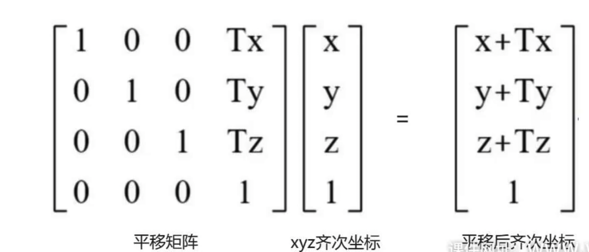

# Three.js Matrix4

## 1. 矩阵到数组的映射关系

Three.js使用**列优先顺序**（Column-Major Order）来存储4×4矩阵的16个元素。

### 矩阵形式与数组对应关系

```
矩阵形式:                           数组存储:
┌                    ┐              elements = [
│  1   0   0   Tx   │                1, 0, 0, 0,    // 第1列
│  0   1   0   Ty   │       ⇔        0, 1, 0, 0,    // 第2列  
│  0   0   1   Tz   │                0, 0, 1, 0,    // 第3列
│  0   0   0   1    │                Tx, Ty, Tz, 1  // 第4列(平移)
└                    ┘              ];
```

### 数组索引对照表

| 矩阵位置  | 数组索引         | 含义              | 说明           |
| --------- | ---------------- | ----------------- | -------------- |
| [0,0]     | elements[0]      | X轴缩放           | 第1列第1行     |
| [1,0]     | elements[1]      | Y轴对X轴的剪切    | 第1列第2行     |
| [2,0]     | elements[2]      | Z轴对X轴的剪切    | 第1列第3行     |
| [3,0]     | elements[3]      | 齐次坐标          | 第1列第4行     |
| [0,1]     | elements[4]      | X轴对Y轴的剪切    | 第2列第1行     |
| [1,1]     | elements[5]      | Y轴缩放           | 第2列第2行     |
| [2,1]     | elements[6]      | Z轴对Y轴的剪切    | 第2列第3行     |
| [3,1]     | elements[7]      | 齐次坐标          | 第2列第4行     |
| [0,2]     | elements[8]      | X轴对Z轴的剪切    | 第3列第1行     |
| [1,2]     | elements[9]      | Y轴对Z轴的剪切    | 第3列第2行     |
| [2,2]     | elements[10]     | Z轴缩放           | 第3列第3行     |
| [3,2]     | elements[11]     | 齐次坐标          | 第3列第4行     |
| **[0,3]** | **elements[12]** | **X轴平移**       | **第4列第1行** |
| **[1,3]** | **elements[13]** | **Y轴平移**       | **第4列第2行** |
| **[2,3]** | **elements[14]** | **Z轴平移**       | **第4列第3行** |
| [3,3]     | elements[15]     | 齐次坐标(通常为1) | 第4列第4行     |

## 2. 重要概念

### ⚠️ 列优先 vs 行优先

- **Three.js使用列优先存储**：先存储第1列的所有元素，再存储第2列...
- 这与很多数学教程中的行优先不同
- **记住：elements[12]、elements[13]、elements[14] 分别是X、Y、Z轴的平移值**

### 为什么使用elements数组？

1. **性能优化**：直接操作数组比调用方法更快
2. **精确控制**：可以直接修改矩阵的任意元素
3. **OpenGL兼容**：与图形API的存储方式一致

## 3. 代码示例

### 基础用法

```javascript
// 创建4x4单位矩阵
const mat4 = new THREE.Matrix4();

// 直接设置elements数组 - 列优先顺序
mat4.elements = [
  1, 0, 0, 0,    // 第1列: [1, 0, 0, 0]
  0, 1, 0, 0,    // 第2列: [0, 1, 0, 0]  
  0, 0, 1, 0,    // 第3列: [0, 0, 1, 0]
  50, 0, 0, 1    // 第4列: [50, 0, 0, 1] - x轴平移50
];

// 访问特定元素
console.log(mat4.elements[12]); // 输出: 50 (x轴平移值)
```

### 常用访问模式

```javascript
// 获取平移值
const tx = mat4.elements[12]; // X轴平移
const ty = mat4.elements[13]; // Y轴平移  
const tz = mat4.elements[14]; // Z轴平移

// 获取缩放值
const sx = mat4.elements[0];  // X轴缩放
const sy = mat4.elements[5];  // Y轴缩放
const sz = mat4.elements[10]; // Z轴缩放

// 修改特定元素
mat4.elements[12] = 100; // 设置x轴平移为100
mat4.elements[13] = 50;  // 设置y轴平移为50
mat4.elements[14] = 25;  // 设置z轴平移为25
```

### 矩阵分解方法

```javascript
// 方法1: 直接访问elements
const translation = {
  x: mat4.elements[12],
  y: mat4.elements[13], 
  z: mat4.elements[14]
};

// 方法2: 使用Three.js的decompose方法
const position = new THREE.Vector3();
const quaternion = new THREE Quaternion();
const scale = new THREE.Vector3();

mat4.decompose(position, quaternion, scale);
console.log(position); // Vector3 {x: 50, y: 0, z: 0}
```

## 4. 实际应用场景

### 创建平移矩阵

```javascript
// 沿x轴平移50的矩阵
const translationMatrix = new THREE.Matrix4();
translationMatrix.elements = [
  1, 0, 0, 0,    // 第1列  
  0, 1, 0, 0,    // 第2列
  0, 0, 1, 0,    // 第3列
  50, 0, 0, 1    // 第4列 - 平移值
];

// 或者使用Three.js方法
translationMatrix.makeTranslation(50, 0, 0);
```

### 创建缩放矩阵

```javascript
// x轴缩放2倍的矩阵
const scaleMatrix = new THREE.Matrix4();
scaleMatrix.elements = [
  2, 0, 0, 0,    // 第1列 - X轴缩放2倍
  0, 1, 0, 0,    // 第2列 - Y轴不变  
  0, 0, 1, 0,    // 第3列 - Z轴不变
  0, 0, 0, 1     // 第4列 - 无平移
];

// 或者使用Three.js方法
scaleMatrix.makeScale(2, 1, 1);
```

### 组合变换矩阵

```javascript
const scaleMatrix = new THREE.Matrix4().makeScale(10, 1, 1);
const translationMatrix = new THREE.Matrix4().makeTranslation(2, 0, 0);

// 先缩放后平移: Scale × Translation
const modelMatrix = new THREE.Matrix4();
modelMatrix.multiplyMatrices(scaleMatrix, translationMatrix);

console.log(modelMatrix.elements);
// 结果: [10, 0, 0, 0,  0, 1, 0, 0,  0, 0, 1, 0,  20, 0, 0, 1]
// 注意: 平移值变成了20 (原来的2被缩放10倍)
```

## 5. 调试技巧

### 打印矩阵的可读格式

```javascript
function printMatrix(matrix) {
  const e = matrix.elements;
  console.log("矩阵形式:");
  console.log("┌                                      ┐");
  for (let row = 0; row < 4; row++) {
    let line = "│ ";
    for (let col = 0; col < 4; col++) {
      const index = col * 4 + row; // 列优先顺序
      line += e[index].toFixed(3).padStart(8) + " ";
    }
    line += "│";
    console.log(line);
  }
  console.log("└                                      ┘");
  
  console.log("elements数组:", e);
  console.log(`平移: x=${e[12]}, y=${e[13]}, z=${e[14]}`);
  console.log(`缩放: x=${e[0]}, y=${e[5]}, z=${e[10]}`);
}

// 使用示例
const mat = new THREE.Matrix4().makeTranslation(50, 30, 10);
printMatrix(mat);
```

### 常见错误排查

```javascript
// ❌ 错误: 按行优先顺序理解
// 以为elements[3]是第一行第四列(平移x)

// ✅ 正确: 按列优先顺序理解  
// elements[12]才是平移x值 (第4列第1行)

// 验证方法
const mat = new THREE.Matrix4().makeTranslation(100, 200, 300);
console.log("X平移:", mat.elements[12]); // 输出: 100
console.log("Y平移:", mat.elements[13]); // 输出: 200  
console.log("Z平移:", mat.elements[14]); // 输出: 300
```

## 6. 核心记忆要点

1. **Three.js使用列优先存储矩阵**
2. **平移值在数组的后4位：elements[12], elements[13], elements[14]**
3. **缩放值在对角线：elements[0], elements[5], elements[10]**
4. **elements数组总是16个元素，按列存储**
5. **直接修改elements比调用方法更高效**

## 7. 参考资料

- [Three.js Matrix4 官方文档](https://threejs.org/docs/#api/en/math/Matrix4)
- OpenGL规范关于矩阵存储的说明
- 线性代数中的列优先vs行优先存储


## 顶点坐标进行矩阵变换



## 概述

在 Three.js 中，顶点坐标的矩阵变换是 3D 图形学的核心概念。通过矩阵运算，我们可以对 3D 空间中的点进行平移、旋转、缩放等变换操作。

## 基础数学原理

### 齐次坐标系

在 3D 图形学中，我们使用齐次坐标系来表示点和向量：

- **3D 点**：`(x, y, z, 1)`
- **3D 向量**：`(x, y, z, 0)`

齐次坐标的第四个分量（w）决定了该坐标是点还是向量，这对变换计算非常重要。

### 变换矩阵类型

#### 1. 平移矩阵 (Translation Matrix)

```
T = | 1  0  0  tx |
    | 0  1  0  ty |
    | 0  0  1  tz |
    | 0  0  0  1  |
```

**Three.js 实现：**

```javascript
const translationMatrix = new THREE.Matrix4();
translationMatrix.makeTranslation(50, 0, 0);
```

#### 2. 旋转矩阵 (Rotation Matrix)

**绕 Z 轴旋转：**

```
Rz = | cos(θ) -sin(θ)  0  0 |
     | sin(θ)  cos(θ)  0  0 |
     | 0       0       1  0 |
     | 0       0       0  1 |
```

**Three.js 实现：**

```javascript
const rotationMatrix = new THREE.Matrix4();
rotationMatrix.makeRotationZ(Math.PI / 2); // 旋转 90 度
```

#### 3. 缩放矩阵 (Scale Matrix)

```
S = | sx  0   0  0 |
    | 0   sy  0  0 |
    | 0   0   sz 0 |
    | 0   0   0  1 |
```

**Three.js 实现：**

```javascript
const scaleMatrix = new THREE.Matrix4();
scaleMatrix.makeScale(2, 2, 2); // 各轴放大 2 倍
```

## 矩阵变换的应用方法

### 方法一：直接对点应用变换

```javascript
// 创建一个 3D 点
const point = new THREE.Vector3(50, 0, 0);

// 创建变换矩阵
const translationMatrix = new THREE.Matrix4();
translationMatrix.makeTranslation(10, 20, 0);

const rotationMatrix = new THREE.Matrix4();
rotationMatrix.makeRotationZ(Math.PI / 2);

// 依次应用变换
point.applyMatrix4(translationMatrix);
point.applyMatrix4(rotationMatrix);
```

### 方法二：组合变换矩阵

```javascript
const point = new THREE.Vector3(50, 0, 0);

// 创建各种变换矩阵
const T = new THREE.Matrix4().makeTranslation(10, 20, 0);
const R = new THREE.Matrix4().makeRotationZ(Math.PI / 2);
const S = new THREE.Matrix4().makeScale(2, 2, 2);

// 组合变换：先缩放，再旋转，最后平移
const combinedMatrix = new THREE.Matrix4()
    .multiply(T)
    .multiply(R)
    .multiply(S);

// 应用组合变换
point.applyMatrix4(combinedMatrix);
```

## 变换顺序的重要性

矩阵乘法不满足交换律，因此变换的顺序非常重要：

### 示例：平移 + 旋转

```javascript
const point = new THREE.Vector3(50, 0, 0);

// 方案 A：先平移再旋转
const matrixA = new THREE.Matrix4()
    .makeRotationZ(Math.PI / 2)
    .multiply(new THREE.Matrix4().makeTranslation(50, 0, 0));

// 方案 B：先旋转再平移
const matrixB = new THREE.Matrix4()
    .makeTranslation(50, 0, 0)
    .multiply(new THREE.Matrix4().makeRotationZ(Math.PI / 2));

point.clone().applyMatrix4(matrixA); // 结果：(0, 100, 0)
point.clone().applyMatrix4(matrixB); // 结果：(100, 50, 0)
```

## 在几何体中的应用

### 批量变换顶点

```javascript
// 创建几何体
const geometry = new THREE.BoxGeometry(10, 10, 10);

// 创建变换矩阵
const transformMatrix = new THREE.Matrix4()
    .makeRotationY(Math.PI / 4)
    .multiply(new THREE.Matrix4().makeTranslation(0, 10, 0));

// 应用变换到所有顶点
geometry.applyMatrix4(transformMatrix);
```

### 实时变换（通过 Object3D）

```javascript
const mesh = new THREE.Mesh(geometry, material);

// 方法 1：直接设置变换属性
mesh.position.set(10, 20, 0);
mesh.rotation.z = Math.PI / 2;
mesh.scale.set(2, 2, 2);

// 方法 2：应用矩阵变换
const matrix = new THREE.Matrix4()
  .makeTranslation(10, 20, 0)
  .multiply(new THREE.Matrix4().makeRotationZ(Math.PI / 2))
  .multiply(new THREE.Matrix4().makeScale(2, 2, 2));
mesh.applyMatrix4(matrix);
```

## 坐标系变换链

在 Three.js 的场景图中，变换是层级化的：

```javascript
// 父对象变换
const parentGroup = new THREE.Group();
parentGroup.position.set(100, 0, 0);
parentGroup.rotation.y = Math.PI / 4;

// 子对象变换
const childMesh = new THREE.Mesh(geometry, material);
childMesh.position.set(50, 0, 0);

parentGroup.add(childMesh);
```

子对象的最终世界坐标 = 父对象变换矩阵 × 子对象本地变换矩阵 × 原始坐标

## 性能优化建议

### 1. 预计算变换矩阵

```javascript
// 好的做法：预计算组合矩阵
const combinedMatrix = new THREE.Matrix4()
    .makeTranslation(x, y, z)
    .multiply(new THREE.Matrix4().makeRotationY(angle));

// 批量应用
vertices.forEach(vertex => vertex.applyMatrix4(combinedMatrix));
```

### 2. 避免重复计算

```javascript
// 不好的做法：每帧重新计算
function animate() {
    mesh.position.x = Math.sin(time) * 50;
    mesh.rotation.y = time * 0.01;
}

// 好的做法：使用矩阵缓存
const baseMatrix = mesh.matrix.clone();
function animate() {
    mesh.matrix.copy(baseMatrix)
        .multiply(translationMatrix)
        .multiply(rotationMatrix);
}
```

## 实际应用场景

### 1. 角色动画

- 骨骼变换矩阵链
- 关节旋转组合
- 蒙皮变形

### 2. 相机控制

- 视图矩阵变换
- 投影矩阵应用
- 视口坐标转换

### 3. 物理模拟

- 刚体变换
- 碰撞检测中的坐标系转换
- 粒子系统的批量变换

## 调试技巧

### 矩阵信息输出

```javascript
const matrix = new THREE.Matrix4().makeTranslation(10, 20, 30);

// 查看矩阵元素
console.log(matrix.elements);

// 分解矩阵
const position = new THREE.Vector3();
const quaternion = new THREE.Quaternion();
const scale = new THREE.Vector3();
matrix.decompose(position, quaternion, scale);

console.log('Position:', position);
console.log('Rotation:', quaternion);
console.log('Scale:', scale);
```

### 可视化变换结果

```javascript
// 创建坐标轴辅助器
const axesHelper = new THREE.AxesHelper(100);
scene.add(axesHelper);

// 显示变换前后的点
const originalPoint = new THREE.Vector3(50, 0, 0);
const transformedPoint = originalPoint.clone().applyMatrix4(transformMatrix);

// 可视化两个点
addPointToScene(originalPoint, 0xff0000); // 红色：原始点
addPointToScene(transformedPoint, 0x00ff00); // 绿色：变换后的点
```

## 总结

顶点坐标的矩阵变换是 3D 图形编程的基础。理解变换矩阵的数学原理、正确的变换顺序，以及如何在 Three.js 中高效实现这些变换，是创建复杂 3D 场景和动画的关键技能。

通过合理使用矩阵变换，我们可以：

- 精确控制物体的位置、旋转和缩放
- 实现复杂的动画效果
- 优化渲染性能
- 构建层级化的 3D 场景


