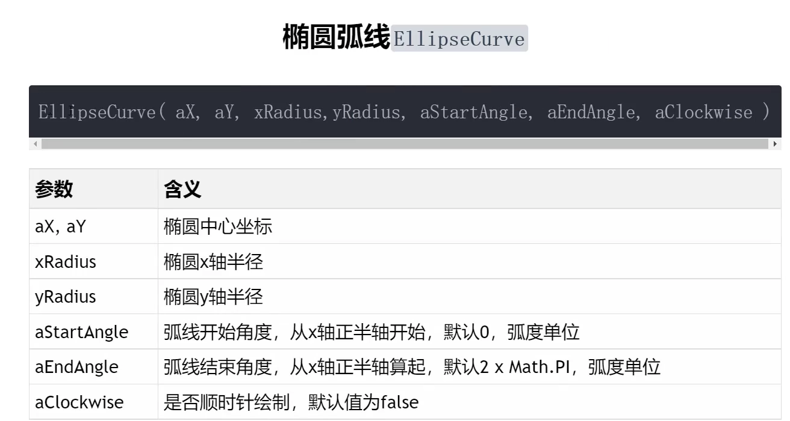

## 数学知识点回顾

```typescript
for (let i = 0; i < N; i++) {
  const angle = sp * i;
  const x = R * Math.cos(angle);
  const y = R * Math.sin(angle);
  const z = 0;
  arr.push(x, y, z);
}
```

详细解释一下 Math.cos(angle) 的原理，以及在代码中是如何工作的。

简单来说，Math.cos(angle) 是一个三角函数，它在一个圆形的上下文中，根据一个角度，返回该角度在圆上对应点的 X 坐标比例。

### 核心原理：单位圆 (The Unit Circle)

为了最直观地理解 cos (余弦)，我们需要借助“单位圆”这个概念。

1. 什么是单位圆？

想象一个在二维坐标系中，圆心在原点 (0, 0)，半径为 1 的圆。这个特殊的圆就叫“单位圆”。

2. 角度 (angle)

角度 angle 是从 X 轴的正方向（即点 (1, 0) 的位置）开始，逆时针旋转的角度。在JavaScript的 Math 函数中，这个角度的单位是弧度 (radians)，而不是我们平时说的度 (degrees)。您的代码中 (2 * Math.PI) / N 正是把一个完整的圆周 (2π 弧度) 分成了 N 份，计算出了每两个点之间的弧度差。

3. cos 和 sin 的作用

对于单位圆上任意一点 P，它的坐标 (x, y) 完全由这个角度 angle 决定：

- x = Math.cos(angle)

- y = Math.sin(angle)

换句话说，cos(angle) 的值就是单位圆上，从X轴正方向逆时针转动 angle 弧度后，那个点的 x坐标。

### 您提到的 “底/半径” 是如何来的？

您这个记忆非常棒，这正是余弦函数在直角三角形中的经典定义！现在我们把单位圆和直角三角形结合起来看：

1. 从单位圆上的点 P(x, y) 向 X 轴画一条垂直的线，你会得到一个直角三角形。

2. 这个三角形的三条边分别是：

- 斜边 (Hypotenuse): 长度等于圆的半径，在单位圆里就是 1。

- 邻边 (Adjacent Side / 底): 长度等于点 P 的 x 坐标。

- 对边 (Opposite Side): 长度等于点 P 的 y 坐标。

3. 根据直角三角形的三角函数定义：

\> 余弦 (cosine) = 邻边 / 斜边

4. 把我们刚才的发现代入公式： cos(angle) = x / 1

因此：x = cos(angle)

这完美地解释了为什么 cos(angle) 能得到 x 坐标。


## 几何体方法setFromPoints()

这是BufferGeometry的一个方法，通过这个方法把数组pointsArr中的坐标数据提取出来赋值给几何体，严格来讲就是把pointsArr里面坐标数据提取出来，赋值给geometry.attributes.position属性。

我们来探讨一下在 Three.js 中使用 THREE.Vector3 和直接写入顶点数据（例如通过 Float32Array）的区别。

在您提供的 model.js 文件中，您使用了 THREE.Vector3 数组来定义一系列点：

```js
// ...
const pointsArr = [
  new THREE.Vector3(0, 0, 0),
  new THREE.Vector3(0, 100, 0),
  new THREE.Vector3(0, 100, 100),
  new THREE.Vector3(0, 0, 100),
];
// ...
```

这两种方式的核心区别在于抽象层次和使用便利性。

### 1. 使用 THREE.Vector3 (高层次抽象)

THREE.Vector3 是 Three.js 提供的一个非常有用的类（Class），它不仅仅是三个数字（x, y, z）的容器。它代表一个三维空间中的向量或点，并内置了大量用于向量运算的方法。

优点:

- 可读性好，代码更直观: new THREE.Vector3(x, y, z) 清晰地表达了“创建一个三维点”的意图。

- 强大的向量运算: Vector3 对象提供了丰富的数学方法，例如：

  - .add(): 向量相加

  - .sub(): 向量相减

  - .multiplyScalar(): 向量乘以一个标量（缩放）

  - .length(): 计算向量长度
    - .normalize(): 将向量单位化

  - .dot(): 点乘

  - .cross(): 叉乘

- 便于操作: 在生成最终的几何体之前，你可以轻松地对这些 Vector3 对象进行移动、旋转、缩放等复杂的数学变换。

- 与Three.js API高度集成: 很多Three.js的辅助方法，比如您用到的 geometry.setFromPoints()，就是专门设计用来接收 THREE.Vector3 数组的，极大地简化了从点集创建几何体的过程。

缺点:

- 微小的性能开销: 每 new THREE.Vector3() 一次，就会创建一个新的JavaScript对象。当点非常多（例如几十万个）的时候，创建大量对象会带来一定的内存和性能开销。但在绝大多数场景下，这点开销可以忽略不计。

**代码预览：**

```typescript
import * as THREE from "three";

const geometry = new THREE.BufferGeometry();

const pointsArr = [
  new THREE.Vector3(0, 0, 0),
  new THREE.Vector3(0, 100, 0),
  new THREE.Vector3(0, 100, 100),
  new THREE.Vector3(0, 0, 100),
];
geometry.setFromPoints(pointsArr);

console.log("几何体变化", geometry.attributes.position);

const material = new THREE.PointsMaterial({
  color: 0xff0000,
  size: 10,
});

const line = new THREE.Points(geometry, material);

export default line;

```


### 2. 直接写入顶点数据 (低层次操作)

这是更接近底层WebGL的方式。你需要手动创建一个类型化数组（通常是 Float32Array），然后把所有的顶点坐标平铺在里面。

例如，与您的 pointsArr 等效的直接写法是：

```js
const vertices = new Float32Array([
  // 第1个点(x, y, z)
  0, 0, 0,
  // 第2个点(x, y, z)
  0, 100, 0,
  // 第3个点(x, y, z)
  0, 100, 100,
  // 第4个点(x, y, z)
  0, 0, 100,
]);

// 然后手动设置BufferAttribute
geometry.setAttribute('position', new THREE.BufferAttribute(vertices, 3)); // 3表示每3个值为一个顶点
```

geometry.setFromPoints() 方法在内部做的其实就是类似上面的事情：它遍历你传入的 Vector3 数组，提取每个向量的x, y, z值，然后帮你创建 Float32Array 和 BufferAttribute。

- 优点:

- 性能更高: 直接操作类型化数组，避免了创建大量中间Vector3对象，内存占用更少，数据传输到GPU的效率也更高。在处理海量顶点数据时，性能优势会体现出来。

- 缺点:

- 代码可读性差: 看着一长串数字，很难直观地看出每个点的位置。

- 操作不便: 如果想对某个点进行数学变换，你需要手动去这个大数组里找到对应的索引（例如 vertices[i*3], vertices[i*3+1], vertices[i*3+2]），然后进行计算，非常繁琐且容易出错。

### 总结

| 特性     | new THREE.Vector3() + setFromPoints()                        | 直接写入 Float32Array                                        |
| :------- | :----------------------------------------------------------- | :----------------------------------------------------------- |
| 抽象层级 | 高                                                           | 低                                                           |
| 易用性   | 非常高，代码直观，易于理解和维护。                           | 较低，需要手动管理索引，操作繁琐。                           |
| 功能性   | 强大，可以利用Vector3的各种数学方法进行复杂的几何变换。      | 基础，只是纯粹的数据存储，不带任何辅助方法。                 |
| 性能     | 略低，有创建对象的开销，但通常可忽略。                       | 更高，直接与底层API对接，是性能最优化的选择。                |
| 推荐场景 | 绝大多数情况：构建、原型设计、动态修改几何体，以及顶点数量不是极端庞大的场景。 | 追求极致性能的场景：例如点云数据可视化，需要一次性加载和渲染几百万甚至上千万个点。 |

简单来说，THREE.Vector3 是为了方便开发者而设计的“便利工具”，而直接写入 Float32Array 是更接近机器运行方式的“原始材料”。

对于学习和绝大多数应用开发而言，强烈推荐使用 THREE.Vector3，因为它能让你更专注于实现创意，而不是陷入繁琐的底层数据操作中。只有当项目遇到明显的性能瓶颈时，才有必要考虑手动管理 BufferAttribute。


# 曲线curve


## 椭圆Three.EllipseCurve

```typescript
import * as THREE from "three";

// 生成椭圆曲线
const arc = new THREE.EllipseCurve(0, 0, 120, 50);

// const pointsArr = arc.getPoints(50);
const pointsArr = arc.getSpacedPoints(50);
console.log("曲线上获取的坐标", pointsArr);

const geometry = new THREE.BufferGeometry();
geometry.setFromPoints(pointsArr);

const material = new THREE.PointsMaterial({
  color: 0xff0000,
  size: 10,
});

const line = new THREE.Points(geometry, material);

export default line;

```



**`const arc = new THREE.EllipseCurve(0, 0, 120, 50);`参数1和2代表椭圆中心坐标，参数3和4代表x和y方向半径。**

1. arc.getPoints() 和 arc.getSpacedPoints() 的核心区别就在于取样点的分布是否均匀。

- getPoints(divisions): 这个方法会根据曲线的参数 t (通常从0到1) 来进行等分，然后计算出对应位置的点。对于像椭圆这样的非匀速曲线，参数 t 的均匀变化并不意味着在曲线上走过的路程（弧长）是均匀的。这会导致在曲率大的地方点会更密集，在曲率小的地方点会更稀疏。

- getSpacedPoints(divisions): 这个方法会先计算整条曲线的总长度，然后将总长度等分，确保返回的点在曲线上的物理间距是大致相等的。这使得点的分布看起来非常均匀。

2. 获取坐标点的过程是完全由 Three.js 的 API 自动完成的。您只需要创建好一个曲线对象（比如这里的 EllipseCurve），然后调用这两个方法之一并传入您希望得到的点的数量，API 内部就会完成所有复杂的数学计算，并返回一个包含 Vector (向量/坐标点) 的数组。

总结一下，就像您在代码中使用的那样，当希望在曲线上获得一组视觉上等间距的点时（比如制作虚线、或均匀分布一些物体），getSpacedPoints() 是更合适的选择。


## 圆弧ArcCurve

```typescript
import * as THREE from "three";


// 生成圆弧曲线
const arc = new THREE.ArcCurve(0, 0, 50);
const pointsArr = arc.getPoints(50);
const geometry = new THREE.BufferGeometry();
geometry.setFromPoints(pointsArr);

const material = new THREE.LineBasicMaterial({
  color: 0xff0000,
  size: 10,
});

const line = new THREE.LineLoop(geometry, material);

export default line;

```

计算机图形学中一个非常核心的概念：用离散的点和线段来模拟（近似）连续的曲线。

我们在 Three.js 中创建的任何 Curve（无论是圆弧、椭圆还是贝塞尔曲线），它在数学上都是一个完美的、连续的曲线。但是，计算机的 GPU（显卡）在渲染时，并不能直接画出一条真正意义上的“光滑曲线”，它最擅长的是画点、直线和三角形。

所以，为了在屏幕上显示这条曲线，Three.js 采取了“近似”的策略：

1. 采样 (Sampling)：通过 arc.getPoints(n) 方法，从这个完美的数学圆弧上提取出 n + 1 个离散的坐标点。这些点都精确地位于圆弧上。

1. 连接 (Connecting)：然后，使用像 Line 或 LineLoop 这样的对象，将这些采样点用直线段依次连接起来。

所以，您最终在屏幕上看到的，并不是一条真正的圆弧，而是一个由许多短直线段构成的正多边形。

- 当 getPoints() 的参数（也就是取样点数量）较少时（比如 getPoints(5)），你会得到一个正六边形，它的棱角会非常明显，看起来一点也不圆。

- 当取样点数量非常多时（比如 getPoints(50)），你会得到一个边数很多的（51条边）正多边形。因为每一条直线段都非常短，它与真实圆弧的偏差极小，所以人眼在视觉上就无法分辨出那些微小的棱角，从而感觉它是一条非常平滑、非常“圆”的圆弧了。

可以尝试将代码中的 50 改成 5 或者 10，就能立刻看到一个棱角分明的多边形，这样可以更直观地理解这个过程。


## 三维样条曲线

```js
import * as THREE from "three";

// 生成不规则的三维曲线
const arr = [
  new THREE.Vector3(-50, 20, 90),
  new THREE.Vector3(-10, 40, 40),
  new THREE.Vector3(0, 0, 0),
  new THREE.Vector3(60, -60, 0),
  new THREE.Vector3(70, 0, 80),
];

const curve = new THREE.CatmullRomCurve3(arr);
const pointsArr = curve.getPoints(50);
// 定义线模型
const geometry = new THREE.BufferGeometry();
geometry.setFromPoints(pointsArr);

const material = new THREE.LineBasicMaterial({
  color: 0xff0000,
});
const line = new THREE.Line(geometry, material);

// 用点模型可视化样条曲线经过的顶点位置
const geometry2 = new THREE.BufferGeometry();
geometry2.setFromPoints(arr);
const material2 = new THREE.PointsMaterial({
  color: 0xff00ff,
  size: 10,
});

const points = new THREE.Points(geometry2, material2);

const group = new THREE.Group();
group.add(line);
group.add(points);

export default group;

```

**为什么我们还是需要getPoints来采样坐标点呢？**

这是一个非常好的问题！您可能会想："既然我已经有了那5个控制点，为什么不能直接连接它们，还要用 getPoints() 来采样更多的点呢？"

答案的关键在于理解控制点和曲线上的实际点的区别：

### 1. 控制点 ≠ 曲线上的点

您定义的这5个 Vector3 点被称为控制点或关键点。对于 CatmullRomCurve3 来说，这些控制点的作用是：

- 定义曲线的形状和走向

- 大部分控制点都在最终的曲线上（这是 Catmull-Rom 曲线的特性）

- **但仅仅连接这5个点，得到的是折线，不是平滑曲线**

### 2. 如果直接连接控制点会怎样？

如果您直接将这5个控制点用直线连接，您会得到一个5段直线组成的折线，有明显的转折角，看起来很生硬。

### 3. 采样的作用

curve.getPoints(50) 的作用是：

- 在由控制点定义的数学曲线上，均匀地采样出51个点

- 这51个点包括了原来的5个控制点，还有中间插值计算出的46个点

- 这些插值点使得相邻两点之间的连线变得非常短，从而让整条线看起来是平滑的曲线

### 4. 一个类比

想象一下：

- 控制点就像是您在地图上标记的几个必经城市

- 采样点就像是GPS导航为您规划的详细路线，包含了途中的每一个小路口

- 如果只按城市连直线，您会"穿山越岭"；但按GPS的详细路线走，您会得到一条平滑可行的道路

所以，getPoints() 采样是必需的，它让数学上定义的平滑曲线能够在计算机图形中正确显示出来。


## 贝塞尔曲线

```typescript
// 二维二次贝塞尔曲线
// p2是控制点，p1和p3是起点和终点
/* const p1 = new THREE.Vector2(-80, 0);
const p2 = new THREE.Vector2(20, 100);
const p3 = new THREE.Vector2(80, 0); */

// 三维二次贝塞尔曲线
/* const p1 = new THREE.Vector3(-80, 0, 0);
const p2 = new THREE.Vector3(20, 100, 0);
const p3 = new THREE.Vector3(80, 0, 100); */

// 二维三次贝塞尔曲线
const p1 = new THREE.Vector2(-80, 0);
const p2 = new THREE.Vector2(-40, 50);
const p3 = new THREE.Vector2(50, 50);
const p4 = new THREE.Vector2(80, 0);
const arr = [p1, p2, p3, p4];
const curve = new THREE.CubicBezierCurve(p1, p2, p3, p4);
const pointsArr = curve.getPoints(100);
// 定义线模型
const geometry = new THREE.BufferGeometry();
geometry.setFromPoints(pointsArr);

const material = new THREE.LineBasicMaterial({
  color: 0xff00ff,
});
const line = new THREE.Line(geometry, material);

// 控制点的点模型
const geometry2 = new THREE.BufferGeometry();
geometry2.setFromPoints(arr);
const pointMaterial = new THREE.PointsMaterial({
  color: 0x00ffff,
  size: 10,
});
const points = new THREE.Points(geometry2, pointMaterial);

// 控制点的连线
const geometry3 = new THREE.BufferGeometry();
geometry3.setFromPoints(arr);
const lineMaterial = new THREE.LineBasicMaterial({
  color: 0x888888,
});
const controlLine = new THREE.Line(geometry3, lineMaterial);

const group = new THREE.Group();
group.add(line); // 贝塞尔曲线
group.add(points); // 控制点
group.add(controlLine); // 控制点连线

export default group;

```


### 1. 贝塞尔曲线为什么不经过中间的控制点？

这是一个非常核心的特点。对于您正在使用的三次贝塞尔曲线 (CubicBezierCurve) 来说：

- 曲线保证会穿过起点 (p1) 和终点 (p4)。

- **曲线通常不会穿过中间的两个控制点 (p2 和 p3)。**

**您可以把中间的控制点想象成具有“引力”的磁铁。它们的作用不是让曲线“穿过”自己，而是把本来是直线的路径向自己这边“拉拽”过来。曲线的最终形状，是所有控制点“拉力”共同作用下的一个平衡结果。**

- p2 的位置主要影响曲线前半段的形状。

- p3 的位置主要影响曲线后半段的形状。

正是因为曲线不直接穿过这些点，我们才能通过调整它们的位置，创造出各种平滑、优美的曲线形态，这是简单地连接几个点所做不到的。

### 2. 控制点的作用是什么？

控制点的核心作用是定义和控制曲线的形状、弯曲程度和方向。

具体来说，在三次贝塞尔曲线中：

1. 定义起止点：p1 是起点，p4 是终点。

1. 定义切线方向：

- 从起点 p1 到控制点 p2 的连线方向，定义了曲线在起点处的切线方向。p2 离 p1 越远，曲线在开头部分“冲出去”的势头就越猛。

- 从控制点 p3 到终点 p4 的连线方向，定义了曲线在终点处的切线方向。p3 离 p4 越远，曲线在结尾部分弯曲的幅度就越大。

简单来说，这四个点构成的“控制笼”（您代码中用灰色线条连接的部分）完整地决定了曲线的最终形态。移动任何一个控制点，都会对整条曲线的平滑度产生影响。

### 3. 二维/三维 与 二次/三次 贝塞尔曲线的区别

这是一个关于“维度”和“阶数”的问题。

#### 二维 (2D) vs. 三维 (3D)

这个区别非常直观：

- 二维贝塞尔曲线：所有控制点都在一个平面上，使用 THREE.Vector2(x, y) 定义。曲线本身也是一个平面图形。

- 三维贝塞尔曲线：控制点在三维空间中，使用 THREE.Vector3(x, y, z) 定义。这使得曲线可以在空间中任意穿梭，形成立体的路径。

#### 二次 (Quadratic) vs. 三次 (Cubic)

这个区别在于控制点的数量和曲线的复杂度：

- 二次贝塞尔曲线 (QuadraticBezierCurve)：

- 3个控制点：一个起点 p1、一个终点 p3 和 一个 中间控制点 p2。

- 形状相对简单，只有一个弯曲。适用于创建简单的弧线。

- 整个曲线的弯曲由唯一的控制点 p2 来控制。

- 三次贝塞尔曲线 (CubicBezierCurve)：

- 4个控制点：一个起点 p1、一个终点 p4 和 两个 中间控制点 p2、p3。

- 因为有两个控制点，所以可以创建更复杂的形状，例如 "S" 形曲线。

- p2 和 p3 像两个“手柄”，分别控制起点和终点方向的曲线形态，提供了更高的自由度。这是在图形设计软件（如PS、AI）中最常用的钢笔工具。


## 实现组合曲线

**组合曲线的坐标顺序和线条组合顺序不能随便写，总的方向是先确定整个曲线的起点，然后沿着一个方向绘制不同的曲线，确保不同类型的曲线做到首尾相接。**

这句话是对 THREE.CurvePath （或类似的组合曲线概念）工作原理的一个非常精准且重要的描述。它强调了在构建复杂路径时必须遵守的规则，否则结果会不符合预期。

我来为您详细解释一下，并用一个例子来说明：

### 核心思想：像连接火车轨道一样

您可以把 CurvePath 想象成一个空的火车轨道蓝图，而每一段独立的曲线（如 LineCurve, ArcCurve, CubicBezierCurve）就是一段段真实存在的轨道零件。

您想要用这些零件拼成一条完整的、可以顺畅跑完的轨道。要做到这一点，您必须：

1. 确定起点：把第一段轨道铺在地上。

1. 按顺序连接：拿出第二段轨道，将它的开头精确地对准第一段轨道的结尾。

1. 保持方向：继续拿出第三段，将其开头对准第二段的结尾，以此类推。

如果您不遵守这个规则，比如把第二段轨道放在了离第一段很远的地方，那么火车从第一段开出后，要么脱轨，要么就得瞬间“跳”到第二段的开头，这显然是不对的。

### "坐标顺序" 和 "组合顺序" 的含义

#### 1. 坐标顺序 (定义每一段曲线)

这句话指的是，在创建每一段独立的曲线时，它的起点和终点坐标必须符合您期望的行进方向。

例子：假设您想从 A点(-10, 0) 走到 B点(10, 0)。

- 正确：`new THREE.LineCurve(new THREE.Vector2(-10, 0), new THREE.Vector2(10, 0))`

- 错误：`new THREE.LineCurve(new THREE.Vector2(10, 0), new THREE.Vector2(-10, 0))`

虽然这两个点是一样的，但第二种写法的“方向”是反的，是从 B 到 A。如果您打算接下来从 B 点继续前进，那么第二种写法就会导致路径混乱。

```typescript
const R = 80; //先设置圆弧半径
const H = 200; //设置直线的高度

const line1 = new THREE.LineCurve(
  new THREE.Vector2(R, H),
  new THREE.Vector2(R, 0)
);
const arc = new THREE.ArcCurve(0, 0, R, 0, Math.PI, true);
```

这段代码创建了一条垂直的直线段。

- new THREE.LineCurve(...): 创建一个直线段的数学定义。

- new THREE.Vector2(R, H): 这是直线的起点。它的坐标是 (50, 100)。

- new THREE.Vector2(R, 0): 这是直线的终点。它的坐标是 (50, 0)。

可视化效果：

这条线从点 (50, 100) 开始，垂直向下延伸，到点 (50, 0) 结束。它平行于 Y 轴，长度为 H (100)。

```tex
      Y
      ^
      |
(50, 100)  <-- line1 的起点
      |
      |
      | line1 (一条垂直线)
      |
      |
 (50, 0)   <-- line1 的终点
 -----+---------------------> X
      |
```

### 第二段代码：ArcCurve (圆弧)

```js
const arc = new THREE.ArcCurve(0, 0, R, 0, Math.PI, true);
```

这段代码创建了一个逆时针方向的下半圆。

- new THREE.ArcCurve(...): 创建一个圆弧的数学定义。它的参数比较多：

- 0, 0: 这是圆弧所在圆的圆心坐标 (x, y)，这里是原点 (0, 0)。

- R: 这是圆的半径，这里是 50。

- 0: 这是圆弧的起始角度（单位是弧度）。0 弧度对应于时钟的3点钟方向。

- Math.PI: 这是圆弧的结束角度（单位是弧度）。Math.PI (π) 弧度对应于180度，即时钟的9点钟方向。

- true: 这是绘制方向。true 表示逆时针 (anticlockwise)。如果为 false，则为顺时针。

可视化效果：

想象一个以原点为中心、半径为 50 的完整圆。这条 arc 从3点钟方向（坐标 (50, 0)）开始，逆时针画一个半圆，到9点钟方向（坐标 (-50, 0)）结束。因为它画的是下半部分，所以会经过 (0, -50)。

```js
                       Y
                       ^
                       |
                       |
<--(-50,0)-----------(0,0)-----------(50,0)--> X   <-- arc 的起点是 (50,0)，终点是 (-50,0)
     .                 |                 .
      .                |                .
       .               |               .
         .          (0,-50)          .    <-- arc 经过这个点
           . . . . . . . . . . . . .      <-- 这是一个逆时针的下半圆
```

特别注意：ArcCurve 的第六个参数（方向）非常重要。如果把它设为 false（顺时针），那么它会从3点钟方向顺时针画一个上半圆，终点依然是9点钟方向。

#### 2. 组合顺序 (将曲线添加到 CurvePath 中)

这句话指的是，您将各个曲线段添加到 CurvePath 这个“组合”中的顺序必须是您希望路径行进的顺序。

最关键的一点：

前一条曲线的终点，必须是后一条曲线的起点。 这就是“首尾相接”的含义。

### 一个具体的代码例子


```js
import * as THREE from "three";

const R = 80; //先设置圆弧半径
const H = 200; //设置直线的高度

const line1 = new THREE.LineCurve(
  new THREE.Vector2(R, H),
  new THREE.Vector2(R, 0)
);
const arc = new THREE.ArcCurve(0, 0, R, 0, Math.PI, true);

const line2 = new THREE.LineCurve(
  new THREE.Vector2(-R, 0),
  new THREE.Vector2(-R, H)
);
// CurvePath创建组合曲线对象
const CurvePath = new THREE.CurvePath();
// line1,arc,line2拼接出来一个U型轮廓曲线，注意顺序
CurvePath.curves.push(line1, arc, line2);
// 三维样条曲线
const pointsArr = CurvePath.getPoints(30);
const geometry = new THREE.BufferGeometry();
geometry.setFromPoints(pointsArr);

const material = new THREE.LineBasicMaterial({
  color: 0x00fffff,
});

const material2 = new THREE.PointsMaterial({
  color: 0xff00ff,
  size: 10,
});

// 点模型对象
const points = new THREE.Points(geometry, material2);

const line = new THREE.Line(geometry, material);

const group = new THREE.Group();
group.add(line);
group.add(points);
export default group;

```

#### 如果不遵守规则会怎样？

直线部分不取多余的点，只取首尾两个点，而曲线会尽量多采样取点确保绘制出圆滑的弧线。

如果你直线也想要均匀取点，那就用getSpacePoints()，但是没必要。


### 总结

所以，这段描述的核心就是在强调：

构建组合曲线是一个有序的、接力式的过程。你必须规划好每一段的内部方向（坐标顺序），并严格按照“前一段的终点”就是“后一段的起点”的规则，将它们按顺序（组合顺序）串联起来，才能得到一条完整、连续的平滑路径。

## 管道模型生成原理

管道模型的创建基于一种在三维建模中非常常见的技术，叫做扫描或放样 (Sweep / Lofting)。其核心思想是：让一个二维的封闭图形（称为“轮廓”或“截面”）沿着一条三维的路径（称为“扫描路径”）移动，并将移动过程中产生的轨迹连接起来形成一个三维实体。

您可以把它想象成这样：

- 路径 (Path)：您在三维空间中预先定义好的一条曲线，比如之前用到的 CatmullRomCurve3 或 CubicBezierCurve3。这就是管道的“骨架”或中心线。

- 轮廓 (Profile)：一个二维图形，对于 TubeGeometry 来说，这个图形永远是一个圆形。

- 生成过程：TubeGeometry 会沿着您给定的三维路径，在许多个点上分别放置一个与路径垂直的圆形轮廓。然后，它会像“缝衣服”一样，把相邻两个圆形的对应顶点用三角形面片连接起来，最终“缝合”成一个完整的中空管道模型。

\### 参数对生成模型的影响

在创建 TubeGeometry 时，最重要的两个参数是 tubularSegments（管道分段数）和 radialSegments（横截面分段数）。它们直接决定了模型的精细度和性能。

#### tubularSegments (管道分段数)

这个参数控制的是沿着管道长度方向的平滑度。

- 作用：它决定了要从您的输入路径（Path）上采集多少个点来构建管道的“骨架”。TubeGeometry 会在路径上取 tubularSegments 那么多个点，并在每个点上创建一个圆形的横截面。

- 影响：

- 值越低：如果您的管道有弯曲，那么在弯曲处会看到明显的棱角，整个管道看起来像是由几段短的直管生硬地连接起来的。

- 值越高：弯曲处会显得非常平滑，因为它是由更多、更短的直管段平滑过渡而成的。

- 类比：这个值非常类似于您之前用过的 curve.getPoints(n) 中的 n。它决定了对路径曲线的采样精度。

#### radialSegments (横截面分段数)

这个参数控制的是管道圆形横截面本身的平滑度。

- 作用：它决定了用多少个顶点来近似模拟一个圆形。
- 影响：
- 值越低：例如，如果 radialSegments 为 3，那么管道的横截面就不是圆形，而是一个三角形，最终生成的模型是一个三棱柱。如果为 4，则是一个四棱柱。
- 值越高：横截面会越来越接近一个完美的圆形，整个管道看起来就越圆润。通常 8 到 12 就能得到不错的效果，更高的值在摄像机离得很近时才看得出区别。

### 总结

- tubularSegments：控制管道弯曲处的平滑度（纵向分段）。

- radialSegments：控制管道管壁本身的圆滑度（横向分段）。

这两个值越高，生成的模型面数（三角形数量）就越多，模型就越精细，但同时对显卡的性能消耗也越大。因此，在实际应用中需要根据模型的重要性和摄像机的远近来权衡选择合适的数值。


## 二次贝塞尔曲线结合组合曲线的应用

```typescript
import * as THREE from "three";

// 移除(0,0,0)点，保留4个点创建U形贝塞尔曲线
const arr = [
  new THREE.Vector3(50, 0, 0),    // 起始点
  new THREE.Vector3(10, 0, 0),    // 控制点1 - 要经过
  new THREE.Vector3(0, 0, 0),     // 控制点2
  new THREE.Vector3(0, 0, 10),    // 控制点3 - 要经过
  new THREE.Vector3(0, 0, 50),    // 结束点
]

// 使用CurvePath组合多段贝塞尔曲线
const curvePath = new THREE.CurvePath();

// 第一段：起始点 -> 控制点1
const segment1 = new THREE.QuadraticBezierCurve3(
  arr[0],  // 起始点 (50,0,0)
  new THREE.Vector3(30, 0, 0),  // 中间控制点
  arr[1]   // 控制点1 (10,0,0) - 经过此点
);

// 第二段：控制点1 -> 控制点3
const segment2 = new THREE.QuadraticBezierCurve3(
  arr[1],  // 控制点1 (10,0,0)
  arr[2],  // 控制点2 (0,0,0) 作为控制点
  arr[3]   // 控制点3 (0,0,10) - 经过此点
);

// 第三段：控制点3 -> 结束点
const segment3 = new THREE.QuadraticBezierCurve3(
  arr[3],  // 控制点3 (0,0,10)
  new THREE.Vector3(0, 0, 30),  // 中间控制点
  arr[4]   // 结束点 (0,0,50)
);

// 将所有段添加到CurvePath
curvePath.add(segment1);
curvePath.add(segment2);
curvePath.add(segment3);

// 从组合路径获取点 - 一行代码搞定！
const pointsArr = curvePath.getPoints(60);

// 创建曲线几何体
const curveGeometry = new THREE.BufferGeometry();
curveGeometry.setFromPoints(pointsArr);

// 创建控制点几何体
const controlPointsGeometry = new THREE.BufferGeometry();
controlPointsGeometry.setFromPoints(arr);


// 材质
const curveMaterial = new THREE.LineBasicMaterial({ 
  color: 0x00ffff, 
  linewidth: 2 
});

const controlPointMaterial = new THREE.PointsMaterial({
  color: 0xff00ff,
  size: 8,
  sizeAttenuation: false
});

const controlLineMaterial = new THREE.LineBasicMaterial({ 
  color: 0xffa500, 
  linewidth: 1,
  transparent: true,
  opacity: 0.5
});

// 创建对象
const curveLine = new THREE.Line(curveGeometry, curveMaterial);
const controlPoints = new THREE.Points(controlPointsGeometry, controlPointMaterial);

const group = new THREE.Group();
group.add(curveLine);
group.add(controlPoints);

export default group;

```

### 贝塞尔曲线的数学限制

单条贝塞尔曲线的约束：

1. 四次贝塞尔曲线只能精确经过2个点：起始点和结束点

1. 中间的控制点只是"影响"曲线形状，曲线不一定经过这些点

1. 高阶贝塞尔曲线难以控制：点数越多，曲线越"飘"，形状难以预测

### 你的需求 vs 单条曲线的能力

从你的代码看，你希望曲线经过这5个关键点：

```typescript
new THREE.Vector3(50, 0, 0),    // 起始点 ✓ 
new THREE.Vector3(10, 0, 0),    // 要经过 ❌
new THREE.Vector3(0, 0, 0),     // 控制点
new THREE.Vector3(0, 0, 10),    // 要经过 ❌  
new THREE.Vector3(0, 0, 50),    // 结束点 ✓
```

如果用一条四次贝塞尔曲线，你只能保证经过起始点和结束点，中间的点 (10,0,0) 和 (0,0,10) 曲线不会精确经过。

### 分段绘制的优势

```typescript
// 你的解决方案：
// 第一段：确保经过 (50,0,0) -> (10,0,0)
// 第二段：确保经过 (10,0,0) -> (0,0,10)  
// 第三段：确保经过 (0,0,10) -> (0,0,50)
```

这样每段都是二次贝塞尔曲线，可以精确控制经过的关键点。


## 轮廓线

```typescript
import * as THREE from "three";

const pointsArr=[
  new THREE.Vector2(50,60),
  new THREE.Vector2(25,0),
  new THREE.Vector2(50,-60)
]

// const geometry=new THREE.LatheGeometry(pointsArr,30,0,Math.PI)
// 做一个二维样条曲线
const curve=new THREE.SplineCurve([...pointsArr])
const arr=curve.getPoints(100)
// 参数分别是：点数组，半径，分段数，角度
const geometry=new THREE.LatheGeometry(arr,30)
// geometry.setFromPoints(arr)
const material=new THREE.MeshLambertMaterial({
  color:0x00ffff,
  side:THREE.DoubleSide
})

const mesh=new THREE.Mesh(geometry,material)

const group = new THREE.Group();
group.add(mesh)

export default group;
  
```

1. pointsArr (轮廓线):

这定义了模型的“轮廓线”。你提供的点 [new THREE.Vector2(50,60), new THREE.Vector2(25,0), new THREE.Vector2(50,-60)] 位于XY平面上。LatheGeometry 会这样解读它们：

- Y坐标：作为模型在旋转轴上的高度。

- X坐标：作为模型在该高度上的半径。

1. 旋转轴:

LatheGeometry 默认围绕世界坐标系的 Y轴 旋转。

2. 旋转方向 (逆时针):

Three.js 使用的是右手坐标系。旋转遵循“右手定则”：当你用右手大拇指指向Y轴的正方向（向上）时，你其余四指弯曲的方向就是正向的旋转方向。从Y轴上方往下看，这个方向就是逆时針。


3. 0 和 Math.PI (旋转角度):

- 第三个参数 0 是 phiStart，代表旋转的起始角度（单位是弧度）。角度 0 对应于 X轴正方向。

- 第四个参数 Math.PI 是 phiLength，代表从起始角度开始旋转的总角度。Math.PI 是180度。

总结一下你的代码效果：

它会从 X 轴正方向开始，将你定义的轮廓线围绕 Y 轴逆时针旋转180度，从而创建一个半开的模型。

这也是为什么你在材质中设置 side: THREE.DoubleSide 是一个好习惯，因为这样你才能同时看到这个半开模型的内外两个面。如果是一个完整的、封闭的模型，通常只需要渲染外表面（side: THREE.FrontSide）。

如果你想生成一个完整的闭合模型，只需要将 Math.PI 改为 Math.PI * 2 即可。

### 半径

对于 THREE.LatheGeometry 来说，轮廓线的半径是完全由你提供的顶点决定的，而不是一个单独的自定义参数。

让我们来详细分解一下这个机制：

LatheGeometry 将你传入的点数组 arr（它是由 Vector2 组成的）看作是在 XY平面 上的一个轮廓。当它围绕 Y轴 旋转生成三维模型时，它会这样解释每个点的坐标 (x, y)：

- y 坐标：定义了模型在中心轴（Y轴）上的高度。

- x 坐标：定义了模型在该特定高度处的半径。

你用 SplineCurve 把这几个点平滑地连接成了一条曲线 arr，这条曲线上有101个点。LatheGeometry 会遍历这101个点，并将每个点的 x 值作为对应 y 高度上的半径，然后将这些半径圈平滑地连接起来，最终形成了你看到的沙漏形状。

总结一下：

- 顶点决定半径：模型的形状（半径在不同高度的变化）完全由输入点集的 X 坐标控制。

- 没有自定义半径参数：LatheGeometry 的构造函数中没有一个像 CylinderGeometry 那样的 radius 参数。它的第二个参数 30，代表的是旋转体的周长分段数，决定了模型横截面的圆滑程度（30边形近似于圆），而不是半径。

所以，你代码中之前的注释 // 参数分别是：点数组，半径，分段数，角度 其实是不准确的，正确的应该是 // 参数分别是：点数组，周长分段数。这也是为什么通过修改 pointsArr 里的 Vector2 的 x 值，你就可以自由地改变最终模型的胖瘦。


## 扫描ExtrudeGeometry

```js
import * as THREE from "three";
const shape=new THREE.Shape([
  new THREE.Vector2(0,0),
  new THREE.Vector2(0,10),
  new THREE.Vector2(10,10),
  new THREE.Vector2(10,0),
])
const curve=new THREE.CatmullRomCurve3([
  new THREE.Vector3(-10,-50,-50),
  new THREE.Vector3(10,0,0),
  new THREE.Vector3(8,50,50),
  new THREE.Vector3(-5,0,100)
])
const geometry=new THREE.ExtrudeGeometry(
  shape,{
    extrudePath:curve,
    steps:100
  }
)
const material=new THREE.MeshLambertMaterial({
  color:0x00ffff,
  side:THREE.DoubleSide,
  // wireframe:true
})
const mesh=new THREE.Mesh(geometry,material)

const group = new THREE.Group();
group.add(mesh)

export default group;
  
```

### 核心概念：基于路径的拉伸

要理解这段代码，首先要明白它的核心思想：将一个二维平面图形，沿着一条三维空间路径移动并“扫描”，从而形成一个三维实体。

这就像是你手里有一个特定形状的印章（THREE.Shape），你蘸了墨水，然后手臂沿着一条预先画好的曲线（THREE.CatmullRomCurve3）在纸上移动，这个过程中连续不断地盖章，最终留下了一条连续的、带有你印章形状的痕迹。这个痕迹，就是我们最终的三维模型。

------

### 为何要结合 Shape 和 CatmullRomCurve3？

这两者分别扮演着不可或缺的角色，它们共同定义了最终模型的形态。

1. const shape = new THREE.Shape([...])：定义“我是谁”

- THREE.Shape 用于定义一个二维轮廓，它本质上是一个封闭或不封闭的二维点集。在这个例子中，[new THREE.Vector2(0,0), new THREE.Vector2(0,10), new THREE.Vector2(10,10), new THREE.Vector2(10,0)] 定义了一个位于XY平面上的10x10的正方形。

- 这个 shape 是拉伸体的横截面（Cross-section）。它决定了我们生成的“通道”长什么样子。如果把它换成一个圆形或者星形，那么最终生成的就会是圆管或者星形管道。它回答了“被拉伸的物体是什么形状？”这个问题。

1. const curve = new THREE.CatmullRomCurve3([...])：定义“我去哪”

- **THREE.CatmullRomCurve3 是一种3D样条曲线。它的特点是一定会平滑地穿过你提供的所有控制点。这使得它在路径规划中非常直观和常用。**

- **这个 curve 是拉伸体的路径（Path）。它定义了上述 shape 在三维空间中移动的轨迹。它回答了“物体要沿着什么路径被拉伸？”这个问题。**

结论：

将两者结合，就是告诉 three.js：“请把这个正方形的横截面（shape），沿着这条平滑的空间曲线（curve） 进行拉伸，从而构建一个三维物体。” 如果缺少任何一个，这个操作都无法完成。没有 shape 就不知道要拉伸什么东西；没有 curve（或者其他路径定义），就不知道要往哪里拉伸。

------

### ExtrudeGeometry 参数的精密作用

ExtrudeGeometry 是实现这一切的“魔法师”。让我们来解析它的构造函数 new THREE.ExtrudeGeometry(shape, options)。

- 第一个参数 shape：这个很简单，就是我们上面定义的那个10x10的正方形轮廓。

- 第二个参数 options 对象：这是控制拉伸行为的关键，我们来逐一分析其中用到的参数。

- extrudePath: curve

- **作用： 这是本次操作的核心参数。它明确指示 ExtrudeGeometry 不要执行默认的、沿着Z轴的直线拉伸，而是要沿着我们提供的 curve 对象所定义的空间路径进行拉伸。**

- **内部机制： 当指定了 extrudePath 后，three.js 会沿着这条曲线计算一系列的标架（Frames）。你可以将每个标架想象成一个微型的、跟随曲线方向变化的局部坐标系。在每个标架的位置，three.js 都会放置一个我们定义的 shape 的副本，并根据该点标架的朝向（由曲线的切线、法线等决定）来旋转这个 shape，确保它始终“垂直”于曲线的前进方向。**

- steps: 100

- 作用： 这个参数定义了沿着 extrudePath 路径的分段数。它直接决定了最终模型的精细度。

- 内部机制： three.js 会将整个 curve 曲线的长度等分成 100 段。这意味着它会计算出 101 个点（包括起点和终点）以及它们对应的标架。然后，它会在这 101 个位置上分别放置一个 shape 的副本。最终的几何体，是由连接相邻两个 shape 副本对应顶点的面片（通常是四边形）所组成的。

- 视觉效果：

- 如果 steps 值很低（比如2），你得到的会是一个由两段长方体生硬拼接而成的、棱角分明的物体。

- 如果 steps 值很高（比如 100），分段就非常多，每一段都很短，所以连接起来的视觉效果就非常平滑，能够很好地还原曲线的弯曲形态，但代价是生成了更多的顶点和面，增加了渲染开销。

### 总结：通道是如何生成的？

1. 准备阶段： three.js 拿到了一个二维正方形 shape 和一条三维曲线 curve。

1. **路径采样： 根据 steps: 100，three.js 在 curve 路径上从头到尾均匀地取了 101 个采样点。**

1. 坐标变换与放置： 在每一个采样点上，three.js 计算出该点的空间位置和朝向（一个局部坐标系）。然后，它将二维的 shape 顶点变换到这个三维的局部坐标系中，相当于在路径的每一个采样点上都“盖”了一个正确朝向的正方形。

1. 顶点连接与“蒙皮”： three.js 将路径上第 i 个正方形的顶点与第 i+1 个正方形的对应顶点两两相连，形成四边形面片。例如，第 i 个正方形的左上角顶点，会和第 i+1 个正方形的左上角顶点连接。这个过程沿着整个路径重复 100 次。

1. 封口（可选）： ExtrudeGeometry 默认还会在通道的起始和末尾处，用我们定义的 shape 来创建两个封口的面，使得它成为一个封闭的实体。

通过以上步骤，一个平滑、弯曲、横截面为正方形的通道就从数学定义变成了我们能看到的、由大量顶点和面片构成的三维几何体。


# Shape轮廓

```js
import * as THREE from "three";

// shape是一个二维轮廓
const shape=new THREE.Shape()
// currentPoint默认值是Vector2(0,0)，currentPoint是动态的当前绘制的终点
console.log('currentPoint',shape.currentPoint);
// currentPoint移动到(10,0)，这将成为起始点
shape.moveTo(10,0)
// 绘制直线线段，起点(10,0)，终点(100,0)
shape.lineTo(100,0)
shape.lineTo(100,100)
shape.lineTo(10,100)
// shape可以自动闭合，也可以手动闭合
/* shape.lineTo(0,0)
shape.closePath() */
const geometry=new THREE.ShapeGeometry(shape)
/* const geometry=new THREE.ExtrudeGeometry(shape,{
  depth:300,
  bevelEnabled:true,
  bevelThickness:10,
  bevelSize:10,
  bevelSegments:10,
}) */
const material=new THREE.MeshLambertMaterial({
  color:0x00ffff,

})
const mesh=new THREE.Mesh(geometry,material)

const group = new THREE.Group();
group.add(mesh)

export default group;
  
```

.assets/image-20250626233759956.png)

### THREE.Shape 的核心特性：路径构建与 currentPoint

THREE.Shape 与我们之前看到的、通过在构造函数中传入点数组的方式不同，它更像是一个绘图工具。你可以把它想象成在二维画布上控制一支画笔。它的所有操作都围绕一个核心属性展开：currentPoint。

- currentPoint: 这可以理解为“笔尖当前所在的位置”。所有绘图指令（如lineTo）都是从这个点开始的。当你完成一个绘图指令后，currentPoint 会自动移动到新的终点，为下一次绘图做准备。

现在我们来逐步分析代码，看看 Shape 的这些特性是如何被运用的：

1. const shape = new THREE.Shape()

- 这里我们创建了一个空的 Shape 对象。此时，你可以想象成我们拿到了一张白纸，并且画笔的笔尖 currentPoint 默认停在了原点 (0, 0)。

- 代码中的 console.log('currentPoint', shape.currentPoint); 会在控制台打印出 Vector2(0, 0)，印证了这一点。

1. shape.moveTo(10, 0)

- 特性应用：moveTo 方法是 Shape 的一个关键指令，它的作用是“**抬起画笔**，移动到新的位置”。它只改变 currentPoint 的位置，但并不会画出任何线条。

- 代码效果：执行这行代码后，笔尖 currentPoint 从 (0, 0) 被移动到了 (10, 0)。这个点将成为我们整个图形路径的起始点。

1. shape.lineTo(100, 0)

- 特性应用：lineTo 方法的作用是“**落下画笔**，从 currentPoint 到指定点画一条直线”。

- 代码效果：

- 它从当前的 currentPoint (即 (10, 0) ) 画一条直线到 (100, 0)。

- 绘制完成后，currentPoint 会自动更新到这条线的终点，也就是 (100, 0)。

1. shape.lineTo(100, 100) 和 shape.lineTo(10, 100)

- 这两行代码重复了上述过程：

- 从 (100, 0) 画一条线到 (100, 100)，然后 currentPoint 更新为 (100, 100)。

- 再从 (100, 100) 画一条线到 (10, 100)，然后 currentPoint 更新为 (10, 100)。

- 至此，我们已经画出了一个不封口、矩形的路径。

### 图形的闭合特性

接下来，我们看代码注释中的部分，这揭示了 Shape 另一个重要的特性：闭合。

- `/* shape.lineTo(0,0) shape.closePath() */`

- 特性应用：自动闭合 vs 手动闭合

1. **自动闭合：当我们将一个未闭合的 Shape 对象传递给 THREE.ShapeGeometry 时，ShapeGeometry 会非常智能地自动将路径的最后一个点 (currentPoint) 与路径的第一个点（由 moveTo 设定的点）连接起来，形成一个封闭的多边形，然后才能进行三角化填充。**在当前代码中，即使我们什么都不做，ShapeGeometry 也会自动添加一条从 (0, 100) 到 (10, 0) 的线段。

1. 手动闭合：如果你想在定义 Shape 时就明确地闭合它，有两种方式：

- shape.lineTo(10, 0): 就像注释里写的，但有一个小错误，应该是 lineTo(10,0) 而不是 (0,0)，因为我们的起始点是 (10,0)。这会手动绘制最后一条边。

- shape.closePath(): 这是更推荐、更语义化的方式。它会命令 Shape 自动从 currentPoint 画一条直线回到当前子路径的起始点，从而闭合形状。

### 从二维轮廓到三维几何体

1. const geometry = new THREE.ShapeGeometry(shape)

- ShapeGeometry 接收我们用上述“绘图”方式定义好的 shape 对象。

- **它的核心工作是执行一个叫三角剖分（Triangulation）的过程。它将我们定义的那个（可能是不规则的）多边形轮廓，智能地分割成若干个三角形面片。因为在计算机图形学中，GPU 最擅长处理和渲染的就是三角形。**

- 最终，geometry  就成了一个由多个顶点和面组成的、可以在三维空间中渲染的平面几何体。

1. 后续代码

- material、mesh、group 和 export 的作用与之前的例子完全相同：为这个新生成的平面几何体赋予材质，创建一个可被场景使用的网格对象，并将其导出。

### 总结

这段代码通过 THREE.Shape 的 moveTo 和 lineTo 等方法，像手绘一样逐步定义了一个二维图形的边界路径。然后利用 THREE.ShapeGeometry 对这个路径轮廓进行“填充”（三角化），最终生成了一个平面的、可见的3D网格对象。整个过程完美地展示了 Shape 基于路径和 currentPoint 的构建特性，以及 ShapeGeometry 的自动闭合与填充功能。


## 结合圆弧arc构建轮廓

```typescript
import * as THREE from "three";

// shape是一个二维轮廓
const shape=new THREE.Shape()
// currentPoint移动到(150,0)
shape.lineTo(150,0)
// 圆弧的.arc()参数的圆心坐标是相对当前.currentPoint而言，而非坐标原点

shape.arc(-50,0,50,0,Math.PI/2)
console.log('currentPoint',shape.currentPoint);
shape.lineTo(0,50)

const geometry=new THREE.ShapeGeometry(shape)

const material=new THREE.MeshLambertMaterial({
  color:0x00ffff,

})
const mesh=new THREE.Mesh(geometry,material)

const group = new THREE.Group();
group.add(mesh)

export default group;
  
```

首先，shape.arc() 的完整参数签名是：

arc( aX, aY, aRadius, aStartAngle, aEndAngle, aClockwise )

- aX, aY: 圆弧圆心的X和Y坐标。

- aRadius: 圆弧的半径。

- aStartAngle: 圆弧的起始角度（以弧度为单位）。

- aEndAngle: 圆弧的结束角度（以弧度为单位）。

- aClockwise: (可选) 布尔值，true 表示顺时针绘制，false (默认) 表示逆时针绘制。

### 最关键的特性：圆心坐标是相对的

就像你代码注释中指出的那样，shape.arc() 的圆心坐标 (aX, aY) 不是绝对的世界坐标，而是相对于 shape.currentPoint（笔尖当前位置）的偏移量。这是理解这段代码行为的重中之重。

让我们来分解你代码中的 shape.arc(-50, 0, 50, 0, Math.PI / 2) 这一行，看看每一步发生了什么：

1. 确定 currentPoint 的位置

- 在调用 .arc() 之前，你执行了 shape.lineTo(150, 0)。

- 因为 shape 是新创建的，它的 currentPoint 初始在 (0, 0)。

- 所以 lineTo(150, 0) 会从 (0, 0) 画一条直线到 (150, 0)。

- **此时，shape.currentPoint 的位置是 (150, 0)。**

1. 计算圆心的绝对位置

- .arc() 的前两个参数是 aX = -50 和 aY = 0。

- **这表示圆心相对于 currentPoint 的偏移是 (-50, 0)。**

- 因此，圆心的绝对位置是：

- centerX = currentPoint.x + aX = 150 + (-50) = 100

- centerY = currentPoint.y + aY = 0 + 0 = 0

- 所以，three.js 将在 (100, 0) 这个点上画圆弧。

1. 解析其他参数

- aRadius = 50: 圆弧的半径是50。

- aStartAngle = 0: 起始角度是0弧度。在数学和three.js中，0弧度角通常指向正X轴方向（3点钟方向）。

- aEndAngle = Math.PI / 2: 结束角度是 π/2 弧度（即90度），指向正Y轴方向（12点钟方向）。

- aClockwise 未提供，默认为 false，所以是逆时针绘制。

### 整个绘制过程的可视化

现在，我们可以把整个过程想象成用圆规画图：

1. 笔尖落位：你的笔尖 (currentPoint) 停在 (150, 0)。

1. 找圆心：arc 指令告诉你，圆规的针尖（圆心）要扎在相对于你笔尖 (-50, 0) 的位置，也就是绝对坐标 (100, 0)。

1. 张开圆规：你把圆规张开，让半径等于 50。你会发现，此时笔尖正好在圆心 (100, 0) 右侧50单位处，也就是 (150, 0)，这正是起始角度为0的位置！three.js 会自动从 currentPoint 连接到圆弧的起点，但因为它们恰好是同一个点，所以不会画出多余的线。

1. 画弧：你从3点钟方向（aStartAngle = 0）开始，逆时针旋转圆规，直到12点钟方向（aEndAngle = Math.PI / 2）停止。

1. 更新笔尖位置：画完后，你的笔尖 (currentPoint) 会停在圆弧的终点。这个终点的坐标是：

- endX = centerX + radius * cos(endAngle) = 100 + 50 * cos(PI/2) = 100 + 0 = 100

- endY = centerY + radius * sin(endAngle) = 0 + 50 * sin(PI/2) = 0 + 50 = 50

- 所以，执行完 .arc() 后，shape.currentPoint 更新到了 (100, 50)。

总结一下：shape.arc(-50, 0, 50, 0, Math.PI / 2) 这句代码，是在 currentPoint (150, 0) 的基础上，以 (100, 0) 为圆心，50 为半径，逆时针地绘制了四分之一的圆弧，最终 currentPoint 移动到了圆弧的终点 (100, 50)。


# 模型边界线

```js
import * as THREE from "three";

// 1. 创建一个立方体几何体 (BoxGeometry)
// BoxGeometry 定义了一个长宽高均为 50 的立方体的形状数据（顶点位置、面等）
const geometry = new THREE.BoxGeometry(50, 50, 50);

// 2. 创建一个网格材质 (MeshLambertMaterial)
// MeshLambertMaterial 是一种对光照有反应的材质（非光亮表面）
const material = new THREE.MeshLambertMaterial({
  color: 0x00ffff, // 设置材质颜色为青色 (cyan)
  transparent: true, // 开启透明效果
  opacity: 0.5, // 设置透明度为 50%
});

// 3. 创建一个网格模型 (Mesh)
// Mesh 是一个可见的物体，它由几何体（形状）和材质（外观）组成
const mesh = new THREE.Mesh(geometry, material);

// 4. 从立方体几何体中提取边缘 (EdgesGeometry)
// EdgesGeometry 会分析传入的 geometry，并只保留所有边的信息，生成一个新的几何体
// 这个新的几何体只包含顶点和足以绘制所有边框线的索引
const edges = new THREE.EdgesGeometry(geometry);

// 5. 创建用于绘制线条的材质 (LineBasicMaterial)
// LineBasicMaterial 是一种简单的、不受光照影响的线材质
const edgesMaterial = new THREE.LineBasicMaterial({
  color: 0x00ffff, // 设置线条颜色为青色，与立方体颜色相同
});

// 6. 创建线段模型 (LineSegments)
// LineSegments 用于将一系列的顶点两两相连绘制成线段
// 这里它会使用 edges 中定义的边框信息和 edgesMaterial 的材质来创建可见的边框
const line = new THREE.LineSegments(edges, edgesMaterial);

// 7. 将线框添加到立方体网格中
// 将 line 作为 mesh 的子对象，这样它们会一起移动、旋转和缩放
mesh.add(line);

// 8. 导出整个组合对象
// 导出的 mesh 对象包含了半透明的立方体以及它的边框线
export default mesh;

```


Three.js 中一个非常核心且强大的概念：场景图 (Scene Graph)。

简单来说，答案是：因为 THREE.Mesh 不仅仅是一个“可见物体”，它更是一个“容器”或“节点”，能够包含其他的“节点”。

### 详细解释：Object3D 的继承

在 Three.js 中，几乎所有您能放到场景里的东西，比如 Mesh (网格)、Line (线)、Points (点)、Group (组)、Light (光源)，甚至 Camera (相机)，它们都有一个共同的“祖先”，叫做 Object3D。

您可以把 Object3D 理解为一个三维空间中的节点。它有以下几个关键特性：

1. 拥有自己的位置 (.position)、旋转 (.rotation) 和缩放 (.scale) 属性。

1. 拥有一个 children 数组，可以用来存放其他的 Object3D 对象。

1. 拥有 .add() 方法，可以方便地将其他 Object3D 对象添加到它的 children 数组中。

因为 THREE.Mesh 继承自 THREE.Object3D，所以一个 Mesh 对象自然也拥有了上述所有特性。它本身可以通过 geometry 和 material 变得可见，同时它也天生就是一个可以容纳其他物体的容器。

### mesh.add(line) 的实际作用

当您执行 mesh.add(line) 时，发生了以下事情：

1. 建立父子关系: line 对象被添加到了 mesh 对象的 children 列表中。我们称 mesh 为 line 的父对象，line 是 mesh 的子对象。

1. **变换的传递: 这是最重要的一点。子对象的所有变换（位置、旋转、缩放）都是相对于其父对象的。**

- 当您移动、旋转或缩放 mesh 时，它的所有子对象（这里是 line）也会跟着进行相同的变换。

- 这保证了立方体的边框线会永远和立方体本身完美地贴合在一起，无论您如何操作这个立方体。您只需要管理 mesh 一个对象就够了，而不需要分别去同步 mesh 和 line 的位置，大大简化了操作。

### 一个生活中的类比

您可以把 mesh 想象成一个文件夹，而 line 就是这个文件夹里的一个文件。

- 这个文件夹本身可以有自己的属性（比如文件夹的名字，对应 mesh 的材质和几何体）。

- 您可以把文件放进文件夹里 (mesh.add(line))。

- 当您移动整个文件夹时，里面的所有文件都会跟着一起被移动。


## 阈值角度

```typescript
// 4. 从立方体几何体中提取边缘 (EdgesGeometry)
// EdgesGeometry 会分析传入的 geometry，并只保留所有边的信息，生成一个新的几何体
// 这个新的几何体只包含顶点和足以绘制所有边框线的索引
// 第二个参数是阈值角度
const edges = new THREE.EdgesGeometry(geometry,30);
```

我说的“侧面”，指的是圆柱体像“可乐罐罐身”一样的那个曲面部分。

为了在三维世界里表现一个“圆柱体”，Three.js 实际上是用很多个小的、平坦的面拼接起来的。一个 CylinderGeometry 主要由三部分组成：

1. 一个平坦的顶面圆 (Top Cap)

1. 一个平坦的底面圆 (Bottom Cap)

1. 一个由很多个细长的长方形拼接而成的侧面 (Side Surface)

------

### 最关键的一步：理解“侧面”的构成

这是您理解这个问题的核心！圆柱的“光滑”侧面，其实是像用纸卷起来一样，由 30 个（您在 CylinderGeometry 中设置的最后一个参数）非常窄的长方形肩并肩地拼接起来的。

*(这是一个低分段圆柱的线框图，可以清晰地看到它是由多个长方形构成的侧面)*


### thresholdAngle 的工作原理

EdgesGeometry 的工作目标并不是画出模型所有的边，而是只画出那些它认为是“锐利”或“硬朗”的边缘，而忽略那些平滑曲面上的连接线。

它是如何判断一条边是否“锐利”的呢？

1. 它会找到共享一条边的两个相邻的面（三角形）。

1. 它会计算这两个面的法线（可以理解为面的朝向）之间的夹角。

1. 它将这个夹角与您提供的 thresholdAngle 进行比较。

- 如果夹角 > thresholdAngle，EdgesGeometry 就认为这是一条锐利的边缘，应该被显示出来。

- 如果夹角 <= thresholdAngle，它就认为这条边位于一个相对平滑的表面上，应该被忽略。

### 应用到您的圆柱体上

1. 创建圆柱体:

- new THREE.CylinderGeometry(60, 60, 100, 30) 创建了一个侧面有 30 个分段的圆柱体。

- 圆柱体的侧面是由 30 个细长的矩形面拼接而成的。

- **整个圆是 360 度，所以侧面每两个相邻矩形面之间的夹角是 360 / 30 = 12 度。**

1. 提取边缘:

- new EdgesGeometry(geometry, 30) 使用了 30 作为 thresholdAngle。

- 对于侧面的垂直线: 它们是夹角为 12 度的两个面之间的边。因为 12 <= 30，EdgesGeometry 认为这些边不够“锐利”，所以将它们全部忽略了。

- 对于顶部和底部的圆形边缘: 它们是顶面/底面与侧面之间的边。一个水平的面和一个垂直的面，它们的夹角是 90 度。因为 90 > 30，EdgesGeometry 认为这是锐利的边缘，所以将它们显示了出来。

结论：您设置的 thresholdAngle (30度) 太高了，以至于只有夹角为90度的顶/底边被显示，而夹角仅为12度的侧边全被过滤掉了。这就是为什么您只能看到上下两个圆圈，而没有中间的竖线。


### EdgesGeometry(geometry, 30) 如何判断

现在，我们来看 EdgesGeometry 是如何带着 30 度的阈值来判断这些边的：

#### 1. 判断顶面/底面的圆形边缘

- 我们来看顶部边缘的那一圈线。

- 这条线是“顶面圆”（一个完全水平的面）和“侧面”（一个几乎垂直的长方形）的交界线。

- 一个水平面和一个垂直面的夹角是多少？是 90度。

- 因为 90 > 30 (阈值)，所以 EdgesGeometry 说：“这个角很锐利！我要画出来！”

- 底面同理，所以上下两个圆圈都被画出来了。

#### 2. 判断侧面的垂直线

- 现在我们来看侧面上那些从上到下的垂直线。

- 每一条垂直线，都是两个相邻的、细长的长方形之间的交界线。

- **我们之前算过，整个圆周 360 度被分成了 30 份，所以这两个长方形之间的夹角只有 360 / 30 = 12 度。**

- 因为 12 <= 30 (阈值)，所以 EdgesGeometry 说：“这个角太平滑了，几乎就是在同一个平面上，我不画它。”

- 因此，所有 30 条侧面上的垂直线都被忽略了。

```tex
      [ 顶面 (一个水平的多边形) ]
----------------+----------------  <-- 这个交界处的夹角是 90度 (被画出)
                |
       [侧面1]  |  [侧面2]        <--- 这两个侧面之间的夹'角'是 12度 (被忽略)
       (垂直面) |  (垂直面)
                |
```


# 顶点颜色

```typescript
import * as THREE from "three";

// 1. 创建一个空的 BufferGeometry
// BufferGeometry 是一个高效的几何体表示，它将所有数据（如顶点位置、颜色、法线）存储在"属性"中。
const geometry = new THREE.BufferGeometry();

// 2. 定义顶点位置数据
// 创建一个 Float32Array（32位浮点数类型化数组）来存储顶点坐标。
// 数组中的数据是按顺序排列的 (x1, y1, z1, x2, y2, z2, ...)
// 这里定义了三个顶点，构成一个三角形。
const vertices = new Float32Array([
  0,
  0,
  0, // 第1个顶点坐标 (V0)
  50,
  0,
  0, // 第2个顶点坐标 (V1)
  0,
  25,
  0, // 第3个顶点坐标 (V2)
]);

// 3. 创建位置属性 (BufferAttribute)
// 将顶点数据封装成一个 BufferAttribute。
// 第二个参数 `3` 表示每组数据有3个分量（即 x, y, z 构成一个顶点）。
const attributes = new THREE.BufferAttribute(vertices, 3);

// 4. 将位置属性赋值给 geometry
// 将创建的属性命名为 "position"，并添加到 geometry 的 attributes 对象中。
// "position" 是一个特殊的名字，着色器会用它来确定顶点的位置。
geometry.attributes.position = attributes;

// 5. 定义顶点颜色数据
// 为每个顶点定义一个颜色。数据格式与顶点位置类似。
// 这里的(R, G, B)值是 0.0 到 1.0 之间的浮点数。
const colors = new Float32Array([
  1,
  0,
  0, // 第1个顶点的颜色 (红色)
  0,
  0,
  1, // 第2个顶点的颜色 (蓝色)
  0,
  1,
  0, // 第3个顶点的颜色 (绿色)
]);

// 6. 创建并赋值颜色属性
// 同样将颜色数据封装成 BufferAttribute，每组数据3个分量 (R, G, B)。
// 并将其命名为 "color" 添加到 geometry 的 attributes 中。
geometry.attributes.color = new THREE.BufferAttribute(colors, 3);

// 7. 创建材质
// 使用 PointsMaterial 或 LineBasicMaterial
const material = new THREE.LineBasicMaterial({
  // 或者 THREE.PointsMaterial
  // color: 0xffff00, // 注意：当 vertexColors 为 true 时，此处的颜色设置会失效
  // 关键！告诉材质去使用 geometry.attributes.color 中定义的顶点颜色
  vertexColors: true,
  size: 20, // 仅对 PointsMaterial 有效，定义点的大小
});

// 8. 创建网格模型 (Points 或 Line)
// const mesh = new THREE.Points(geometry, material); // 如果想显示为三个彩色的点
// Line 会将顶点按顺序连接起来，形成 V0-V1-V2 的折线
const mesh = new THREE.Line(geometry, material);

// 9. 导出模型
export default mesh;

```

### 原理讲解

#### 1. 如何为顶点赋予颜色？

为顶点赋予颜色的过程可以分为三步，这三步必须协同工作：

1. 在 BufferGeometry 中提供颜色数据：

- 您需要创建一个与顶点位置一一对应的颜色数组。如果您的模型有3个顶点，那么您就需要提供3个颜色值。

- 您将这个颜色数组封装成一个 BufferAttribute，并将其添加到几何体的属性中，必须命名为 color (geometry.attributes.color = ...)。

1. 在材质中启用顶点颜色：

- 仅仅在几何体中提供了颜色数据还不够。您必须在创建材质时，明确地告诉它：“请不要使用你自己的统一颜色，去使用几何体上每个顶点自带的颜色！”

- **这个指令就是 vertexColors: true。当 Three.js 的渲染器看到这个属性为 true 时，它就会去 geometry.attributes 中寻找那个名为 color 的属性来用。如果找不到，或者 vertexColors 为 false，它就会使用材质上设置的统一 color 属性（比如 color: 0xffff00）。**

1. 渲染器进行颜色插值：

- 当您使用 Line (线) 或 Mesh (三角面) 时，GPU 会自动在顶点之间进行颜色插值。

- 比如，您的代码中有一条线段是从红色顶点 (V0) 连接到蓝色顶点 (V1)。GPU 在绘制这条线上的像素时，会自动计算出中间像素的颜色，形成一个从红到蓝的平滑渐变。这就是您在 Line 模型上看到渐变效果的原因。

#### 2. color 对应的值是 RGB 吗？

是的，完全正确。geometry.attributes.color 中数组的值就是 RGB (红, 绿, 蓝)。

但有一个非常重要的细节：它使用的不是我们平时在 CSS 中常见的 0-255 范围的整数，而是归一化 (Normalized) 的浮点数，范围是 0.0 到 1.0。

- (1.0, 0.0, 0.0) 对应 rgb(255, 0, 0)，即纯红色。

- (0.0, 1.0, 0.0) 对应 rgb(0, 255, 0)，即纯绿色。

- (0.0, 0.0, 1.0) 对应 rgb(0, 0, 255)，即纯蓝色。

- (1.0, 1.0, 0.0) 是红色和绿色的混合，即黄色。

- (0.5, 0.5, 0.5) 是中灰色。

所以您代码中的 [1, 0, 0, 0, 0, 1, 0, 1, 0] 就分别代表了 红色、蓝色、绿色，并依次赋给了前三个顶点。


