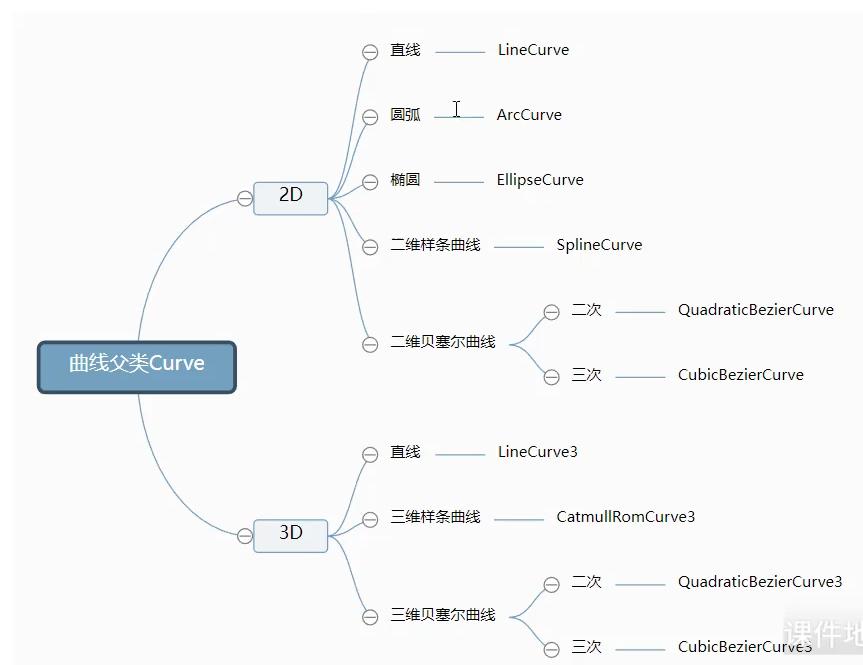
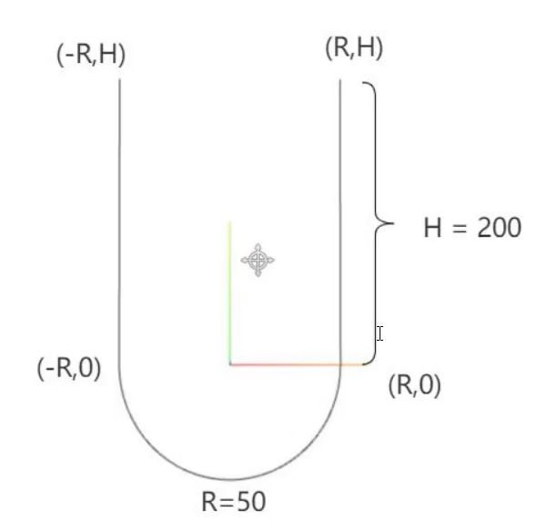
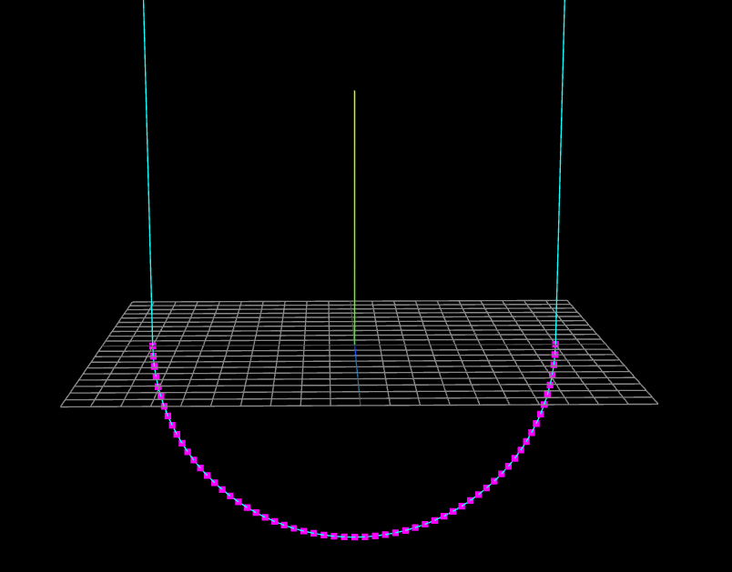
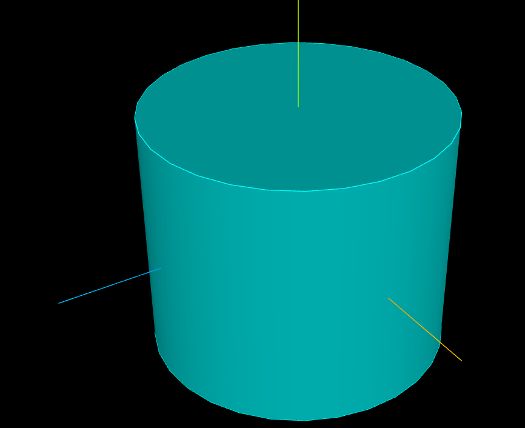

# 09 生成曲线和几何体

> 复习方式：每节先看「一句话结论」，能回忆起来就跳过；想不起来再看代码和「坑」。

本章分三条线，层层递进：

```text
一、自己用 cos/sin 算顶点        （01_生成圆弧顶点）
        ↓  把"算顶点"这件事交给 API
二、setFromPoints：点数组 → 几何体 （02_setFromPoints）
        ↓
三、曲线 Curve：公式 → 采样点       （03_curve）
四、用曲线 / 轮廓生成三维几何体      （03_curve）
五、模型边界线、六、顶点颜色         （03_curve）
```

---

# 一、生成圆弧顶点

不借助任何曲线 API，**自己用三角函数算出圆上每个点的坐标**，再交给几何体连成圆。这正是后面 `ArcCurve`、`EllipseCurve` 在内部做的事。

## 1.1 核心公式：圆上一点的坐标

**一句话结论**：圆心在原点、半径为 R 的圆上，角度为 θ 的点，坐标是 `(R·cos θ, R·sin θ)`。

```js
const x = R * Math.cos(angle)
const y = R * Math.sin(angle)
```

### 为什么是 cos 对 x、sin 对 y

从圆上的点 P 向 X 轴画垂线，得到一个直角三角形：

```text
        Y
        ↑
        |      P (x, y)
        |     /|
        |  R / |
        |   /  | 对边 = y
        |  /θ  |
 ───────O──────+────→ X
           邻边 = x
```

| 三角形的边 | 长度 |
|---|---|
| 斜边 | 半径 R |
| 邻边（底） | 点 P 的 x 坐标 |
| 对边（高） | 点 P 的 y 坐标 |

```text
cos θ = 邻边 / 斜边 = x / R   →   x = R · cos θ
sin θ = 对边 / 斜边 = y / R   →   y = R · sin θ
```

**单位圆**（R = 1）时简化成 `x = cos θ`、`y = sin θ`：`cos θ` 就是单位圆上那个点的 x 坐标，乘以 R 就是把圆放大到半径 R。

### 角度从哪里开始量

θ 从 **X 轴正方向**开始，**逆时针**增大：

```text
              Math.PI / 2 (90°)
                    ↑
                    |
 Math.PI (180°) ←───O───→ 0 (0°)
                    |
                    ↓
            Math.PI * 1.5 (270°)
```

## 1.2 弧度，不是角度

**一句话结论**：`Math.cos` / `Math.sin` 接收的是**弧度**。一整圈 = `2 * Math.PI`，半圈 = `Math.PI`。

| 角度 | 弧度 |
|---|---|
| 90° | `Math.PI / 2` |
| 180° | `Math.PI` |
| 360° | `2 * Math.PI` |

```js
const rad = deg * Math.PI / 180   // 角度 → 弧度

Math.cos(90)            // ❌ 90 被当成 90 弧度
Math.cos(Math.PI / 2)   // ✅ ≈ 0（有极小的浮点误差，如 6e-17）
```

## 1.3 生成整圆的顶点

**一句话结论**：把 `2π` 等分成 N 份，每份 `sp = 2π / N`；第 i 个点的角度是 `sp * i`，用公式算出坐标，平铺进数组。

```js
const R = 100
const N = 50
const sp = (2 * Math.PI) / N   // 相邻两个顶点之间的弧度
const arr = []

for (let i = 0; i < N; i++) {
  const angle = sp * i
  arr.push(R * Math.cos(angle), R * Math.sin(angle), 0)  // z = 0：圆在 XY 平面
}

const geometry = new THREE.BufferGeometry()
geometry.setAttribute('position', new THREE.BufferAttribute(new Float32Array(arr), 3))

const material = new THREE.LineBasicMaterial({ color: 0xff0000 })
const line = new THREE.LineLoop(geometry, material)   // 首尾自动闭合
```

**N 决定圆不圆**：GPU 不会画真正的曲线，只是把顶点用直线段连起来，看到的其实是正 N 边形。N = 5 是五边形，N = 50 看起来就是圆了。

**补充**：代码里写的 `geometry.attributes.position = ...` 效果一样，官方推荐写 `geometry.setAttribute('position', ...)`。

## 1.4 改变圆心位置

**一句话结论**：公式前面加上圆心坐标：`x = cx + R·cos θ`，`y = cy + R·sin θ`。相当于先在原点画好圆，再整体平移。

```js
const cx = 200
const cy = 200
arr.push(cx + R * Math.cos(angle), cy + R * Math.sin(angle), 0)
```

## 1.5 只生成一段圆弧

**一句话结论**：从起始角画到结束角，等分这一段的弧度，循环用 `i <= N` 把终点也算进去。

```js
const startAngle = 0
const endAngle = Math.PI
const sp = (endAngle - startAngle) / N

for (let i = 0; i <= N; i++) {     // <=，否则缺最后一个点
  const angle = startAngle + sp * i
  arr.push(R * Math.cos(angle), R * Math.sin(angle), 0)
}
const line = new THREE.Line(geometry, material)  // 圆弧不闭合
```

| | 循环 | 顶点数 | 线模型 |
|---|---|---|---|
| 整圆 | `i < N` | N | `LineLoop`：自动连回起点 |
| 圆弧 | `i <= N` | N + 1 | `Line`：不闭合 |

整圆用 `i < N`，是因为第 N 个点的角度是 `2π`，和第 0 个点重合，闭合交给 `LineLoop` 就行。

**坑**
- 整圆用了 `Line` + `i < N`：圆上会缺一个小口。
- 想让圆平躺在地面（XZ 平面）：`arr.push(x, 0, y)`。

---

# 二、几何体方法 setFromPoints()

**一句话结论**：`geometry.setFromPoints(点数组)` 把 `Vector3`（或 `Vector2`）数组里的坐标提取出来，帮你创建 `Float32Array` 和 `BufferAttribute`，赋值给 `geometry.attributes.position`。

```js
const geometry = new THREE.BufferGeometry()

const pointsArr = [
  new THREE.Vector3(0, 0, 0),
  new THREE.Vector3(0, 100, 0),
  new THREE.Vector3(0, 100, 100),
  new THREE.Vector3(0, 0, 100),
]
geometry.setFromPoints(pointsArr)

console.log(geometry.attributes.position)   // 自动生成的 BufferAttribute，itemSize 为 3

const material = new THREE.PointsMaterial({ color: 0xff0000, size: 10 })
const points = new THREE.Points(geometry, material)
```

### 它等价于手写的这段

```js
const vertices = new Float32Array([
  0, 0, 0,       // 第1个点
  0, 100, 0,     // 第2个点
  0, 100, 100,   // 第3个点
  0, 0, 100,     // 第4个点
])
geometry.setAttribute('position', new THREE.BufferAttribute(vertices, 3))
```

传入 `Vector2` 时，z 会自动补 0。所以第三部分曲线 API 返回的二维点数组，也能直接交给 `setFromPoints`。

### 两种写法的对比

| 特性 | `Vector3` + `setFromPoints()` | 直接写 `Float32Array` |
|---|---|---|
| 抽象层级 | 高 | 低，接近 WebGL |
| 可读性 | 好，一眼看出每个点 | 差，一长串数字 |
| 操作点 | 方便：`Vector3` 自带 `.add()`、`.sub()`、`.multiplyScalar()`、`.length()`、`.normalize()`、`.dot()`、`.cross()` 等方法 | 繁琐：要手动找 `vertices[i*3]`、`[i*3+1]`、`[i*3+2]` |
| 性能 | 每个点都 new 一个对象，有少量开销，通常可忽略 | 最优，没有中间对象 |
| 适用 | 绝大多数场景 | 几十万上百万点的点云这类极端场景 |

一句话：`Vector3` 是"便利工具"，`Float32Array` 是"原始材料"。日常开发用前者，遇到明显的性能瓶颈再换后者。

---

# 三、曲线 Curve

## 3.1 曲线家族



所有曲线都继承自父类 `Curve`，分二维和三维两组：

| | 二维（`Vector2`） | 三维（`Vector3`） |
|---|---|---|
| 直线 | `LineCurve` | `LineCurve3` |
| 圆弧 | `ArcCurve` | — |
| 椭圆 | `EllipseCurve` | — |
| 样条曲线 | `SplineCurve` | `CatmullRomCurve3` |
| 二次贝塞尔 | `QuadraticBezierCurve` | `QuadraticBezierCurve3` |
| 三次贝塞尔 | `CubicBezierCurve` | `CubicBezierCurve3` |

**命名规律**：三维版本的名字末尾带 `3`。

所有曲线的用法都是同一个套路：

```js
const curve = new THREE.某某Curve(...)       // 1. 定义曲线（数学公式）
const pointsArr = curve.getPoints(50)        // 2. 采样出点
geometry.setFromPoints(pointsArr)            // 3. 点 → 几何体
const line = new THREE.Line(geometry, material)  // 4. 渲染
```

---

## 3.2 为什么一定要 getPoints()：曲线是公式

**一句话结论**：Curve 对象只是一个**数学函数**，给它一个参数 t（0~1），它能算出曲线上对应的点；但 WebGL 只认顶点数组。`getPoints()` 就是从数学到图形的桥梁。

```js
// Curve 内部类似于：
class SomeCurve {
  getPoint(t) {        // t: 0 ~ 1
    return /* 用公式算出 t 位置的坐标 */
  }

  getPoints(divisions) {
    const points = []
    for (let i = 0; i <= divisions; i++) {
      points.push(this.getPoint(i / divisions))   // t = 0, 0.02, 0.04 ... 1
    }
    return points      // divisions + 1 个点
  }
}
```

```text
控制点 → Curve 对象 → getPoints() → 采样点 → 几何体 → 渲染
  ↑          ↑              ↑           ↑          ↑        ↑
 定义    数学函数        离散化      顶点数据    GPU数据   显示
```

| | 数学曲线（Curve） | 渲染曲线（Line） |
|---|---|---|
| 本质 | 公式，无限平滑 | 直线段连成的折线 |
| 能否直接渲染 | 不能 | 能 |
| 取点 | 任意 t：`curve.getPoint(0.5)` | 顶点数量固定 |

**记忆口诀**："曲线是公式，渲染需要点，getPoints 来采样，数量定平滑。"

**注意**：`getPoints(n)` 返回的是 **n + 1** 个点（n 段）。

---

## 3.3 椭圆 EllipseCurve

**一句话结论**：`new THREE.EllipseCurve(aX, aY, xRadius, yRadius, aStartAngle, aEndAngle, aClockwise)`，xRadius 和 yRadius 不相等就是椭圆。

```js
const arc = new THREE.EllipseCurve(0, 0, 120, 50)   // 中心 (0,0)，x 半径 120，y 半径 50

// const pointsArr = arc.getPoints(50)
const pointsArr = arc.getSpacedPoints(50)
console.log('曲线上获取的坐标', pointsArr)

const geometry = new THREE.BufferGeometry()
geometry.setFromPoints(pointsArr)

const material = new THREE.PointsMaterial({ color: 0xff0000, size: 10 })
const points = new THREE.Points(geometry, material)
```


| 参数 | 含义 | 默认值 |
|---|---|---|
| `aX, aY` | 椭圆中心坐标 | 0, 0 |
| `xRadius` | x 轴方向半径 | 1 |
| `yRadius` | y 轴方向半径 | 1 |
| `aStartAngle` | 开始角度，从 x 轴正半轴算起，弧度 | 0 |
| `aEndAngle` | 结束角度，从 x 轴正半轴算起，弧度 | `2 * Math.PI` |
| `aClockwise` | 是否顺时针绘制 | `false` |

### getPoints() 和 getSpacedPoints() 的区别

**一句话结论**：`getPoints` 按参数 t 等分，`getSpacedPoints` 按**弧长**等分。

| 方法 | 怎么分 | 椭圆上的效果 |
|---|---|---|
| `getPoints(n)` | 参数 t 均匀变化 | t 均匀不代表走过的路程均匀：长轴两端（弯得厉害）点密，短轴两端点疏 |
| `getSpacedPoints(n)` | 先算总长度，再按长度等分 | 点在曲线上的间距大致相等，分布均匀 |

想要视觉上等间距的点（虚线、沿曲线均匀摆放物体），用 `getSpacedPoints()`。

**坑**：`01_curve.js` 的注释把 `getPoints` 写成了"获取椭圆曲线上的随机点"。它不是随机的，只是按参数 t 等分、在弧长上不均匀。

---

## 3.4 圆弧 ArcCurve

**一句话结论**：`ArcCurve` 是 xRadius = yRadius 的椭圆，参数少了一个半径：`new THREE.ArcCurve(aX, aY, aRadius, aStartAngle, aEndAngle, aClockwise)`。它就是第一部分手写循环的封装版。

```js
new THREE.ArcCurve(
  aX,           // 圆心 X
  aY,           // 圆心 Y
  aRadius,      // 半径
  aStartAngle,  // 起始角度（弧度）
  aEndAngle,    // 结束角度（弧度）
  aClockwise    // 是否顺时针，默认 false（逆时针）
)
```

角度参考（和第一部分一致）：

```text
         Math.PI/2 (90°)
              ↑
Math.PI ←─────┼─────→ 0 (0°)
(180°)        ↓
         3*Math.PI/2 (270°)
```

### 顺时针参数决定"走哪半边"

起点终点相同，方向不同，画出来的弧完全不同：

```js
// 逆时针（默认）：0° → 180°，从右侧经过【上方】到左侧
new THREE.ArcCurve(0, 0, 50, 0, Math.PI, false)

// 顺时针：0° → 180°，从右侧经过【下方】到左侧
new THREE.ArcCurve(0, 0, 50, 0, Math.PI, true)
```

### 常见用法

```js
new THREE.ArcCurve(0, 0, 50, 0, Math.PI * 2)       // 完整的圆
new THREE.ArcCurve(0, 0, 50, 0, Math.PI)           // 上半圆
new THREE.ArcCurve(0, 0, 50, Math.PI / 2, Math.PI) // 90° → 180° 的四分之一圆
new THREE.ArcCurve(100, 50, 30, 0, Math.PI * 2)    // 圆心在 (100, 50)
```

### 完整示例

```js
const arc = new THREE.ArcCurve(0, 0, 50, 0, Math.PI * 2, false)
const pointsArr = arc.getPoints(50)
console.log('采样点数量：', pointsArr.length)  // 51

const geometry = new THREE.BufferGeometry()
geometry.setFromPoints(pointsArr)

const material = new THREE.LineBasicMaterial({
  color: 0xff0000,
  // linewidth 在大多数平台无效，线宽恒为 1 像素
})
const line = new THREE.LineLoop(geometry, material)
```

### 用离散的线段近似连续的曲线

这是图形学的核心概念：GPU 擅长画点、直线和三角形，画不了真正光滑的曲线。所以 Three.js 先**采样**（`getPoints(n)` 取出 n + 1 个精确位于圆弧上的点），再**连接**（`Line` / `LineLoop` 用直线段把它们连起来）。屏幕上看到的其实是正多边形：

| 采样 | 整圆的效果 |
|---|---|
| `getPoints(5)` | 6 个点，但首尾重合 → **正五边形**，棱角明显 |
| `getPoints(50)` | 51 个点，首尾重合 → **正五十边形**，看起来已经很圆 |

整圆的首尾两个点重合（0° 和 360° 是同一个位置），所以 n 段就是正 n 边形。

---

## 3.5 三维样条曲线 CatmullRomCurve3

**一句话结论**：给一组 `Vector3` 点，`CatmullRomCurve3` 生成一条**平滑穿过所有这些点**的三维曲线，适合做自然流畅的路径。

```js
const arr = [
  new THREE.Vector3(-50, 20, 90),
  new THREE.Vector3(-10, 40, 40),
  new THREE.Vector3(0, 0, 0),
  new THREE.Vector3(60, -60, 0),
  new THREE.Vector3(70, 0, 80),
]

const curve = new THREE.CatmullRomCurve3(arr)
const pointsArr = curve.getPoints(50)

// 红色曲线
const geometry = new THREE.BufferGeometry()
geometry.setFromPoints(pointsArr)
const line = new THREE.Line(geometry, new THREE.LineBasicMaterial({ color: 0xff0000 }))

// 紫色点：标出曲线经过的 5 个关键点
const geometry2 = new THREE.BufferGeometry()
geometry2.setFromPoints(arr)
const points = new THREE.Points(geometry2, new THREE.PointsMaterial({ color: 0xff00ff, size: 5 }))

const group = new THREE.Group()
group.add(line, points)
```

### 完整语法

```js
new THREE.CatmullRomCurve3(
  points,     // Vector3 数组
  closed,     // 是否闭合，默认 false
  curveType,  // 曲线类型，默认 'centripetal'
  tension     // 张力，默认 0.5（curveType 为 'catmullrom' 时生效）
)
```

### 已经有 5 个点了，为什么还要 getPoints 采样？

**控制点 ≠ 渲染用的点**。直接把 5 个点连起来，得到的是有明显转折的 5 段折线；`getPoints(50)` 在这 5 个点定义的平滑曲线上算出 51 个点，相邻点非常近，连起来才看着光滑。

**类比**：控制点像地图上标的几个必经城市，采样点像 GPS 规划出的详细路线。只按城市连直线会"穿山越岭"，按 GPS 路线走才是一条平滑的路。

| | 控制点（5 个） | 采样点（51 个） |
|---|---|---|
| 作用 | 定义曲线的形状、走向 | 渲染曲线 |
| 数量 | 少 | 多 |

**注意**：曲线一定**经过**每个控制点，但 51 个采样点**不一定恰好落在**控制点上。5 个控制点分别对应 t = 0、0.25、0.5、0.75、1，而 `getPoints(50)` 取的 t 是 0、0.02、0.04 ……，0.25 和 0.75 就取不到。想让采样点精确落在控制点上，divisions 要是"控制点数 − 1"的倍数，比如 4、8、48。

### 采样数的影响

```js
curve.getPoints(10)    // 11 个点：有棱角
curve.getPoints(50)    // 51 个点：比较平滑
curve.getPoints(200)   // 201 个点：非常平滑，但顶点更多
```

### Line 和 Points 的区别

| 特性 | `Line` | `Points` |
|---|---|---|
| 作用 | 把顶点按顺序连成线段 | 每个顶点单独显示成一个点 |
| 材质 | `LineBasicMaterial` | `PointsMaterial` |
| 连接性 | 顶点依次相连 | 互不相连 |

**坑**：`12_顶点颜色渐变.js` 的注释写着"CatmullRomCurve3 是一个三次贝塞尔曲线"，这是错的。它是 Catmull-Rom 样条曲线，最大的区别是：样条曲线**经过**所有点，贝塞尔曲线**不经过**中间的控制点（见 3.6）。

---

## 3.6 贝塞尔曲线

**一句话结论**：贝塞尔曲线**只经过起点和终点**，中间的控制点像磁铁一样把曲线"拉"向自己，但曲线不会穿过它们。

```js
// 二维二次贝塞尔：p1 起点，p2 控制点，p3 终点
// const p1 = new THREE.Vector2(-80, 0)
// const p2 = new THREE.Vector2(20, 100)
// const p3 = new THREE.Vector2(80, 0)

// 三维二次贝塞尔
// const p1 = new THREE.Vector3(-80, 0, 0)
// const p2 = new THREE.Vector3(20, 100, 0)
// const p3 = new THREE.Vector3(80, 0, 100)

// 二维三次贝塞尔：p1 起点，p2、p3 控制点，p4 终点
const p1 = new THREE.Vector2(-80, 0)
const p2 = new THREE.Vector2(-40, 50)
const p3 = new THREE.Vector2(50, 50)
const p4 = new THREE.Vector2(80, 0)
const arr = [p1, p2, p3, p4]
const curve = new THREE.CubicBezierCurve(p1, p2, p3, p4)
const pointsArr = curve.getPoints(100)

// 贝塞尔曲线
const geometry = new THREE.BufferGeometry()
geometry.setFromPoints(pointsArr)
const line = new THREE.Line(geometry, new THREE.LineBasicMaterial({ color: 0xff00ff }))

// 控制点
const geometry2 = new THREE.BufferGeometry()
geometry2.setFromPoints(arr)
const points = new THREE.Points(geometry2, new THREE.PointsMaterial({ color: 0x00ffff, size: 10 }))

// 控制点连线（"控制笼"）
const geometry3 = new THREE.BufferGeometry()
geometry3.setFromPoints(arr)
const controlLine = new THREE.Line(geometry3, new THREE.LineBasicMaterial({ color: 0x888888 }))

const group = new THREE.Group()
group.add(line, points, controlLine)
```

### 控制点的作用

以三次贝塞尔为例：

- **起止点**：p1 是起点，p4 是终点，曲线一定经过。
- **起点切线**：p1 → p2 的方向，就是曲线在起点处的切线方向。p2 离 p1 越远，开头"冲出去"的势头越猛。
- **终点切线**：p3 → p4 的方向，就是曲线在终点处的切线方向。p3 离 p4 越远，结尾的弯曲幅度越大。
- p2 主要影响**前半段**，p3 主要影响**后半段**。

四个点连成的"控制笼"（代码里的灰线）完整决定了曲线形态，移动任何一个点，整条曲线都会变。正因为曲线不穿过中间的控制点，才能通过拖动它们调出各种平滑的形状，这也是 PS、AI 里钢笔工具的原理。

### 二维 / 三维、二次 / 三次的区别

.assets/image-20251012171735892.png)

.assets/image-20251012172309093.png)

```js
const p1 = new THREE.Vector3(-80, 0, 0)    // 起点
const p2 = new THREE.Vector3(20, 100, 0)   // 控制点
const p3 = new THREE.Vector3(80, 0, 100)   // 终点

const curve = new THREE.QuadraticBezierCurve3(p1, p2, p3)
```

.assets/image-20251012172340726.png)

.assets/image-20251012172355174.png)

```js
const p1 = new THREE.Vector2(-80, 0)     // 起点
const p2 = new THREE.Vector2(-40, 50)    // 控制点1
const p3 = new THREE.Vector2(50, 50)     // 控制点2
const p4 = new THREE.Vector2(80, 0)      // 终点

const curve = new THREE.CubicBezierCurve(p1, p2, p3, p4)
```

| 维度 | 点的类型 | 曲线 |
|---|---|---|
| 二维 | `Vector2(x, y)` | 平面图形 |
| 三维 | `Vector3(x, y, z)` | 可以在空间中任意穿梭 |

| 阶数 | 点数 | 特点 |
|---|---|---|
| 二次 Quadratic | 3 个：起点、1 个控制点、终点 | 只有一个弯，适合简单弧线 |
| 三次 Cubic | 4 个：起点、2 个控制点、终点 | 两个"手柄"分别控制两端，能做 S 形 |

---

## 3.7 应用：模拟轨迹的飞线

**一句话结论**：起点、终点放在地面上，控制点放在两者**中点的正上方**，二次贝塞尔曲线就成了一条抛物线状的飞线。

```js
const p1 = new THREE.Vector3(-100, 0, -100)   // 起点
const p3 = new THREE.Vector3(100, 0, 100)     // 终点

// 控制点：p1、p3 的中点，再抬高 h
const x2 = (p1.x + p3.x) / 2
const z2 = (p1.z + p3.z) / 2
const h = 120
const p2 = new THREE.Vector3(x2, h, z2)

const curve = new THREE.QuadraticBezierCurve3(p1, p2, p3)
const pointsArr = curve.getPoints(100)
```

**坑**：飞线的最高点**不是 h，而是 h / 2**。二次贝塞尔在 t = 0.5 处的位置是 `(p1 + 2·p2 + p3) / 4`，起点终点高度为 0 时，最高点 y = `2h / 4 = h / 2`。想让最高点等于 H，控制点要设成 `2H`。

---

## 3.8 组合曲线 CurvePath

**一句话结论**：`CurvePath` 把多段曲线拼成一条，前提是**首尾相接**：前一段的终点，必须是后一段的起点。

### 核心思想：像铺火车轨道

`CurvePath` 是空的轨道蓝图，每段曲线是一节轨道零件。要拼成一条能顺畅跑完的轨道，必须：

1. 确定起点，铺下第一节；
2. 第二节的开头对准第一节的结尾；
3. 第三节的开头对准第二节的结尾，依此类推。

否则火车要么脱轨，要么瞬间"跳"到下一节的开头。

### 两个顺序都不能乱

| | 含义 |
|---|---|
| **坐标顺序** | 每一段曲线内部，起点、终点的方向要和行进方向一致 |
| **组合顺序** | 添加进 `CurvePath` 的顺序，就是路径行进的顺序 |

坐标顺序的例子：从 A(-10, 0) 走到 B(10, 0)：

```js
new THREE.LineCurve(new THREE.Vector2(-10, 0), new THREE.Vector2(10, 0))  // ✅ A → B
new THREE.LineCurve(new THREE.Vector2(10, 0), new THREE.Vector2(-10, 0))  // ❌ B → A，方向反了
```

### 例子：拼出一个 U 形



```js
const R = 80   // 圆弧半径
const H = 200  // 直线高度

// 第一段：右侧直线，从 (R, H) 向下走到 (R, 0)
const line1 = new THREE.LineCurve(
  new THREE.Vector2(R, H),
  new THREE.Vector2(R, 0)
)

// 第二段：下半圆，从 (R, 0) 顺时针走到 (-R, 0)
const arc = new THREE.ArcCurve(0, 0, R, 0, Math.PI, true)

// 第三段：左侧直线，从 (-R, 0) 向上走到 (-R, H)
const line2 = new THREE.LineCurve(
  new THREE.Vector2(-R, 0),
  new THREE.Vector2(-R, H)
)

const curvePath = new THREE.CurvePath()
curvePath.curves.push(line1, arc, line2)   // 注意顺序

const pointsArr = curvePath.getPoints(30)
const geometry = new THREE.BufferGeometry()
geometry.setFromPoints(pointsArr)

const line = new THREE.Line(geometry, new THREE.LineBasicMaterial({ color: 0x00ffff }))
const points = new THREE.Points(geometry, new THREE.PointsMaterial({ color: 0xff00ff, size: 10 }))
```

逐段检查首尾：

```text
line1：(R, H) ──→ (R, 0)
arc  ：         (R, 0) ──→ (-R, 0)      ✅ 接上了
line2：                   (-R, 0) ──→ (-R, H)   ✅ 接上了
```

### 重点看 arc 的方向

```js
new THREE.ArcCurve(0, 0, R, 0, Math.PI, true)
```

- 起始角 0 → 点 (R, 0)，3 点钟方向；结束角 π → 点 (-R, 0)，9 点钟方向。
- 第六个参数 `true` = **顺时针**。从 3 点钟顺时针转到 9 点钟，经过的是 6 点钟方向，也就是**下半圆**，经过 (0, -R)。
- 如果改成 `false`（逆时针，默认），终点不变，但会经过 12 点钟画出**上半圆**，U 形就变成了一个倒过来的形状。

```text
                       Y
                       ↑
<--(-R,0)------------(0,0)------------(R,0)--> X   ← arc 起点 (R,0)，终点 (-R,0)
     .                 |                 .
       .               |               .
          .         (0,-R)          .      ← 顺时针：经过下方
             . . . . . . . . . . .
```

### 采样点的分布



`CurvePath.getPoints()` 对**直线段只取首尾两个点**（直线不需要中间点），对圆弧这类曲线则多采样，保证弧线圆滑。如果想让直线上也均匀分布点，用 `getSpacedPoints()`，不过一般没必要。

**坑**
- `02_组合曲线.js` 里的颜色写成了 `0x00fffff`（7 位十六进制），实际是 `0x0fffff`，不是青色。应该是 `0x00ffff`。
- 添加曲线有两种写法，效果一样：`curvePath.curves.push(a, b, c)` 或 `curvePath.add(a)`。

---

## 3.9 多段二次贝塞尔组合：让曲线经过指定点

**一句话结论**：单条贝塞尔曲线只经过首尾两点。想让曲线**精确经过**中间的几个关键点，就把路径拆成多段二次贝塞尔，用关键点做每段的首尾，再用 `CurvePath` 拼起来。

### 单条贝塞尔曲线的限制

1. 只能精确经过 2 个点：起点和终点；
2. 中间的控制点只"影响"形状，曲线不经过它们；
3. 阶数越高（点越多），曲线越"飘"，越难控制。Three.js 本身也只提供二次和三次贝塞尔。

需求：曲线要经过这 5 个点中的关键点：

```js
const arr = [
  new THREE.Vector3(50, 0, 0),    // 起点 ✓
  new THREE.Vector3(10, 0, 0),    // 要经过
  new THREE.Vector3(0, 0, 0),     // 转角处的控制点
  new THREE.Vector3(0, 0, 10),    // 要经过
  new THREE.Vector3(0, 0, 50),    // 终点 ✓
]
```

用一条五点贝塞尔曲线，只能保证经过首尾，(10,0,0) 和 (0,0,10) 不会被精确经过。

### 解法：拆成三段

```js
const curvePath = new THREE.CurvePath()

// 第一段：(50,0,0) → (10,0,0)
const segment1 = new THREE.QuadraticBezierCurve3(
  arr[0],
  new THREE.Vector3(30, 0, 0),  // 中间控制点
  arr[1]
)

// 第二段：(10,0,0) → (0,0,10)，用转角 (0,0,0) 做控制点，拐出圆角
const segment2 = new THREE.QuadraticBezierCurve3(arr[1], arr[2], arr[3])

// 第三段：(0,0,10) → (0,0,50)
const segment3 = new THREE.QuadraticBezierCurve3(
  arr[3],
  new THREE.Vector3(0, 0, 30),
  arr[4]
)

curvePath.add(segment1)
curvePath.add(segment2)
curvePath.add(segment3)

const pointsArr = curvePath.getPoints(60)   // 一行代码从整条路径取点
```

每段的首尾都是关键点，所以整条曲线会精确经过 (50,0,0)、(10,0,0)、(0,0,10)、(0,0,50)，并在 (0,0,0) 附近拐出一个圆角。

### 接缝处为什么是平滑的

接缝点**两侧的控制点和它在同一条直线上**，接缝就不会出现折角：

```text
接缝 (10,0,0)：前一段控制点 (30,0,0) —— 接缝 (10,0,0) —— 后一段控制点 (0,0,0)   都在 x 轴上 ✅
接缝 (0,0,10)：前一段控制点 (0,0,0)  —— 接缝 (0,0,10) —— 后一段控制点 (0,0,30)  都在 z 轴上 ✅
```

这是拼接贝塞尔曲线的通用规则：前一段末尾的切线方向，要和后一段开头的切线方向一致。

**坑**：`03_二次贝塞尔组合.js` 里定义了 `controlLineMaterial`，但没有用到；`linewidth: 2` 在大多数平台上也无效。

---

# 四、用曲线和轮廓生成几何体

前面得到的都是**线**，这一部分把线变成**面和体**。共同思路：一个二维的"形状"，加一种"运动方式"。

| 几何体 | 输入 | 运动方式 |
|---|---|---|
| `TubeGeometry` | 一条三维路径 | 圆形截面沿路径扫过 |
| `LatheGeometry` | 一条二维轮廓线 | 绕 Y 轴旋转 |
| `ShapeGeometry` | 一个二维封闭轮廓 | 不运动，直接填充成平面 |
| `ExtrudeGeometry` | 一个二维封闭轮廓 | 沿 Z 轴直线拉伸，或沿路径扫描 |

---

## 4.1 管道 TubeGeometry

**一句话结论**：一个**圆形截面**沿着一条三维路径移动，把移动轨迹"缝"起来，就成了管道。这种技术叫扫描 / 放样（Sweep / Lofting）。

```js
const path = new THREE.CatmullRomCurve3([
  new THREE.Vector3(-50, 20, 90),
  new THREE.Vector3(-10, 40, 40),
  new THREE.Vector3(0, 0, 0),
  new THREE.Vector3(60, -60, 0),
  new THREE.Vector3(70, 0, 80),
])

const geometry = new THREE.TubeGeometry(
  path,  // 路径：管道的"骨架"、中心线
  100,   // tubularSegments：沿路径的分段数
  5,     // radius：管道半径
  20,    // radialSegments：截面圆的分段数
  false  // closed：路径是否闭合
)
const material = new THREE.MeshLambertMaterial({ color: 0x00ffff, side: THREE.DoubleSide })
const mesh = new THREE.Mesh(geometry, material)
```

### 生成过程

- **路径（Path）**：三维空间中的一条曲线，比如 `CatmullRomCurve3`、`CubicBezierCurve3`。
- **轮廓（Profile）**：对 `TubeGeometry` 来说，截面永远是圆形。
- **生成**：沿路径在许多个点上各放一个与路径垂直的圆，再像"缝衣服"一样，把相邻两个圆的对应顶点用三角形连起来，缝成一个中空的管道。

### 两个分段参数

| 参数 | 控制 | 值越低 | 值越高 |
|---|---|---|---|
| `tubularSegments` | **纵向**：沿路径的平滑度，相当于 `getPoints(n)` 的 n | 弯曲处有明显棱角，像几段直管硬接起来 | 弯曲处平滑 |
| `radialSegments` | **横向**：截面圆的圆滑度 | 3 是三棱柱，4 是四棱柱 | 越接近圆，8 ~ 12 通常够用 |

两个值越高，三角形越多，模型越精细，性能消耗也越大。要根据模型重要程度和相机远近来权衡。

**坑**：路径必须是**三维曲线**（`Vector3` 定义的）。二维曲线不能直接用作 `TubeGeometry` 的路径。

---

## 4.2 旋转成型 LatheGeometry

**一句话结论**：给一条二维轮廓线，`LatheGeometry` 把它**绕 Y 轴旋转**一圈，生成一个旋转体（花瓶、沙漏、碗）。

```js
const pointsArr = [
  new THREE.Vector2(50, 60),
  new THREE.Vector2(25, 0),
  new THREE.Vector2(50, -60),
]

// 先用二维样条曲线把 3 个点连成平滑的轮廓
const curve = new THREE.SplineCurve(pointsArr)
const arr = curve.getPoints(100)

// 参数：轮廓点数组, 周长分段数, 起始角, 旋转角度
const geometry = new THREE.LatheGeometry(arr, 30)
// const geometry = new THREE.LatheGeometry(pointsArr, 30, 0, Math.PI)  // 只转半圈

const material = new THREE.MeshLambertMaterial({ color: 0x00ffff, side: THREE.DoubleSide })
const mesh = new THREE.Mesh(geometry, material)
```

### 轮廓点的 x、y 是什么意思

| 坐标 | 含义 |
|---|---|
| `y` | 在旋转轴（Y 轴）上的**高度** |
| `x` | 在这个高度上的**半径** |

所以 `LatheGeometry` **没有单独的半径参数**，半径完全由轮廓点的 x 决定。改 x 就能改模型的胖瘦。上面的轮廓是中间 x 小（25）、两头 x 大（50），转出来就是沙漏形。

### 完整参数

```js
new THREE.LatheGeometry(
  points,     // Vector2 数组：轮廓线
  segments,   // 周长分段数，默认 12：横截面用几边形近似圆
  phiStart,   // 起始角度（弧度），默认 0
  phiLength   // 旋转的总角度（弧度），默认 2π
)
```

- `phiLength = Math.PI`：只转 180°，得到一个半开的模型；`Math.PI * 2` 是完整闭合的模型。
- 旋转方向：Three.js 是右手坐标系，右手大拇指指向 Y 轴正方向，四指弯曲的方向就是旋转方向。从 Y 轴上方往下看是逆时针。
- `phiStart = 0` 对应的是 **Z 轴正方向**（不是 X 轴），从 Z 轴开始向 X 轴转。

### 为什么要 DoubleSide

半开的模型能看到内外两面，默认只渲染正面（`FrontSide`），内侧会看不见。设成 `side: THREE.DoubleSide` 两面都渲染。完整闭合的模型一般只需要渲染外表面。

**坑**
- 旧代码注释写的"参数：点数组，半径，分段数，角度"是错的，第二个参数是**周长分段数**，不是半径。
- 轮廓点的 x 应该 ≥ 0。x 为负数时，半径变成负的，生成的面会翻到轴的另一侧，结果很怪。

---

## 4.3 轮廓填充 ShapeGeometry

**一句话结论**：用一组 `Vector2` 点创建 `Shape`（二维封闭轮廓），交给 `ShapeGeometry`，它会把轮廓内部**填充成一个平面**。

```js
const pointsArr = [
  new THREE.Vector2(-50, -50),
  new THREE.Vector2(-60, 0),
  new THREE.Vector2(0, 50),
  new THREE.Vector2(60, 0),
  new THREE.Vector2(50, -50),
]

const shape = new THREE.Shape(pointsArr)        // 点数组 → 二维轮廓
const geometry = new THREE.ShapeGeometry(shape) // 轮廓 → 填充平面

const material = new THREE.MeshLambertMaterial({
  color: 0x00ffff,
  side: THREE.DoubleSide,
  wireframe: true,   // 线框模式：能看到内部被分成了三角形
})
const mesh = new THREE.Mesh(geometry, material)
```

开 `wireframe` 能看到，填充的本质是把多边形**分割成三角形**（三角剖分，见 4.6）。

### 和 LatheGeometry 的区别

同一组点，用法完全不同：

| | 点的含义 | 结果 |
|---|---|---|
| `LatheGeometry(points)` | 一条轮廓**线**，x 是半径、y 是高度 | 三维旋转体 |
| `ShapeGeometry(new Shape(points))` | 一个封闭**区域**的边界 | 二维平面 |

---

## 4.4 拉伸 ExtrudeGeometry

**一句话结论**：`ExtrudeGeometry` 把二维轮廓沿 **Z 轴**拉伸成一个有厚度的实体，还可以给边缘加倒角。

```js
const shape = new THREE.Shape([
  new THREE.Vector2(-50, -50),
  new THREE.Vector2(-50, 50),
  new THREE.Vector2(50, 50),
  new THREE.Vector2(50, -50),
])

const geometry = new THREE.ExtrudeGeometry(shape, {
  depth: 120,            // 拉伸的深度（Z 方向）
  bevelEnabled: true,    // 是否启用倒角
  bevelThickness: 6,     // 倒角在拉伸方向（垂直）上的尺寸
  bevelSize: 16,         // 倒角在轮廓平面（水平）上向外扩出的尺寸
  bevelSegments: 10,     // 倒角的分段数，越大越圆润
})
const material = new THREE.MeshLambertMaterial({ color: 0x00ffff, side: THREE.DoubleSide })
const mesh = new THREE.Mesh(geometry, material)
```

```text
侧面剖视：
        ┌─ bevelSize（向外扩）
       ╭─────────────╮  ← 倒角：bevelThickness 高
       │             │
       │   depth     │  ← 拉伸主体
       │             │
       ╰─────────────╯  ← 倒角
```

**坑**
- `bevelEnabled` **默认就是 true**。不想要倒角时要显式写 `bevelEnabled: false`，否则模型边缘会多出一圈。
- 倒角是**往外加**的：总厚度 = `depth + 2 × bevelThickness`，轮廓也会比原来大一圈 `bevelSize`。

---

## 4.5 扫描 ExtrudeGeometry + extrudePath

**一句话结论**：给 `ExtrudeGeometry` 传入 `extrudePath`，它就不再沿 Z 轴直线拉伸，而是让二维轮廓**沿着一条三维曲线**扫过去。和 `TubeGeometry` 的区别是：截面形状可以任意定义，不只是圆。

```js
// 截面：10×10 的正方形
const shape = new THREE.Shape([
  new THREE.Vector2(0, 0),
  new THREE.Vector2(0, 10),
  new THREE.Vector2(10, 10),
  new THREE.Vector2(10, 0),
])

// 路径：三维样条曲线
const curve = new THREE.CatmullRomCurve3([
  new THREE.Vector3(-10, -50, -50),
  new THREE.Vector3(10, 0, 0),
  new THREE.Vector3(8, 50, 50),
  new THREE.Vector3(-5, 0, 100),
])

const geometry = new THREE.ExtrudeGeometry(shape, {
  extrudePath: curve,  // 沿这条曲线扫描
  steps: 100,          // 沿路径的分段数
})
const material = new THREE.MeshLambertMaterial({ color: 0x00ffff, side: THREE.DoubleSide })
const mesh = new THREE.Mesh(geometry, material)
```

### 印章类比

`Shape` 是一枚特定形状的印章，`curve` 是预先画好的路线。手臂沿路线移动、连续不断地盖章，留下的痕迹就是三维模型。

| | 回答的问题 |
|---|---|
| `shape` | "我是谁"：截面长什么样。换成圆形就是圆管，换成星形就是星形管 |
| `curve` | "我去哪"：截面沿什么轨迹移动。`CatmullRomCurve3` 一定穿过所有点，做路径很直观 |

缺一不可：没有 shape 不知道拉伸什么，没有 curve 不知道往哪拉。

### 参数

- **`extrudePath`**：沿曲线计算一系列**标架（Frames）**，可以理解成跟着曲线方向变化的微型局部坐标系。每个标架处放一个 shape 副本，并按标架朝向旋转，保证截面始终**垂直于曲线的前进方向**。
- **`steps`**：沿路径的分段数。曲线长度会被**等分**成 100 段，得到 101 个位置，各放一个截面。steps 很低（比如 2）就是两段长方体生硬拼接；很高就平滑，但顶点和面更多。

### 生成过程

1. **准备**：拿到二维正方形 `shape` 和三维曲线 `curve`；
2. **路径采样**：按 `steps: 100` 在曲线上等距取 101 个点；
3. **放置截面**：在每个点上算出位置和朝向，把 shape 的顶点变换过去，相当于每个点都盖了一个朝向正确的正方形；
4. **蒙皮**：第 i 个正方形的顶点和第 i + 1 个的对应顶点两两相连，组成四边形面片，重复 100 次；
5. **封口**：默认在两端用 shape 各补一个面，成为封闭实体。

**坑**
- 用了 `extrudePath` 后，`depth` 不再起作用，长度由路径决定，精细度由 `steps` 决定。
- **沿路径扫描时不支持倒角**，`bevel` 相关参数都会被忽略。

---

## 4.6 Shape 轮廓：用画笔绘制

**一句话结论**：`Shape` 除了传点数组，还可以像**画笔**一样一步步绘制：`moveTo` 抬笔移动，`lineTo` 落笔画线，一切围绕笔尖位置 `currentPoint` 进行。

```js
const shape = new THREE.Shape()
console.log('currentPoint', shape.currentPoint)  // Vector2(0, 0)：笔尖初始在原点

shape.moveTo(10, 0)      // 抬笔，移到 (10, 0)，作为起点
shape.lineTo(100, 0)     // 落笔，画到 (100, 0)
shape.lineTo(100, 100)
shape.lineTo(10, 100)
// 不手动闭合也可以，ShapeGeometry 会自动闭合
// shape.closePath()

const geometry = new THREE.ShapeGeometry(shape)
// 也可以拉伸成三维：
// const geometry = new THREE.ExtrudeGeometry(shape, {
//   depth: 300, bevelEnabled: true, bevelThickness: 10, bevelSize: 10, bevelSegments: 10,
// })

const material = new THREE.MeshLambertMaterial({ color: 0x00ffff })
const mesh = new THREE.Mesh(geometry, material)
```

.assets/image-20250626233759956.png)

### currentPoint：笔尖当前位置

| 指令 | 动作 | 是否画线 | currentPoint 变化 |
|---|---|---|---|
| `new Shape()` | 拿到一张白纸 | — | 停在 (0, 0) |
| `moveTo(10, 0)` | 抬笔移动 | ❌ | → (10, 0) |
| `lineTo(100, 0)` | 从笔尖画直线到目标点 | ✅ | → (100, 0) |
| `lineTo(100, 100)` | 同上 | ✅ | → (100, 100) |
| `lineTo(10, 100)` | 同上 | ✅ | → (10, 100) |

每条指令都**从当前笔尖开始**，画完后笔尖自动移到终点，为下一条指令做准备。到这里，画出的是一个三条边、没封口的矩形路径。

### 闭合

- **自动闭合**：把没闭合的 Shape 交给 `ShapeGeometry`，它会自动把最后一个点连回起点再填充。这段代码里会自动补一条从 **(10, 100) 到 (10, 0)** 的边。
- **手动闭合**：
  - `shape.lineTo(10, 0)`：手动画最后一条边。旧注释里写的 `lineTo(0, 0)` 是错的，起点是 (10, 0)，不是原点。
  - `shape.closePath()`：从笔尖画直线回到起点，**更推荐**，语义也更清楚。

### ShapeGeometry 做了什么：三角剖分

GPU 最擅长渲染的是三角形。`ShapeGeometry` 会把（可能不规则的）多边形轮廓，自动分割成若干个三角形面片，这个过程叫**三角剖分（Triangulation）**，得到一个可渲染的平面几何体。

---

## 4.7 Shape 结合圆弧：arc 与 absarc

**一句话结论**：`shape.arc()` 的圆心坐标是**相对于 currentPoint** 的偏移；`shape.absarc()` 的圆心坐标是**绝对坐标**（相对于原点）。其余参数一样。

```js
const shape = new THREE.Shape()
shape.lineTo(150, 0)                    // 笔尖从 (0,0) 画到 (150,0)

shape.arc(-50, 0, 50, 0, Math.PI / 2)   // 圆心 = 笔尖 + (-50, 0) = (100, 0)
// 等价的绝对写法：
// shape.absarc(100, 0, 50, 0, Math.PI / 2)

console.log('currentPoint', shape.currentPoint)  // (100, 50)
shape.lineTo(0, 50)

const geometry = new THREE.ShapeGeometry(shape, 20)  // 第二个参数：曲线分段数
```

### 参数

```js
shape.arc(aX, aY, aRadius, aStartAngle, aEndAngle, aClockwise)
shape.absarc(aX, aY, aRadius, aStartAngle, aEndAngle, aClockwise)
```

| 参数 | 含义 |
|---|---|
| `aX, aY` | 圆心。`arc`：相对 currentPoint 的偏移；`absarc`：绝对坐标 |
| `aRadius` | 半径 |
| `aStartAngle` / `aEndAngle` | 起止角度（弧度），0 指向 X 轴正方向 |
| `aClockwise` | 可选，`true` 顺时针，默认 `false` 逆时针 |

### 用圆规理解整个过程

1. **笔尖落位**：`lineTo(150, 0)` 后，笔尖在 (150, 0)。
2. **找圆心**：`arc(-50, 0, ...)` 让圆规针尖扎在笔尖偏移 (-50, 0) 处，也就是 (100, 0)。
3. **张开圆规**：半径 50。笔尖 (150, 0) 恰好在圆心右侧 50 处，正是起始角 0 的位置。Three.js 会自动从 currentPoint 连一条线到圆弧起点，这里两点重合，所以不会多画线。
4. **画弧**：从 3 点钟（0）逆时针转到 12 点钟（π/2）。
5. **更新笔尖**：笔尖停在圆弧终点：
   - `x = 100 + 50·cos(π/2) = 100`
   - `y = 0 + 50·sin(π/2) = 50`
   - currentPoint 变成 (100, 50)。

之后 `lineTo(0, 50)` 画到 (0, 50)，`ShapeGeometry` 再自动闭合回 (0, 0)，得到一个"右上角是圆角"的长方形。

### ShapeGeometry 的第二个参数

`new THREE.ShapeGeometry(shape, curveSegments)`：轮廓里每段曲线（圆弧）用多少段直线来近似，默认 12。值越大圆弧越光滑。

**坑**：`arc` 的圆心用错参照系是最常见的错误。拿不准时就用 `absarc`，直接写圆心的绝对坐标。

---

## 4.8 Shape 内孔：holes

**一句话结论**：用 `THREE.Path` 画出孔的轮廓，`push` 进 `shape.holes` 数组，填充时这些区域会被挖空。

```js
// 外轮廓：100×100 的正方形
const shape = new THREE.Shape()
shape.lineTo(100, 0)
shape.lineTo(100, 100)
shape.lineTo(0, 100)

// 孔1、孔2：两个圆
const path1 = new THREE.Path()
path1.absarc(20, 20, 10)   // 圆心 (20,20)，半径 10

const path2 = new THREE.Path()
path2.absarc(80, 20, 10)

// 孔3：一个正方形
const path3 = new THREE.Path()
path3.moveTo(50, 50)
path3.lineTo(80, 50)
path3.lineTo(80, 80)
path3.lineTo(50, 80)

shape.holes.push(path1, path2, path3)

const geometry = new THREE.ShapeGeometry(shape, 20)
// 换成 ExtrudeGeometry，就是一块带孔的厚板
```

| 类 | 用途 |
|---|---|
| `Shape` | 外轮廓，可以被填充 |
| `Path` | 只是一条路径，用来描述孔 |

`Path` 的画法和 `Shape` 完全一样（`moveTo`、`lineTo`、`absarc` ……）。

**为什么 `absarc(20, 20, 10)` 只传 3 个参数就是整圆**：起止角度不传时，默认值是 0 和 `2π`，正好是一整圈。

**坑**：孔必须完全在外轮廓**内部**，孔与孔之间也不能重叠，否则三角剖分会出错。

---

# 五、模型边界线 EdgesGeometry

**一句话结论**：`EdgesGeometry` 从一个几何体中**只提取"硬"边**（比如立方体的 12 条棱），生成一个新的几何体，再用 `LineSegments` 画出来，就能给模型描边。

```js
const geometry = new THREE.BoxGeometry(50, 50, 50)
const material = new THREE.MeshLambertMaterial({
  color: 0x00ffff,
  transparent: true,
  opacity: 0.5,
})
const mesh = new THREE.Mesh(geometry, material)

// 从几何体中提取边缘，生成新几何体
const edges = new THREE.EdgesGeometry(geometry)

// 线段模型：顶点两两相连，画出每条边
const edgesMaterial = new THREE.LineBasicMaterial({ color: 0x00ffff })
const line = new THREE.LineSegments(edges, edgesMaterial)

// 边框线作为 mesh 的子对象
mesh.add(line)
```

### 和 wireframe 的区别

| | `wireframe: true` | `EdgesGeometry` |
|---|---|---|
| 画出的线 | 所有三角形的边，包括面上的对角线 | 只有"硬"边，平滑面上的连接线会被过滤 |
| 立方体的效果 | 每个面上多一条对角线 | 只有 12 条棱 |

### 为什么 mesh 能 add 一条线

Three.js 的**场景图（Scene Graph）**：`Mesh`、`Line`、`Points`、`Group`、`Light`、`Camera` 都继承自 `Object3D`。`Object3D` 是三维空间中的一个**节点**：

1. 有自己的 `.position`、`.rotation`、`.scale`；
2. 有 `children` 数组，可以容纳其他 `Object3D`；
3. 有 `.add()` 方法，把对象放进 `children`。

所以 `Mesh` 不仅是一个可见物体，也天生是一个**容器**。`mesh.add(line)` 之后：

- line 成为 mesh 的子对象；
- **子对象的变换是相对父对象的**：移动、旋转、缩放 mesh，line 会一起跟着变。边框永远贴合模型，只需要管理 mesh 一个对象。

**类比**：mesh 是一个文件夹，line 是文件夹里的文件。移动整个文件夹，里面的文件一起移动。

## 5.1 阈值角度 thresholdAngle

**一句话结论**：`new EdgesGeometry(geometry, thresholdAngle)` 的第二个参数是一个角度（单位：**度**，默认 1）。两个相邻面的夹角**大于**阈值时，它们之间的边才会被画出来。

```js
const geometry = new THREE.CylinderGeometry(60, 60, 100, 30)  // 侧面 30 个分段
const edges = new THREE.EdgesGeometry(geometry, 30)
```

### 圆柱是怎么构成的

`CylinderGeometry` 由三部分组成：

1. 平坦的顶面圆；
2. 平坦的底面圆；
3. 侧面：像用纸卷起来一样，由 30 个（最后一个参数）细长的长方形拼成。



### 判断过程

1. 找到共享一条边的两个相邻面；
2. 计算两个面的法线（面的朝向）之间的夹角；
3. 和阈值比较：**夹角 > 阈值** 就画，**夹角 ≤ 阈值** 就认为是平滑表面上的边，忽略。

### 应用到圆柱上（阈值 30）

| 边 | 两个面 | 夹角 | 结果 |
|---|---|---|---|
| 顶面、底面的圆形边缘 | 水平的顶面 vs 竖直的侧面 | 90° | 90 > 30，**画出** |
| 侧面上的竖线 | 相邻两个侧面长方形 | 360 / 30 = **12°** | 12 ≤ 30，**忽略** |

```text
      [ 顶面 (水平的多边形) ]
----------------+----------------  ← 夹角 90°（画出）
                |
       [侧面1]  |  [侧面2]          ← 夹角 12°（忽略）
       (竖直面) |  (竖直面)
                |
```

所以阈值设成 30 时，只能看到上下两个圆圈，看不到侧面的竖线。

| 阈值 | 圆柱的效果 |
|---|---|
| 1（默认，`10_模型边界线.js` 里用的值） | 12 > 1，侧面 30 条竖线全部画出 |
| 30 | 只剩上下两个圆圈 |

**规律**：阈值越小，画出的边越多；阈值越大，只保留越"锐利"的边。

---

# 六、顶点颜色

## 6.1 给顶点设置颜色

**一句话结论**：像 `position` 一样，给几何体加一个 `color` 属性（每个顶点一组 RGB），再在材质里开启 `vertexColors: true`。顶点之间的颜色由 GPU 自动**插值**，形成渐变。

```js
const geometry = new THREE.BufferGeometry()

// 三个顶点
const vertices = new Float32Array([
  0, 0, 0,     // V0
  50, 0, 0,    // V1
  0, 25, 0,    // V2
])
geometry.setAttribute('position', new THREE.BufferAttribute(vertices, 3))

// 每个顶点一个颜色，与顶点一一对应
const colors = new Float32Array([
  1, 0, 0,     // V0：红
  0, 0, 1,     // V1：蓝
  0, 1, 0,     // V2：绿
])
geometry.setAttribute('color', new THREE.BufferAttribute(colors, 3))

const material = new THREE.LineBasicMaterial({
  vertexColors: true,   // 关键：使用 geometry 里的顶点颜色
  // color: 0xffff00,   // 开启 vertexColors 后，这里的颜色会和顶点颜色相乘，一般不写
})

const line = new THREE.Line(geometry, material)       // 线：V0→V1 红到蓝渐变
// const points = new THREE.Points(geometry, new THREE.PointsMaterial({ vertexColors: true, size: 20 }))
```

### 三步缺一不可

1. **几何体提供颜色数据**：颜色数组和顶点一一对应（3 个顶点就要 3 组颜色），属性名**必须叫 `color`**。
2. **材质开启 `vertexColors: true`**：告诉材质"别用你自己的统一颜色，去用每个顶点自带的颜色"。没开的话，材质不会去读 `color` 属性。
3. **GPU 插值**：`Line` 或 `Mesh` 在绘制顶点之间的像素时，会自动计算中间颜色。红色顶点连到蓝色顶点，中间就是红到蓝的平滑渐变。

### 颜色值的范围：0 ~ 1，不是 0 ~ 255

| 顶点颜色 | 对应 CSS |
|---|---|
| `1, 0, 0` | `rgb(255, 0, 0)` 红 |
| `0, 1, 0` | `rgb(0, 255, 0)` 绿 |
| `0, 0, 1` | `rgb(0, 0, 255)` 蓝 |
| `1, 1, 0` | 黄（红 + 绿） |
| `0.5, 0.5, 0.5` | 中灰 |

**坑**
- `size: 20` 只对 `PointsMaterial` 有效，写在 `LineBasicMaterial` 里不起作用。
- 写成 `255, 0, 0` 会被当成超出范围的值，颜色会不对。

---

## 6.2 应用：沿曲线的渐变色

**一句话结论**：按顶点的**序号**算出一个 0 ~ 1 的百分比，用它混合两种颜色，就能让一条曲线从一头到另一头渐变。

```js
const curve = new THREE.CatmullRomCurve3([
  new THREE.Vector3(-50, 20, 90),
  new THREE.Vector3(-10, 40, 40),
  new THREE.Vector3(0, 0, 0),
  new THREE.Vector3(60, -60, 0),
  new THREE.Vector3(70, 0, 80),
])
const pointsArr = curve.getSpacedPoints(100)   // 等距采样，渐变更均匀

const geometry = new THREE.BufferGeometry()
geometry.setFromPoints(pointsArr)

const pos = geometry.attributes.position
const count = pos.count                         // 顶点数量：101
const colorsArr = []

for (let i = 0; i < count; i++) {
  const percent = i / (count - 1)               // 0 ~ 1
  colorsArr.push(percent, 0, 1 - percent)       // 起点蓝 (0,0,1) → 终点红 (1,0,0)
}

geometry.setAttribute('color', new THREE.BufferAttribute(new Float32Array(colorsArr), 3))

const material = new THREE.LineBasicMaterial({ vertexColors: true })
const line = new THREE.Line(geometry, material)
```

| 属性 | 含义 |
|---|---|
| `pos.count` | 顶点数量（不是数组长度；数组长度 = count × 3） |
| `colorsArr.length` | count × 3 |

**坑**：代码里写的是 `i / count`，最后一个点的 percent 是 100/101，到不了 1，终点不是纯红。用 `i / (count - 1)` 才能让最后一个点正好是 1。

---

## 6.3 查看或设置 gltf 几何体顶点：地形高度着色

**一句话结论**：加载进来的 gltf 模型，几何体顶点同样存放在 `geometry.attributes.position` 里，可以用 `getX/getY/getZ(i)` 读、`setX/setY/setZ(i, v)` 改；按每个顶点的**高度**算出颜色，就能做出"山谷蓝、山腰绿、山顶红"的地形图。

### 读写单个顶点

```js
const pos = mesh.geometry.attributes.position

pos.count          // 顶点数量
pos.getX(0)        // 第 0 个顶点的 x
pos.getY(i)        // 第 i 个顶点的 y
pos.setY(i, y * 2) // 把第 i 个顶点抬高一倍
```

比直接操作 `pos.array[i * 3 + 1]` 直观，不用自己算下标。

### 按高度着色

```js
loader.load('./assets/地形.glb', gltf => {
  const mesh = gltf.scene.children[0]
  mesh.material.vertexColors = true                 // 开启顶点颜色

  const pos = mesh.geometry.attributes.position
  const count = pos.count

  // 1. 找出最低点和最高点
  let minY = Infinity
  let maxY = -Infinity
  for (let i = 0; i < count; i++) {
    const y = pos.getY(i)
    if (y < minY) minY = y
    if (y > maxY) maxY = y
  }
  const height = maxY - minY

  // 2. 三种颜色：山谷 → 山腰 → 山顶
  const color1 = new THREE.Color(0x0000ff)   // 蓝
  const color2 = new THREE.Color(0x00ff00)   // 绿
  const color3 = new THREE.Color(0xff0000)   // 红

  // 3. 每个顶点按高度比例混色
  const colorsArr = []
  for (let i = 0; i < count; i++) {
    const percent = (pos.getY(i) - minY) / height       // 0 ~ 1
    let c
    if (percent < 0.5) {
      c = color1.clone().lerp(color2, percent * 2)        // 下半段：蓝 → 绿
    } else {
      c = color2.clone().lerp(color3, (percent - 0.5) * 2) // 上半段：绿 → 红
    }
    colorsArr.push(c.r, c.g, c.b)
  }

  mesh.geometry.setAttribute('color', new THREE.BufferAttribute(new Float32Array(colorsArr), 3))
  model.add(mesh)
})
```

### 两段混色的思路

```text
percent:  0 ──────── 0.5 ──────── 1
颜色:     蓝 ──→──── 绿 ──→────── 红
          └ lerp(绿, percent*2) ┘└ lerp(红, (percent-0.5)*2) ┘
```

- `color1.lerp(color2, t)`：从 color1 向 color2 混合，t = 0 是 color1，t = 1 是 color2。
- 每段的 t 都要重新映射到 0 ~ 1，所以下半段乘 2，上半段先减 0.5 再乘 2。
- **一定要先 `clone()`**：`lerp` 会**直接修改**调用它的颜色对象。不 clone 的话，color1 本身会被改掉，后面的顶点全算错。

**坑**
- **`yArr.sort()` 的 bug**：原代码先把所有 y 放进数组再 `sort()` 取首尾。但 JS 的 `sort()` 不传比较函数时，是**按字符串**排序的：`[-5, 10, 2].sort()` 得到 `[-5, 10, 2]`，`[1.5, 10, 9].sort()` 得到 `[1.5, 10, 9]`。最低点、最高点会取错。要么写 `sort((a, b) => a - b)`，要么像上面一样用循环找最小最大值（还更快）。
- 这段代码在模型**加入场景之前**修改，所以能直接生效。如果模型已经渲染过，再改顶点坐标要加 `pos.needsUpdate = true`；再改 `vertexColors` 开关要加 `material.needsUpdate = true`。

---

# 七、一页速记

| 需求 / 现象 | 解法 |
|---|---|
| 圆上一点的坐标 | `x = cx + R·cos θ`，`y = cy + R·sin θ`（θ 用弧度） |
| 整圆 / 圆弧的循环 | 整圆 `i < N` + `LineLoop`；圆弧 `i <= N` + `Line` |
| 点数组 → 几何体 | `geometry.setFromPoints(pointsArr)` |
| 曲线 → 点 | `getPoints(n)`（按 t 等分），返回 n + 1 个点 |
| 点在曲线上等距分布 | `getSpacedPoints(n)`（按弧长等分） |
| 曲线有棱角 | 加大采样数 |
| 椭圆 / 圆弧 | `EllipseCurve` / `ArcCurve`，注意 `aClockwise` 决定走哪半边 |
| 曲线经过所有给定点 | `CatmullRomCurve3`（二维用 `SplineCurve`） |
| 曲线只经过首尾、被控制点拉弯 | 贝塞尔：二次 3 点，三次 4 点 |
| 飞线最高点 | 控制点抬高 h，曲线最高点只有 h / 2 |
| 多段曲线拼接 | `CurvePath`，前一段终点 = 后一段起点 |
| 拼接处平滑 | 接缝点两侧的控制点和它共线 |
| 圆形管道 | `TubeGeometry(path, 纵向分段, 半径, 横向分段)` |
| 旋转体 | `LatheGeometry(轮廓点, 分段)`：x 是半径，y 是高度，绕 Y 轴转 |
| 填充平面 | `ShapeGeometry(shape, 曲线分段)` |
| 拉伸成实体 | `ExtrudeGeometry(shape, { depth })`，倒角默认开启 |
| 任意截面沿路径扫描 | `ExtrudeGeometry(shape, { extrudePath, steps })`，不支持倒角 |
| 画笔绘制轮廓 | `moveTo` 抬笔 / `lineTo` 画线 / `closePath` 闭合 |
| 轮廓里画圆弧 | `arc` 圆心相对笔尖；`absarc` 圆心是绝对坐标 |
| 挖孔 | `Path` 画孔，`shape.holes.push(path)` |
| 模型描边 | `EdgesGeometry` + `LineSegments`，`mesh.add(line)` |
| 描边线太多 / 太少 | 调 `thresholdAngle`：越小边越多（默认 1°） |
| 顶点颜色 | `color` 属性（0 ~ 1）+ 材质 `vertexColors: true` |
| 读写模型顶点 | `pos.getY(i)` / `pos.setY(i, v)`，已渲染后改要 `needsUpdate = true` |
| 颜色混合 | `color1.clone().lerp(color2, t)`，记得 clone |
| 数字数组排序 | `sort((a, b) => a - b)`，不传比较函数会按字符串排 |
