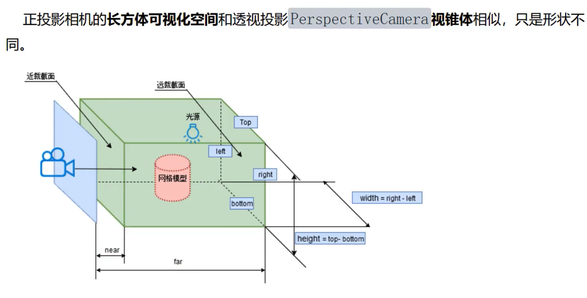
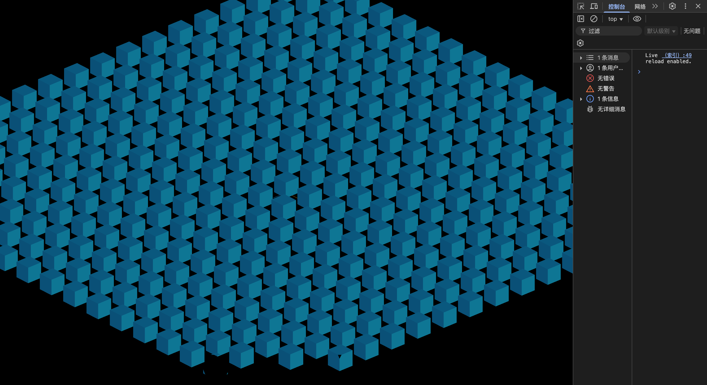

# 正投影相机



```js
import * as THREE from "three";
import { OrbitControls } from "three/examples/jsm/controls/OrbitControls.js";

import model from "./mesh.js";

//场景
const scene = new THREE.Scene();
scene.add(model); //模型对象添加到场景中

//辅助观察的坐标系
const axesHelper = new THREE.AxesHelper(100);
scene.add(axesHelper);

// 添加网格辅助线（在xz平面）
/* const gridHelper = new THREE.GridHelper(200, 20);
gridHelper.position.set(0, -10, 0);
scene.add(gridHelper); */

//光源设置
const directionalLight = new THREE.DirectionalLight(0xffffff, 1);
directionalLight.position.set(100, 60, 50);
scene.add(directionalLight);
const ambient = new THREE.AmbientLight(0xffff2312ff, 0.4);
scene.add(ambient);


/* const width = window.innerWidth; //canvas画布高度
const height = window.innerHeight; //canvas画布宽度
const camera = new THREE.PerspectiveCamera(45, width / height, 1, 8000);
camera.position.set(800, 800, 800);
camera.lookAt(0, 0, 0); */

// 正投影相机
const width=window.innerWidth
const height=window.innerHeight
const k=width/height
// 控制left right top bottom near far范围大小
const s=600
const camera=new THREE.OrthographicCamera(-s*k,s*k,s,-s,1,8000)
camera.position.set(0,2000,0)
camera.lookAt(0,0,0)

// WebGL渲染器设置
const renderer = new THREE.WebGLRenderer({
  antialias: true, //开启优化锯齿
});
renderer.setPixelRatio(window.devicePixelRatio); //防止输出模糊
renderer.setSize(width, height);

// 将渲染器的canvas添加到body中
document.body.appendChild(renderer.domElement);

// 渲染循环
function render() {
  renderer.render(scene, camera);
  requestAnimationFrame(render);
}
render();

const controls = new OrbitControls(camera, renderer.domElement);

// 画布跟随窗口变化
window.onresize = function () {
  const width = window.innerWidth;
  const height = window.innerHeight;
  renderer.setSize(width, height);
  camera.aspect = width / height;
  camera.updateProjectionMatrix();
};

```

在 Three.js 中，OrthographicCamera(left, right, top, bottom, near, far) 定义了一个**视景体 (viewing frustum)，在正交投影下就是一个没有远近透视缩放的“盒子”**。我们来一步步解释：

## 🧱 为什么const s = 600控制了上下左右的“远近”？

你代码里写的是：

```typescript
const s = 600;
const k = width / height;
const camera = new THREE.OrthographicCamera(-s * k, s * k, s, -s, 1, 8000);
```

- left = -s * k 和 right = +s * k
- top = +s 和 bottom = -s

这些参数设置了你的相机能够**看到**的区域范围（世界坐标系中的 x、y 方向长度）。

- top = +600：表示相机可以看到 y = +600 之内的内容
- bottom = -600：看到 y = -600
- 类似 left 和 right 对应 x 方向

因此，s = 600 就是上下范围的半尺寸，决定你能在画面中看到多大的区域，更大 s 可以看到更广的场景，但物体会显得更小，反之则更“放大”。这就是“控制上下左右远近”的含义。

s 这个值直接控制了正交相机 (OrthographicCamera) 的可视范围大小。我们来具体看一下：

OrthographicCamera 的构造函数是：

THREE.OrthographicCamera(left, right, top, bottom, near, far)

在你的代码中：

- top = s

- bottom = -s

- right = s * k

- left = -s * k

(其中 k 是 width / height 的宽高比)

这定义了一个可视区域（我们称之为视景体）：

1. 可视高度: 由 top 和 bottom 决定，大小为 top - bottom = s - (-s) = 2s。

1. 可视宽度: 由 left 和 right 决定，大小为 right - left = s*k - (-s*k) = 2 * s * k。

所以，正如你所说，如果你的模型在场景中所占的区域高度大约是 4000，那么将 s 设置为 2000，可视高度就正好是 2 * 2000 = 4000，模型在垂直方向上就能刚好完全显示。

同理，模型在水平方向上能否完全显示，就取决于 2 * s * k 的大小了。如果模型的宽度也是 4000，那么只有在画布的宽高比 k >= 1（即宽度大于或等于高度）的情况下，模型才能在水平方向上被完整看到。如果窗口是瘦高形的（k < 1），那么模型的左右两边会被裁减掉一部分。

总结来说，s 就像一个缩放因子，它决定了相机能“看”到的基础范围，然后这个范围会根据画布的宽高比进行调整。你通过设置 s 的值来匹配模型尺寸的做法是完全正确的。

## **正交投影原理简介**

### **1. 正交投影 vs 透视投影**

- **透视投影 (PerspectiveCamera)**：越远的物体看起来越小，有消失点的效果
- **正交投影 (OrthographicCamera)**：物体无视深度，尺寸不变，就像在 CAD 或平面图里看模型  

### **2. 视景体是个“矩形盒子”**

在正交投影下，相机定义的是一个长方体（盒子）：

- x 方向：从 left 到 right
- y 方向：从 bottom 到 top
- z 方向：从 near 到 far

这个盒子内的内容都被渲染出来。具体来看你例子中的参数：

- x 范围：[-600×k, +600×k]
- y 范围：[-600, +600]
- z 范围：从 1 到 8000

所有在这个盒子里的网格几何体才会被渲染 。

简单来说，left 和 right 使用 s * k 是为了保证渲染出的画面比例和你的浏览器窗口（或 canvas 画布）比例一致，从而防止物体被拉伸或压扁。

我们来分解一下：

#### 1. 目标：保持正确的宽高比（Aspect Ratio）

想象一下，你在一个宽屏显示器上看一个正方形的视频，如果视频播放器没有正确处理，这个正方形可能会被强行拉伸，填满整个宽屏，变成一个长方形。这显然不是我们想要的。

在Three.js中，canvas 元素就是我们的“显示器”，3D场景就是我们的“视频”。canvas的宽高比由 window.innerWidth / window.innerHeight 决定，我们称之为 k。

我们的目标是，让相机“拍摄”到的画面，其本身的宽高比也等于 k。这样，当这个画面被“贴”到 canvas 上时，比例就能完美匹配，不会产生任何变形。

#### 2. 相机视景体的宽高比

我们再来看一下正交相机视景体（那个长方体盒子）的尺寸：

- 高度: top - bottom = s - (-s) = 2 * s

- 宽度: right - left = (s * k) - (-s * k) = 2 * s * k

现在，我们来计算这个视景体本身的宽高比：

视景体宽高比 = (视景体宽度) / (视景体高度) = (2 * s * k) / (2 * s)

分子分母中的 2 * s 可以被约掉，最后得到：

视景体宽高比 = k

#### 3. 完美匹配

看，通过这个计算，我们成功地让相机的视景体宽高比 (k) 与canvas 画布的宽高比 (k) 完全相等了。

这样一来，无论你的浏览器窗口是宽是窄，渲染出来的3D物体都会保持其正确的比例。

#### 如果不这么做会怎么样？

假设我们不使用 k，而是像设置 top 和 bottom 一样，简单地设置：

```js
// 错误的做法
const camera = new THREE.OrthographicCamera(
  -s, // left
  s,  // right
  s,  // top
  -s, // bottom
  ...
);
```

在这种情况下，相机的视景体宽度是 2 * s，高度也是 2 * s。它的宽高比是 (2 * s) / (2 * s) = 1，也就是说，它是一个正方形的视野。

现在，如果你的浏览器窗口是一个很宽的长方形（比如 width=1600, height=800，k=2），Three.js会把这个正方形的视野强行拉伸，以填满你这个2:1的canvas。结果就是，你场景里所有的东西都会被水平拉长一倍，看起来非常奇怪。

#### 总结

所以，* k 这个操作的核心目的就是：将相机的视野从一个固定的正方形（或任何固定比例），动态调整为与当前画布完全相同的比例，以实现无失真的、响应式的渲染。

### **3. 为什么尺寸不随距离变化？**

因为投影方式是平行投影，也就是说投影光线是平行的，不像透视投影那样根据距离发生收敛。正交投影是平行光方向垂直于投影平面，所以物体在视野里的实际占比只由这个盒子的尺寸决定 。

## **总结**

- s 决定了垂直方向（y）的视野大小，x 方向则按宽高比 k 自动计算
- 它定义了一个“盒子”的范围，范围内的几何体才会被渲染
- 正交相机不会因为 z 值远近自动缩放物体，而是始终保持真实尺寸


## 遮挡情况的说明



你看到的现象是视锥体裁剪 (Frustum Culling) 的结果。简单来说，就是当模型的一部分超出了相机的可视范围后，这部分就不会被渲染，看起来就像被一个无形的平面切掉了。

原因在于你的相机设置和旋转操作的组合：

1. 正交相机的视景体：

OrthographicCamera 定义了一个长方体的可视空间（视景体）。你的代码是这样设置的：

```js
    const s = 2000;
    const camera = new THREE.OrthographicCamera(-s*k, s*k, s, -s, 1, 8000);
```

- 这个视景体的高度是 s - (-s) = 2s = 4000。

- 宽度是 s*k - (-s*k) = 2*s*k = 4000*k (k是宽高比)。

- 深度是 far - near = 8000 - 1 = 7999。

1. 相机旋转：

你使用了 OrbitControls 来旋转相机。当你从正上方向下看时，整个 4000x4000 的模型正好能被容纳在 4000x4000 的视景体内（假设屏幕宽高比 k 接近1）。

然而，当你旋转相机，从一个倾斜的角度观察时，问题就出现了。虽然你的模型本身没有变大，但它在相机视角下的投影范围变大了。


- 上图示意: 想象一下，黄色的物体是你的立方体网格，它被固定在场景中。蓝色的框是相机的视景体。

- 左图 (俯视图): 相机在正上方，物体正好在视景体内。

- 右图 (倾斜视图): 当相机旋转后，整个视景体也跟着旋转了。为了能容纳下整个物体，这个视景体需要变得更大。你代码中 s=2000 定义的视景体，在倾斜后就不足以包裹住整个物体了，导致远端（在你的截图中是下方）的几何体超出了边界，被裁剪掉了。

### 如何解决？

有两种常见的解决方法：

1. 增大视景体范围：

最直接的方法就是增大 s 的值。当你从一个倾斜角度观察时，一个 4000x4000 的平面在屏幕上的投影高度会超过 4000。你可以试着把 s 改大一些，比如 3000，来为倾斜视角提供足够的空间。

```typescript
    // ... existing code ...
    const height=window.innerHeight
    const k=width/height
    // 控制left right top bottom near far范围大小
    const s=3000 // 比如从 2000 增大到 3000
    const camera=new THREE.OrthographicCamera(-s*k,s*k,s,-s,1,8000)
    camera.position.set(0,2000,0)
    // ... existing code ...
```

缺点: 这会让初始的俯视图看起来更"远"，因为同样的物体显示在了更大的可视范围内，显得更小了。

1. 动态调整视景体：

一个更优雅的方案是，在相机旋转时，动态计算模型在当前视角下的边界，并相应地调整相机的 left, right, top, bottom 属性。但这会更复杂一些，需要你在渲染循环中加入计算逻辑。

对于目前的场景，我建议你先尝试第一种方法，将 s 的值调大，看看是否能解决你的问题。