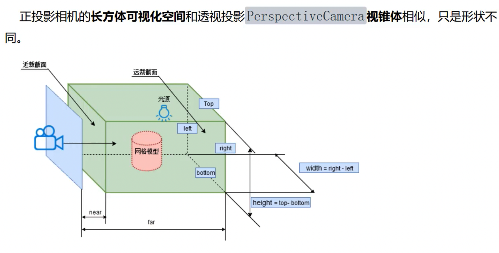
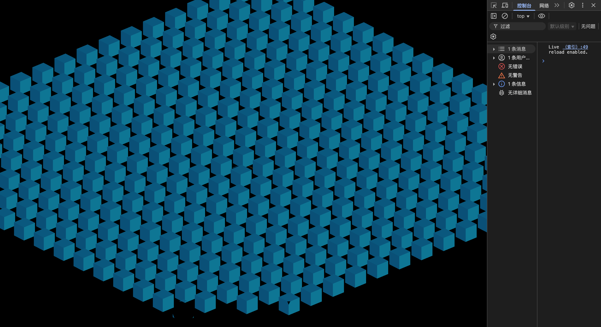

# 正投影相机 OrthographicCamera



> 本章配套文件：`index.html`（用 importmap 引入 three）、`mesh.js`（创建模型）、`index.js`（场景、相机、渲染器）。

---

## 0. 本章的模型：19×19 个方块

**一句话结论**：模型是 19×19 = 361 个边长 100 的立方体，铺在 xz 平面上，总宽约 **3700**，后面算可视范围都要拿这个数比较。

**最小代码**（mesh.js）

```js
import * as THREE from "three";

const group = new THREE.Group();

const geometry = new THREE.BoxGeometry(100, 100, 100);
geometry.translate(0, 50, 0); // 几何体整体上移 50，方块底面正好落在 y=0

const material = new THREE.MeshLambertMaterial({ color: 0x00ffff });

for (let i = -9; i < 10; i++) {   // i = -9 ~ 9，共 19 个
  for (let j = -9; j < 10; j++) {
    const mesh = new THREE.Mesh(geometry, material);
    mesh.position.set(i * 200, 0, j * 200); // 间隔 200
    group.add(mesh);
  }
}

export default group;
```

**代入数字算一下模型尺寸**

- 方块中心 x 从 `-9×200 = -1800` 到 `9×200 = 1800`
- 再加上方块自身的半宽 50 → x 范围是 **-1850 ~ 1850**，宽 **3700**
- z 方向同理：**3700**
- y 方向：0 ~ 100（因为 `translate(0,50,0)`）
- 从中心到角落 (1850, 0, 1850) 的距离：√(1850² + 1850²) ≈ **2616**（第 6 节会用到）

**坑**

- 原文写"模型高度大约 4000"，实际是 3700。用 4000 估算不会出错，只是多留了一点余量。

---

## 1. 正投影 vs 透视投影

**一句话结论**：透视投影是"近大远小"，正投影是"远近一样大"。

- **透视投影**（PerspectiveCamera）：和人眼一样，越远的物体看起来越小，有消失点。
- **正投影**（OrthographicCamera）：物体离相机多远都不影响它在画面里的大小，就像 CAD 图纸、平面图。

**为什么正投影远近一样大？**
"投影"可以理解为把 3D 物体压扁画到屏幕上。透视投影的投影线都汇聚到相机这一个点上，所以远处的物体被压得更小；正投影的投影线**互相平行**，不汇聚，所以物体在画面里占多大只取决于下面要讲的那个"盒子"的尺寸。

```
透视投影（线汇聚到相机）        正投影（线互相平行）
   相机                          ────────────────▶
    ●──────▶ 远处物体小           ────────────────▶
     \                           ────────────────▶
      ─────▶ 近处物体大           物体大小与远近无关
```

> 📷 待补截图：同一组方块分别用透视相机和正投影相机俯视的对比图

---

## 2. 构造参数：视景体是一个长方体"盒子"

**一句话结论**：`OrthographicCamera(left, right, top, bottom, near, far)` 定义了一个长方体盒子，盒子里的东西才会被渲染。这个盒子叫**视景体**（也就是"相机能看到的空间范围"）。

**先代入数字**：假设画布 `width=1600, height=800`，`s=600`

| 参数 | 写法 | 数值 |
|---|---|---|
| k（宽高比） | `width / height` | 1600 / 800 = **2** |
| left | `-s*k` | **-1200** |
| right | `s*k` | **1200** |
| top | `s` | **600** |
| bottom | `-s` | **-600** |
| near | `1` | 相机前方 1 |
| far | `8000` | 相机前方 8000 |

盒子尺寸：

- 宽 = right - left = 1200 - (-1200) = **2400**
- 高 = top - bottom = 600 - (-600) = **1200**
- 深 = far - near = 8000 - 1 = **7999**

```
        top = s
    ┌──────────────┐
    │              │
left│   相机看到的   │right
-s*k│   2s*k × 2s   │ s*k
    │              │
    └──────────────┘
       bottom = -s
   （再沿视线方向从 near 延伸到 far，就是一个长方体）
```

**抽象结论**

- 宽 = `2*s*k`，高 = `2*s`，深 = `far - near`
- left/right/top/bottom 是**相对相机自己**的左右上下，相机转动时盒子跟着转（第 6 节的关键）。
- near/far 是从相机位置**沿视线往前**量的距离，相机背后的东西一定看不到。

**最小代码**

```js
const width = window.innerWidth;
const height = window.innerHeight;
const k = width / height;
const s = 600; // 控制 left right top bottom 范围大小
const camera = new THREE.OrthographicCamera(-s * k, s * k, s, -s, 1, 8000);
```

**坑**

- 上下左右的范围用的是**世界坐标的长度单位**（和模型尺寸是同一种单位），不是像素。

---

## 3. s 控制可视范围大小

**一句话结论**：s 越大，盒子越大，能看到的范围越广，物体在画面里显得越小；s 越小，物体越"放大"。

**代入数字**：模型宽 3700，画布 k = 2

| s | 可视高 2s | 可视宽 2sk | 结果 |
|---|---|---|---|
| 600 | 1200 | 2400 | 模型 3700 放不下，只能看到中间一部分，方块显得很大 |
| 2000 | 4000 | 8000 | 高宽都 ≥ 3700，俯视时整个模型都能看到 |

想刚好装下模型：`2s ≥ 3700` → `s ≥ 1850`，所以代码里用 `s = 2000`。

**抽象结论**：s 像一个缩放因子，决定垂直方向的基础范围；水平方向再按 k 自动换算。

**坑**

- 水平方向能不能装下取决于 `2*s*k`。如果窗口是瘦高的（比如手机竖屏 k = 0.5），`s=2000` 时可视宽只有 2000，模型左右两边会被切掉。

---

## 4. 为什么 left/right 要乘 k

**一句话结论**：乘 k 是为了让盒子的宽高比等于画布的宽高比，防止画面被拉伸或压扁。

**代入数字**：画布 1600×800（k = 2），s = 600

- **乘 k**：盒子宽 2400、高 1200，宽高比 2400/1200 = **2**，和画布一样 → 不变形 ✅
- **不乘 k**（left = -s, right = s）：盒子宽 1200、高 1200，宽高比 **1**（正方形）。要把这个正方形的画面贴满 2:1 的画布，就只能横向拉宽一倍 → 正方体方块变成扁长方体 ❌

**抽象结论**：

盒子宽高比 = `(2*s*k) / (2*s)` = `k` = 画布宽高比。

**最小代码**

```js
// ✅ 正确
new THREE.OrthographicCamera(-s * k, s * k, s, -s, 1, 8000);
// ❌ 错误：宽高比固定为 1，宽屏下物体被横向拉伸
new THREE.OrthographicCamera(-s, s, s, -s, 1, 8000);
```

**坑**

- 只要窗口尺寸一变，k 就变了，left/right 也必须跟着重算，见第 7 节。

---

## 5. 相机位置、观察目标与 OrbitControls

**一句话结论**：`position` 决定相机站在哪，`lookAt` 决定看向哪。但只要用了 OrbitControls，**真正的观察点以 `controls.target` 为准**，所以两处要设成同一个点。

**代入数字**

- `camera.position.set(0, 2000, 0)`：相机在原点正上方 2000 处
- `lookAt(0, 0, 0)`：往正下方看 → **俯视图**
- 正投影下，把 2000 改成 3000，方块在画面里的大小**不会变**（第 1 节），只要模型还在 near~far 之间就行。

**最小代码**（本章 index.js 的写法：观察点移到 (2000, 0, 2000)）

```js
camera.position.set(0, 2000, 0);
camera.lookAt(2000, 0, 2000);

const controls = new OrbitControls(camera, renderer.domElement);
controls.target.set(2000, 0, 2000); // 与 lookAt 保持一致
controls.update();                   // 改了 target 必须 update 才生效
```

**坑**

- 只写 `lookAt` 不设 `controls.target`：OrbitControls 的 target 默认是 (0,0,0)，第一次拖动画面就会"跳"回去看原点。
- 改完 `controls.target` 忘了 `controls.update()`，设置不生效。
- 用鼠标滚轮"拉近拉远"时，正投影相机的画面也会放大缩小。这不是因为距离变了，而是 OrbitControls 对正投影相机做的是缩放画面，和"远近一样大"不矛盾。

---

## 6. 模型被切掉的情况（近裁剪面）



**一句话结论**：倾斜视角下画面一侧被切掉，主要原因是模型靠近相机的那部分**跑到了相机身后**（超出了 near），而不是上下左右的范围不够。**把相机拉远**就能解决，而且正投影下拉远不会让物体变小。

> 原文把这个现象解释为"视锥体裁剪 + 视景体上下左右范围不够，要增大 s"，并说被切的是"远端"。经计算，被切的其实是**离相机最近**的那一端，原因是 near 方向。下面用数字说明。

**代入数字**（原文那版：`s=2000`，相机离观察点 (0,0,0) 距离 2000）

1. 把相机转到斜上方：仰角 30°，朝着模型角落 (1850, 0, 1850) 的方向。
2. 这个角落在视线方向上离观察点有多远：2616 × cos30° ≈ **2266**。
3. 相机离观察点只有 **2000**，所以这个角落在相机前方 2000 - 2266 = **-266** 的位置。负数表示在相机**身后**，比 near = 1 还靠后 → 被切掉。
4. 这个角落离相机最近，在倾斜俯视的画面里位于**屏幕下方**，所以截图里看到的是下方被切。
5. 再看上下左右：同一视角下，这个角落在画面里的竖直位置约为可视高度的 65%，水平位置在中线上，**都在盒子里**。所以把 s 调大是治标，不是对症。

用 three.js 实际计算该角落的标准化坐标（在盒子里时 x、y、z 都在 -1~1 之间）：

| 场景 | x | y | z（深度） | 结果 |
|---|---|---|---|---|
| 相机距离 2000 | 0.00 | -0.65 | **-1.07** | z 超出 → 被切 |
| 相机距离拉到 5000 | 0.00 | -0.65 | -0.32 | 在盒子里 ✅ |

本章 index.js（相机 (0,2000,0)，观察 (2000,0,2000)）也是同样的情况：角落 (-1850, 0, -1850) 在相机身后约 981 处，一开始就被切。

**最小代码**：把相机放远，far 保证够大

```js
const s = 2000;
const camera = new THREE.OrthographicCamera(-s * k, s * k, s, -s, 1, 8000);
// 相机离观察点的距离 > 模型中心到最远角落的距离（约 2616），留足余量
camera.position.set(0, 5000, 0);
camera.lookAt(0, 0, 0);
```

检查 far 够不够：最远的点离相机约 5000 + 2616 = 7616 < 8000 ✅

**抽象结论**

- 被切的原因要分方向看：上下左右是 s 和 k 管，前后是 near/far 管。
- 相机到观察点的距离要大于模型的"半径"，模型才不会跑到相机身后。
- 正投影下"拉远相机"没有副作用（物体不会变小），只要同时保证 far 够大。

**坑**

- 原文提出的"增大 s"方案：画面里所有东西都会变小，而且如果是 near 方向的问题，s 调多大都没用。
- 原文的"动态调整视景体"方案超出本章范围，可以先不考虑。

> 📷 待补截图：相机距离 2000 时倾斜视角下方被切 vs 距离 5000 时完整显示的对比图

---

## 7. 画布尺寸变化

**一句话结论**：正投影相机**没有 `aspect` 属性**，窗口变化时要重算 left/right，再调用 `updateProjectionMatrix()`。

**代入数字**：窗口从 1600×800（k = 2）拉成 1200×800（k = 1.5），s = 2000

- 旧值：left = -4000，right = 4000
- 新值：left = -2000×1.5 = **-3000**，right = **3000**
- top/bottom 只和 s 有关，不变（±2000）

**最小代码**

```js
window.onresize = function () {
  const width = window.innerWidth;
  const height = window.innerHeight;
  renderer.setSize(width, height);

  const k = width / height;
  camera.left = -s * k;
  camera.right = s * k;
  camera.updateProjectionMatrix(); // 相机参数改了必须调用
};
```

**坑**

- 原代码照搬了透视相机的 `camera.aspect = width / height`。对正投影相机来说这只是多加了一个没用的属性，left/right 没变，窗口一变画面就被拉伸（第 4 节的问题会重新出现）。

---

## 8. 本章完整代码（index.js，已修正）

```js
import * as THREE from "three";
import { OrbitControls } from "three/examples/jsm/controls/OrbitControls.js";
import model from "./mesh.js";

// 场景
const scene = new THREE.Scene();
scene.add(model);

// 辅助观察的坐标系
const axesHelper = new THREE.AxesHelper(100);
scene.add(axesHelper);

// 光源
const directionalLight = new THREE.DirectionalLight(0xffffff, 1);
directionalLight.position.set(100, 60, 50);
scene.add(directionalLight);
const ambient = new THREE.AmbientLight(0xffffff, 0.4);
scene.add(ambient);

// 正投影相机
const width = window.innerWidth;
const height = window.innerHeight;
const k = width / height;
const s = 2000; // 2s = 4000 ≥ 模型宽 3700
const camera = new THREE.OrthographicCamera(-s * k, s * k, s, -s, 1, 8000);
camera.position.set(0, 5000, 0); // 距离 5000 > 模型半径 2616，倾斜时也不会被切
camera.lookAt(0, 0, 0);

// 渲染器
const renderer = new THREE.WebGLRenderer({ antialias: true });
renderer.setPixelRatio(window.devicePixelRatio);
renderer.setSize(width, height);
document.body.appendChild(renderer.domElement);

// 轨道控制器：target 与 lookAt 保持一致
const controls = new OrbitControls(camera, renderer.domElement);
controls.target.set(0, 0, 0);
controls.update();

// 渲染循环
function render() {
  renderer.render(scene, camera);
  requestAnimationFrame(render);
}
render();

// 画布跟随窗口变化
window.onresize = function () {
  const width = window.innerWidth;
  const height = window.innerHeight;
  renderer.setSize(width, height);
  const k = width / height;
  camera.left = -s * k;
  camera.right = s * k;
  camera.updateProjectionMatrix();
};
```

**坑**

- 原代码中的环境光颜色 `0xffff2312ff` 有 10 位十六进制，正常颜色是 6 位。three.js 实际只会取到 `0x2312ff`（蓝紫色），所以方块会偏蓝。这里已改成 `0xffffff`。

---

## 📋 速记表

| 知识点 | 记住这句 | 代码 / 公式 |
|---|---|---|
| 正投影特点 | 远近一样大，投影线平行 | `new THREE.OrthographicCamera(...)` |
| 参数 | 左右上下 + 近远，定义一个长方体盒子 | `(left, right, top, bottom, near, far)` |
| 标准写法 | top/bottom 用 s，left/right 用 s*k | `(-s*k, s*k, s, -s, 1, 8000)` |
| 可视尺寸 | 高 2s，宽 2sk，深 far-near | s=2000, k=2 → 8000 × 4000 |
| s 的作用 | s 大 → 看得广、物体小；s 小 → 物体大 | 装下模型：`2s ≥ 模型尺寸` |
| 乘 k | 盒子宽高比 = 画布宽高比，不变形 | `(2sk)/(2s) = k` |
| 本章模型 | 19×19 个方块，宽约 3700，半径约 2616 | `i*200`，i 为 -9 ~ 9 |
| 相机距离 | 正投影拉远不变小，但要大于模型半径 | `position` 距离 > 2616，且距离 + 半径 < far |
| 被切掉 | 上下左右看 s/k，前后看 near/far | 倾斜被切多半是在相机身后 → 拉远相机 |
| OrbitControls | 观察点以 target 为准 | `controls.target.set(...)` + `controls.update()` |
| 窗口变化 | 正投影没有 aspect，重算 left/right | `camera.left/right = ∓s*k` + `updateProjectionMatrix()` |
