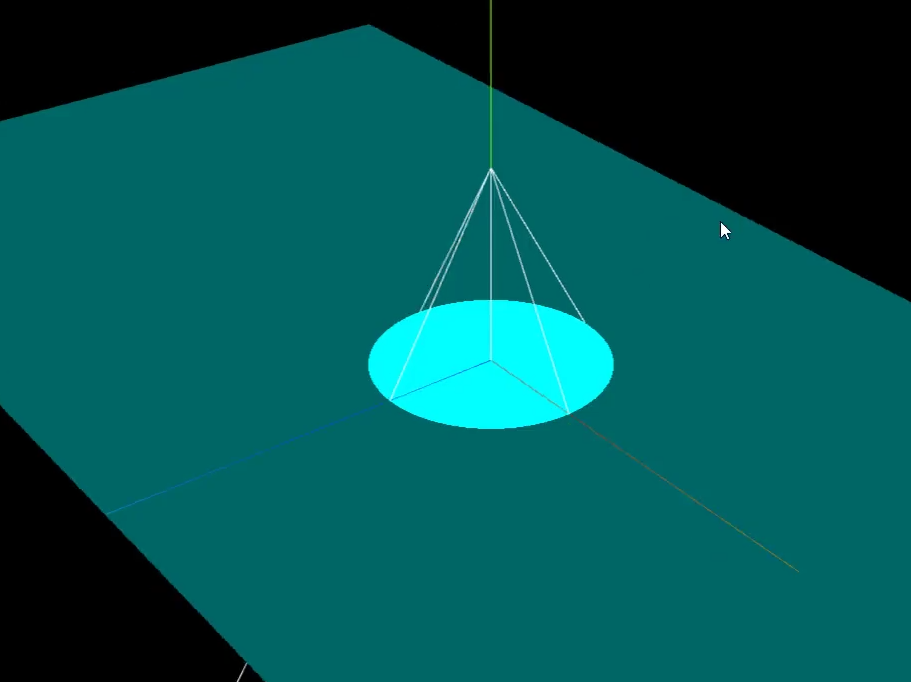

# 聚光源



聚光源（SpotLight）可以想成**一个手电筒**：从一个点出发，朝一个方向打出一个圆锥形的光，离得越远越暗。

---

## 1. 聚光源 vs 平行光

**一句话结论：** 聚光源越远越暗，平行光不管多远都一样亮。所以聚光源的 `intensity` 要设得比平行光大得多。

|                  | 聚光源 SpotLight        | 平行光 DirectionalLight      |
| ---------------- | ----------------------- | ---------------------------- |
| 形状             | 从一个点发出圆锥形的光  | 所有光线互相平行（模拟太阳） |
| 距离衰减         | 有：亮度 ≈ 强度 / 距离² | 无：强度恒定                 |
| intensity 常用值 | 几百到几千（看距离）    | 1 ~ 2 就够亮                 |

**最小代码：**

```js
// 平行光：强度 1 就很亮
const directionalLight = new THREE.DirectionalLight(0xffffff, 1);

// 聚光源：同样是 1 几乎看不见，要设得很大
const spotLight = new THREE.SpotLight(0xffffff, 1000);
```

**坑：**

- 把平行光的习惯（强度 1）照搬到聚光源上，会发现场景"一片黑"，其实是强度太小。

---

## 2. 强度与距离衰减

**一句话结论：** 照到物体上的亮度 ≈ `intensity / 距离²`。距离变成 2 倍，亮度变成 1/4（这就叫"平方反比"）。

**代入数字算一遍**（光源在 `(0, 50, 0)`，`intensity = 1000`）：

| 照到哪里           | 离光源距离 | 算式                     | 亮度   |
| ------------------ | ---------- | ------------------------ | ------ |
| 立方体顶面（y≈20） | 30         | 1000 / 30² = 1000 / 900  | ≈ 1.11 |
| 地面中心（y=0）    | 50         | 1000 / 50² = 1000 / 2500 | 0.40   |

立方体顶面只比地面近了 20，亮度却是地面的约 2.8 倍。

**经验公式：** 想让距离 d 处的亮度 ≈ 1，就设 `intensity ≈ d²`。

- 光源离地面 50 → `intensity ≈ 2500`
- 光源离地面 30 → `intensity ≈ 900`

**最小代码：**

```js
const spotLight = new THREE.SpotLight(0xffffff, 1);
spotLight.intensity = 1000; // 也可以事后修改
spotLight.position.set(0, 50, 0);
scene.add(spotLight); // 聚光源必须手动添加到场景
```

**坑：**

- 想"同样强度更亮"，可以把光源挪近。但别挪进模型里面：立方体高 20、`position.y = 10.1`，顶面在 y≈20.1，光源放在 `(0, 20, 0)` 就在立方体内部了。可以改成 `(0, 30, 0)`。

> 📷 待补截图：光源在 y=50 与 y=30 时的亮度对比

---

## 3. 锥形角度 angle

**一句话结论：** `angle` 是**从中心轴到光锥边缘的夹角**（半角），只决定光斑大小，**不决定**光斑中心有多亮。

**代入数字算一遍**（光源高 50，`angle = Math.PI / 6` 即 30°）：

- 光斑半径 = 高度 × tan(angle) = 50 × tan30° ≈ 50 × 0.577 ≈ **28.9**
- 光斑直径 ≈ **57.7**（200×200 的地面上只亮中间一块）

```
          ● 光源 (0,50,0)
         /|\
        / | \        ← angle 是这一半的角度（30°）
       /  |  \
      /   |50 \
     /    |    \
 ───┴─────┼─────┴───  地面
    |← 28.9 →|
```

**最小代码：**

```js
spotLight.angle = Math.PI / 6; // 30°，光斑半径 = 高度 × tan30°
```

**坑：**

- 把 `angle` 当成整个光锥的张角：`Math.PI / 6` 实际照出的是 60° 的锥。
- 以为角度调小光斑会变亮：不会，只是光斑变小。亮度看 `intensity` 和距离。

> 📷 待补截图：angle = π/6 与 π/12 时的光斑对比

---

## 4. 照射方向 target

**一句话结论：** 聚光源朝 `spotLight.target` 照射。target 是一个 Object3D，默认在原点；改了它的位置，要把它加到场景里才会生效。

**最小代码：**

```js
spotLight.target.position.set(0, 0, 0); // 照向原点
scene.add(spotLight.target); // 修改位置后需要加入场景
```

**坑：**

- 只改了 `target.position`，没 `scene.add(spotLight.target)`，光的方向不跟着变。

---

## 5. 材质对光照的响应

**一句话结论：** 光照效果只对受光照影响的材质生效。`MeshBasicMaterial` 完全不受光照影响，要用 `MeshStandardMaterial` 这类材质。

**最小代码：**

```js
// 地面：接收光照
const planeMaterial = new THREE.MeshStandardMaterial({
  color: 0x888888,
  side: THREE.DoubleSide,
});
// 立方体：接收光照
const cubeMaterial = new THREE.MeshStandardMaterial({ color: 0xff0000 });
```

**坑：**

- 用了 `MeshBasicMaterial`，怎么调灯都没变化。

---

## 6. 聚光源阴影

**一句话结论：** 阴影要**三处同时开启**：渲染器开阴影、光源投射阴影、物体投射或接收阴影，少一处都看不到。

**最小代码：**

```js
// ① 渲染器开启阴影
renderer.shadowMap.enabled = true;

// ② 光源投射阴影
spotLight.castShadow = true;
spotLight.shadow.mapSize.width = 1024;  // 阴影贴图越大，阴影边缘越清晰
spotLight.shadow.mapSize.height = 1024;

// ③ 物体：谁挡光谁 castShadow，谁显示影子谁 receiveShadow
cube.castShadow = true;
plane.receiveShadow = true;
```

**坑：**

- 只开了光源的 `castShadow`，忘了 `renderer.shadowMap.enabled`。
- 立方体底面和地面完全贴合会闪烁（两个面抢着显示），所以代码里写 `cube.position.y = 10.1`，略微抬高。

> 📷 待补截图：立方体在地面上的阴影效果

---

## 7. 聚光源辅助对象 SpotLightHelper

**一句话结论：** `SpotLightHelper` 把光锥的范围画成线框，方便调 `angle` 和位置。调完后可以注释掉。

**最小代码：**

```js
const spotLightHelper = new THREE.SpotLightHelper(spotLight);
scene.add(spotLightHelper);
```

**坑：**

- 注释写了"移除辅助对象"，下面却还在 `scene.add`，导致注释和效果对不上。注释和代码要保持一致。

> 📷 待补截图：SpotLightHelper 显示的光锥线框

---

## 速记表

| 知识点         | 记住这一句                   | 代码                                                 |
| -------------- | ---------------------------- | ---------------------------------------------------- |
| 与平行光的区别 | 聚光源有距离衰减，平行光没有 | `new THREE.SpotLight(0xffffff, 1000)`                |
| 亮度           | ≈ intensity / 距离²          | 距离 50 → 1000 / 2500 = 0.4                          |
| 强度经验值     | 想让距离 d 处亮度≈1，取 d²   | 距离 50 → 2500                                       |
| 位置           | 别放进模型内部               | `spotLight.position.set(0, 50, 0)`                   |
| angle          | 半角，只管光斑大小           | `angle = Math.PI / 6` → 半径 = 50 × tan30° ≈ 28.9    |
| target         | 决定照射方向，改了要加入场景 | `scene.add(spotLight.target)`                        |
| 材质           | Basic 材质不受光照影响       | `MeshStandardMaterial`                               |
| 阴影           | 三处同时开                   | `shadowMap.enabled` + `castShadow` + `receiveShadow` |
| 阴影清晰度     | 贴图越大越清晰               | `shadow.mapSize.width/height = 1024`                 |
| 防闪烁         | 物体略微抬高，别和地面重合   | `cube.position.y = 10.1`                             |
| 调试           | 用 Helper 看光锥范围         | `new THREE.SpotLightHelper(spotLight)`               |

|      |      |      |
|---|---|---|
|      |      |      |
|      |      |      |
|      |      |      |
|      |      |      |
|      |      |      |
|      |      |      |
|      |      |      |
|      |      |      |
|      |      |      |
|      |      |      |
|      |      |      |
|      |      |      |
|      |      |      |