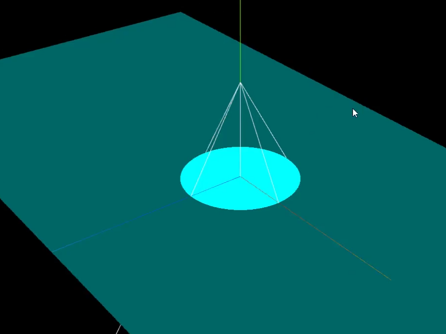

# 聚光源



## 聚光源 vs 平行光的区别

### 1. 光照衰减 (Light Attenuation)

- 聚光源 (SpotLight)：有距离衰减，距离越远光照强度越弱

- 平行光 (DirectionalLight)：无距离衰减，强度恒定

### 2. 光照分布

- 聚光源：从一个点向锥形区域发光，光照强度会随距离按平方反比衰减

- 平行光：模拟无限远的光源（如太阳），所有光线平行，强度均匀

### 3. Three.js 中的光照强度单位

```typescript
// 平行光：强度通常是 0.5-2 就足够
const directionalLight = new THREE.DirectionalLight(0xffffff, 1);

// 聚光源：强度通常需要 50-1000+ 才明显
const spotLight = new THREE.SpotLight(0xffffff, 100);
```

## 影响聚光源亮度的因素

1. 距离衰减公式：intensity / (distance²)

1. 锥形角度：角度越小，光照越集中

1. 材质类型：不同材质对光照的响应不同

这就是为什么：

- 平行光强度 1-2 就很亮（无衰减）

- 聚光源需要 100+ 才明显（有距离衰减）

您可以尝试调整 spotLight.position.set(0, 20, 0) 把聚光源放近一点，这样同样强度下效果会更明显。