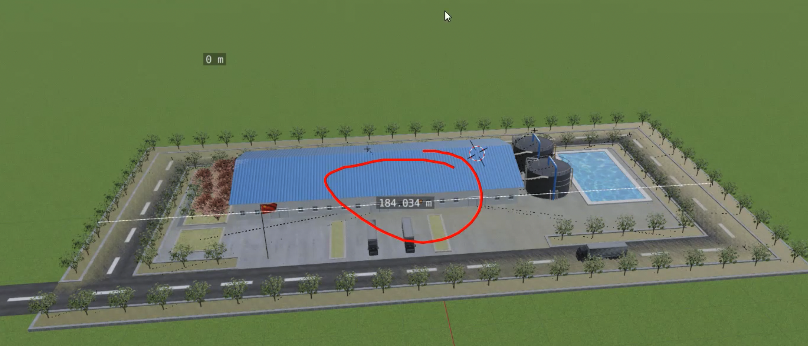

# 旧知识点梳理

### GLTF 环境贴图加载与应用流程

在 Three.js 中为模型添加环境贴图，主要是为了模拟物体对周围环境的反射，从而极大地增强场景的真实感。这个过程主要分为两大步：加载环境贴图 和 将贴图应用到模型材质上。

下面是详细的步骤说明：

#### . 加载环境贴图 (CubeTexture)

环境贴图通常是一种称为"立方体贴图" (CubeTexture) 的特殊纹理，它由六张图片组成，分别代表一个立方体在 +X, -X, +Y, -Y, +Z, -Z 六个方向的视图。

1. 创建 CubeTextureLoader

首先，你需要实例化一个立方体贴图加载器。

```typescript
import * as THREE from "three";

const textureCubeLoader = new THREE.CubeTextureLoader();
```

1. 设置资源路径

使用 .setPath() 方法可以为你的六张贴图设置一个公共的父目录路径。这样在加载时，你只需要提供文件名即可。

```typescript
textureCubeLoader.setPath("./环境贴图/");
```

1. 加载贴图

调用 .load() 方法，并传入一个包含六张图片文件名的数组。

**注意： 数组中文件名的顺序是固定的，必须严格按照 [px, nx, py, ny, pz, nz] 的顺序排列，分别对应 [右, 左, 上, 下, 前, 后]。**

```typescript
const textureCube = textureCubeLoader.load([
  "px.jpg", "nx.jpg", "py.jpg", "ny.jpg", "pz.jpg", "nz.jpg"
]);
```

1. 设置颜色编码 (Encoding)

为了让渲染效果在物理上更准确，特别是对于 PBR (Physically-Based Rendering) 材质，通常需要将环境贴图的颜色编码设置为 sRGBEncoding。

```js
textureCube.encoding = THREE.sRGBEncoding;
```

#### 2. 加载 GLTF 模型并应用环境贴图

在加载完 GLTF 模型后，你需要遍历其内部的所有网格（Mesh），并将我们刚刚创建的环境贴图应用到它们的材质上。

1. 加载 GLTF 模型

使用 GLTFLoader 来加载 .glb 或 .gltf 文件。加载是异步的，所以主要逻辑都在回调函数中完成。

```js
import { GLTFLoader } from "three/examples/jsm/loaders/GLTFLoader.js";

const loader = new GLTFLoader();
loader.load("./工厂.glb", (gltf) => {
  // ... 应用贴图的逻辑
});
```

1. 遍历场景并应用贴图

加载成功后，gltf.scene 对象包含了模型的所有信息。我们需要使用 .traverse() 方法来访问场景图中的每一个对象。

当遍历到网格（isMesh 为 true）时，我们就可以设置其材质（material）的两个关键属性：

- material.envMap: 将这个属性设置为我们之前创建的 textureCube。这样，该材质就会开始反射环境。

- material.envMapIntensity: 这个属性用于控制环境贴图反射的强度，默认值为 1。你可以根据需要调整它。

```js
loader.load("./工厂.glb", (gltf) => {
  // 遍历模型的所有子对象
  gltf.scene.traverse((obj) => {
    // 判断对象是否是网格模型
    if (obj.isMesh) {
      // 为材质设置环境贴图
      obj.material.envMap = textureCube;
      // 设置环境贴图对模型的影响强度
      obj.material.envMapIntensity = 1;
    }
  });
  // 将模型添加到场景中
  scene.add(gltf.scene);
});
```

你可以把一个GLTF模型想象成一个"文件夹"，这个文件夹里包含了：

1. 多个子模型（Mesh）：比如工厂的墙壁是一个Mesh，屋顶是另一个Mesh，里面的机器又是多个不同的Mesh。每个Mesh都有自己的几何形状（Geometry）和材质（Material）。

1. 组织结构（Group）：可能有空的Group对象，用来把相关的Mesh组织在一起，方便进行整体的移动或旋转。

1. 其他信息：可能还包含灯光、相机、动画等。

当你加载gltf.scene时，你得到的是这个"文件夹"的根节点。

### 为什么需要 .traverse()？

因为gltf.scene的结构是树状的，你不知道它具体有多少层，也不知道那些需要被渲染的Mesh具体在哪一层。

例如，这个工厂模型的内部结构可能是这样的：

```typescript
gltf.scene (Group)
  |
  +-- Factory_Building (Group)
  |   |
  |   +-- Walls (Mesh)  <-- 需要给它的 material 加 envMap
  |   +-- Roof (Mesh)   <-- 需要给它的 material 加 envMap
  |   +-- Windows (Mesh) <-- 需要给它的 material 加 envMap
  |
  +-- Machinery (Group)
      |
      +-- Machine_1 (Mesh) <-- 需要给它的 material 加 envMap
      +-- Machine_2 (Mesh) <-- 需要给它的 material 加 envMap
```

如果你只对 gltf.scene 的直接子元素操作，你可能只能访问到 Factory_Building 和 Machinery 这两个Group，而Group本身是没有.material属性的，你真正想修改的是它们内部的那些Mesh。

**`gltf.scene.traverse(obj => { ... })` 的作用就是深度遍历这个树状结构下的每一个节点（obj）。无论一个Mesh被嵌套在多深的Group里，traverse都能访问到它。**

然后，通过 if (obj.isMesh) 这个判断，我们就能确保只对真正的网格模型执行操作，把环境贴图应用到它自己的.material.envMap上。

总结：

**traverse是一种非常健壮和通用的方法，它让你不必关心模型的内部具体结构，就能确保将修改（比如添加环境贴图）应用到所有应该被渲染的部件上。**

**即使这个工厂模型恰好只有一个Mesh，使用traverse也是最标准的做法，因为你的代码可以适用于任何复杂的GLTF模型而无需改动。**

# Gltf模型的阴影计算

在Three.js中为一个复杂的GLTF模型正确地计算阴影，是一个系统性工程。它要求我们不仅要开启相关属性，更要精确地设置光源的阴影范围，并理解其背后的更新机制。

### 第一步：开启阴影"三件套"

要让阴影出现，场景中的三个关键角色都必须开启阴影功能：

1.  **渲染器 (Renderer)**：必须开启全局的阴影计算。
    ```javascript
    // index.js
    renderer.shadowMap.enabled = true;
    ```

2.  **光源 (Light)**：产生阴影的光源必须设置为投射阴影。
    ```javascript
    // index.js
    directionalLight.castShadow = true;
    ```

3.  **物体 (Mesh)**：模型中的每一个需要显示阴影的网格，都必须同时设置为 **投射阴影(castShadow)** 和 **接收阴影(receiveShadow)**。
    ```javascript
    // mesh.js
    gltf.scene.traverse(obj => {
      if (obj.isMesh) {
        // 物体自身要能投射阴影
        obj.castShadow = true;
        // 物体自身也要能接收来自其他物体的阴影
        obj.receiveShadow = true;
      }
    });
    ```

### 第二步：精确计算模型尺寸

为了让阴影不多不少，恰好覆盖整个模型，我们必须先知道模型到底有多大。最可靠的方法是使用`THREE.Box3`（包围盒）来计算。

这是一个在模型加载后获取其尺寸的典型调试方法：
```javascript
// mesh.js (仅用于调试获取尺寸)
loader.load("./工厂.glb", gltf => {
  // 1. 创建一个包围盒实例
  const box = new THREE.Box3();
  // 2. 将GLTF模型的所有部分都包含进来
  box.setFromObject(gltf.scene);
  // 3. 获取尺寸和中心点
  const size = box.getSize(new THREE.Vector3());
  const center = box.getCenter(new THREE.Vector3());

  // 4. 在控制台打印出详细尺寸，作为下一步设置的依据
  console.log("模型尺寸 (宽×高×深):", size);
  console.log("X轴范围:", box.min.x, "到", box.max.x);
});
```
在本项目中，我们通过此方法得知工厂模型的尺寸大约是 `2000 * 17 * 2000`。

### 第三步：设置光源的阴影相机范围

平行光的阴影是通过一个内部的正交相机(`OrthographicCamera`)来计算的。我们必须根据第二步得到的模型尺寸，来根据覆盖的需求设置这个内部相机的拍摄范围（视锥体）。

```javascript
// 设置三维场景计算阴影的范围
directionalLight.shadow.camera.left=-100
directionalLight.shadow.camera.right=100
directionalLight.shadow.camera.top=100
directionalLight.shadow.camera.bottom=-100
directionalLight.shadow.camera.near=1
directionalLight.shadow.camera.far=1000
```

### 第四步：【最关键的陷阱】更新投影矩阵

这是本次调试中最核心、最易出错的一步。当你手动修改了相机的任何视锥体属性（如`left`, `right`, `far`等）之后，**必须手动调用 `.updateProjectionMatrix()` 方法**。

```javascript
// index.js
// 【关键】在设置完相机属性后，必须调用此方法来应用更改
directionalLight.shadow.camera.updateProjectionMatrix();
```

**为什么这如此重要？**
- **工作原理**：Three.js不会在每次属性变更时都自动重新计算昂贵的投影矩阵。它需要你明确地发出指令。
- **视觉陷阱**：如果你忘记调用此方法，`CameraHelper`（用于可视化的辅助框）会根据一个**陈旧的、未更新的**投影矩阵来绘制自己。这会导致一个极其迷惑的现象：**辅助框在视觉上可能是错误的、被不成比例缩放的，让你误以为相机范围是巨大的，而实际上它依然很小。** 这正是我们项目中遇到的问题根源。

### 第五步：可视化与提升阴影质量

1.  **可视化**：使用 `CameraHelper` 来观察你设置的阴影范围是否正确。记住，它只有在投影矩阵被正确更新后才是可信的。
    ```javascript
    // index.js
    const cameraHelper = new THREE.CameraHelper(directionalLight.shadow.camera);
    scene.add(cameraHelper);
    ```
    

2.  **提升质量**：
    - **清晰度**：通过增大阴影贴图的分辨率(`mapSize`)来获得更清晰的阴影。
      ```javascript
      directionalLight.shadow.mapSize.set(2048, 2048); // 默认512
      ```
    - **柔和度**：设置阴影的`radius`属性，可以模拟出现实中更柔和的阴影边缘。
      ```javascript
      directionalLight.shadow.radius = 3; // 值越大，边缘越模糊
      ```
    - **平滑算法**：使用更高级的阴影贴图算法，如`VSMShadowMap`，可以消除硬的阴影边界，让光照过渡更自然。
      ```javascript
      renderer.shadowMap.type = THREE.VSMShadowMap;
      ```

通过遵循以上步骤，我们就能为复杂的GLTF模型实现精确且高质量的动态阴影效果，并避开因更新机制不明而产生的视觉陷阱。

### VSMShadowMap 的优势

1. 消除硬边界：范围内外不会有突兀的亮度跳跃

1. 更真实的光照：模拟现实中光线的自然衰减

1. 更好的视觉效果：整体光照看起来更统一


