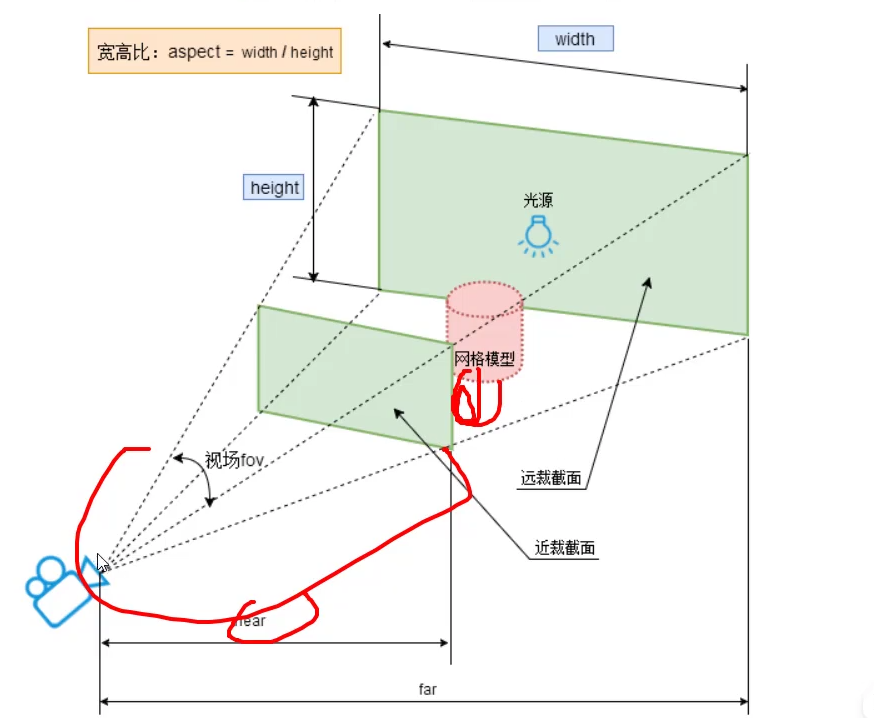

# 精灵模型

## 本章路线图

| 步骤 | 学什么                            | 依赖上一步的什么 |
| ---- | --------------------------------- | ---------------- |
| 1    | 精灵是什么：永远正对相机的平面    | —                |
| 2    | 精灵有多大：scale 就是尺寸        | 精灵是一个平面   |
| 3    | 用精灵做标注：贴图 + 大小 + 位置  | 会设大小         |
| 4    | 用精灵做下雨：撒很多个 + 每帧下落 | 会做一个精灵     |
| 5    | 调 near：让贴着相机的雨滴不画     | 下雨已经跑起来   |

---

## 1. 精灵是什么

**效果：** 左边是 Sprite，右边是 Mesh 平面，贴同一张图，分别从三个角度看。


**要解决的问题：** 头顶标签、光点、雨滴这类东西，希望从任何角度看都是正面。Mesh 做不到，换个角度就会看到侧面。

**最小代码：**

```js
import * as THREE from "three";

const spriteMaterial = new THREE.SpriteMaterial({ color: 0xffffff });
const sprite = new THREE.Sprite(spriteMaterial);
sprite.scale.set(100, 100, 1);

const group = new THREE.Group();
group.add(sprite);
export default group;
```

**逐行解释：**

- `SpriteMaterial`：精灵专用的材质，**不受光照影响**
- `new THREE.Sprite(材质)`：只传材质，不传几何体，因为精灵自带一个平面
- 这个平面会**永远正对相机**：相机转到哪，它就跟着转到哪（叫"广告牌效应"）

|      | Sprite                     | Mesh             |
| ---- | -------------------------- | ---------------- |
| 创建 | 只要材质                   | 几何体 + 材质    |
| 朝向 | 永远正对相机               | 固定，会看到侧面 |
| 形状 | 只能是平面                 | 任意形状         |
| 适合 | 标签、光点、雨雪、远处的树 | 建筑、角色、地面 |

**坑：** 精灵只是一张平面，没有厚度，不能用来做需要立体感的物体。

**小结：** 要一张永远正对你的图，用 Sprite；要一个有体积的物体，用 Mesh。

---

## 2. 精灵有多大

**效果：** 正投影相机上下能看到 20 高。左图精灵 scale = 20，刚好上下填满；右图 scale = 10，只占一半。


**要解决的问题：** 创建精灵时没传几何体，那它到底多大？

**一句话：** 精灵自带一个 **1 × 1** 的平面，所以 **scale 是多少，精灵就是多大**。

**最小代码：**

```js
// 精灵：20 × 20
const sprite = new THREE.Sprite(new THREE.SpriteMaterial({ color: 0xffffff }));
sprite.scale.set(20, 20, 1);

// 正投影相机：上下正好看到 20 高，用来验证
const k = width / height;
const s = 10;
const camera = new THREE.OrthographicCamera(-s * k, s * k, s, -s, 1, 8000);
camera.position.set(0, 0, 200);
camera.lookAt(0, 0, 0);
```

**逐行解释：**

`sprite.scale.set(20, 20, 1)`

- 是什么：把 1 × 1 的平面放大 20 倍
- 结果：20 × 20。第三个值写什么都行，平面没有厚度

`new THREE.OrthographicCamera(left, right, top, bottom, near, far)`

- 是什么：正投影相机，6 个参数顺序固定：左、右、上、下、近、远
- 为什么用它验证：正投影相机没有近大远小，top 到 bottom 是多少，画面上下就正好能看到多少

| 参数         | 写法               | 代入 s = 10、k = 1.6 | 含义                   |
| ------------ | ------------------ | -------------------- | ---------------------- |
| left / right | `-s * k` / `s * k` | -16 / 16             | 左右能看到 32 宽       |
| top / bottom | `s` / `-s`         | 10 / -10             | 上下能看到 20 高       |
| near / far   | `1` / `8000`       | 1 / 8000             | 从相机前方 1 拍到 8000 |

- `k = width / height` 是画布宽高比。上下定成 20 之后，左右按同样的比例放大，画面才不会被拉伸

**算一遍：** 相机上下 20，精灵 20 高 → 刚好上下填满；左右 32，精灵 20 宽 → 左右留空。

**坑：** 用透视相机做这个验证看不准，因为透视相机近大远小，精灵在画面上的大小会随距离变化。

**小结：** scale 就是精灵在世界坐标里的尺寸。下一步做标注，就靠这一点来算位置。

---

## 3. 用精灵做标注

**效果：** 立方体顶上放一个光点。左：只有贴图；中：贴图 + 颜色；右：Mesh 平面同样能混合颜色。


**要解决的问题：** 在模型头顶放一个光点或图标，从任何角度看都是正面。

**最小代码：**

```js
import * as THREE from "three";

// 立方体：底面 y = 0，顶面 y = 100
const geometry = new THREE.BoxGeometry(25, 100, 50);
geometry.translate(0, 50, 0);
const mesh = new THREE.Mesh(geometry, new THREE.MeshLambertMaterial({ color: 0x00ffff }));

// 光点
const texture = new THREE.TextureLoader().load("./assets/光点.png");
const spriteMaterial = new THREE.SpriteMaterial({
  map: texture,
  // color: 0x00ffff, // 打开后：颜色 × 贴图
});
const sprite = new THREE.Sprite(spriteMaterial);
sprite.scale.set(10, 10, 1);
sprite.position.set(0, 105, 0);

const group = new THREE.Group();
group.add(mesh, sprite);
export default group;
```

**逐行解释：**

`geometry.translate(0, 50, 0)`

- 是什么：把 100 高的立方体整体往上挪 50
- 为什么：让底面在 y = 0，**顶面在 y = 100**，方便算光点放在哪

`map: texture`

- 是什么：给精灵贴一张 png
- 透明的部分会自动隐藏，因为 `SpriteMaterial` 的 `transparent` **默认就是 true**

`color: 0x00ffff`（可选）

- 是什么：颜色和贴图**相乘**。白色光点 × 青色 = 青色光点
- Mesh 材质同时设 `color` 和 `map`，也是相乘（效果图右边）

`sprite.scale.set(10, 10, 1)`

- 是什么：光点 10 × 10
- 为什么是 10：标注大小和被标注的物体差不多一个数量级就行（物体 25 × 100 × 50），先设个大概值，再按效果调

`sprite.position.set(0, 105, 0)`

- 是什么：精灵的 position 是它的**中心点**
- 为什么是 105：让光点底边贴着立方体顶面

**算一遍：**

- 光点 10 高，中心到底边 = 10 ÷ 2 = 5
- 底边要在顶面 100 → 中心 = 100 + 5 = **105**

**坑：** 把 position 当成底边，直接设成 100，光点会有一半陷进立方体里。

**小结：** 标注 = 贴图 + 大小（scale，第 2 步）+ 位置（中心 = 底边 + 半高）。

---

## 4. 用精灵做下雨

**效果：**

> 📷 待补截图：工厂场景中下雨的效果

**要解决的问题：** 一个精灵会做了，下雨就是：**很多个精灵随机撒在空中 + 每帧往下落 + 落地后回到顶上**。

**最小代码：**

```js
const RAIN_TOP = 600;  // 雨滴最高高度
const SPEED = 60;      // 每秒落 60

const spriteMaterial = new THREE.SpriteMaterial({
  map: new THREE.TextureLoader().load("./assets/雨滴.png"),
});
const rainGroup = new THREE.Group();

for (let i = 0; i < 16000; i++) {
  const sprite = new THREE.Sprite(spriteMaterial); // 共享一个材质，节省内存
  sprite.scale.set(0.5, 0.5, 1);
  sprite.position.set(
    1000 * (Math.random() - 0.5),
    RAIN_TOP * Math.random(),
    1000 * (Math.random() - 0.5)
  );
  rainGroup.add(sprite);
}

const clock = new THREE.Clock();
function loop() {
  const t = clock.getDelta();
  rainGroup.children.forEach((sprite) => {
    sprite.position.y -= t * SPEED;
    if (sprite.position.y < 0) sprite.position.y = RAIN_TOP;
  });
  requestAnimationFrame(loop);
}
loop();
```

**逐行解释：**

`1000 * (Math.random() - 0.5)`

- 是什么：雨滴的 x、z 坐标
- 怎么算：`Math.random()` 是 0 ~ 1 → 减 0.5 变成 -0.5 ~ 0.5 → 乘 1000 变成 **-500 ~ 500**
- 结果：雨下在一个 1000 × 1000 的区域里

`RAIN_TOP * Math.random()`

- 是什么：雨滴的 y 坐标，0 ~ 600

`const t = clock.getDelta()`

- 是什么：**上一帧到这一帧过了多少秒**。每帧调用一次，返回距离上次调用的秒数

`sprite.position.y -= t * SPEED`

- 要解决的问题：每帧要决定雨滴往下挪多少，目标是**每秒落 60**（SPEED 是自己定的）
- 怎么算：距离 = 速度 × 时间，这一帧只过了 t 秒，所以这一帧挪 `60 × t`

| 每秒几帧 | 每帧的 t    | 每帧移动 60 × t | 一秒总共        |
| -------- | ----------- | --------------- | --------------- |
| 60       | ≈ 0.0167 秒 | ≈ 1             | 1 × 60 = **60** |
| 30       | ≈ 0.0333 秒 | ≈ 2             | 2 × 30 = **60** |

- 为什么要乘 t：如果直接写 `-= 1`（每帧固定走 1），60 帧的电脑每秒落 60，30 帧的只落 30，雨速就跟着电脑快慢变了

`if (sprite.position.y < 0) sprite.position.y = RAIN_TOP`

- 是什么：落到地面以下，就回到顶上重新落，雨就能一直下

**坑：**

- **出生高度和重生高度要一致。** 如果出生用 `1000 * Math.random()`（0 ~ 1000），落地却回到 600，开头的雨分布在 0 ~ 1000，落过一轮后只剩 0 ~ 600，前后不一致。两处统一用 `RAIN_TOP`。
- 不乘 t，雨速会随帧率变化。

**为什么用精灵，不用 Mesh：**

1. **顶点少**：一个精灵 4 个顶点。10,000 个雨滴是 4 万个顶点；Mesh 雨滴按每个 100 个顶点算是 100 万个，差 25 倍
2. **不算光照**：`SpriteMaterial` 不受光照影响，计算简单
3. **看不出来**：雨滴又小又快，只要永远正对相机，就足够以假乱真

**小结：** 下雨 = 第 1~2 步的精灵 × 16000 + 每帧落 `速度 × t` + 落地重生。

---

## 5. 调 near：让贴着相机的雨滴不画

**效果：** 相机前方 2、4、7 处各放了一个雨滴。near = 1 时它们被画成显眼的长条，near = 10 时不画。




**要解决的问题：** 相机在 `(92, 113, 85)`，雨下在 x、z 为 -500 ~ 500、y 为 0 ~ 600 的区域里。**相机就站在雨里**，身边随时有雨滴经过。透视相机近大远小，贴着相机的雨滴会被放得很大，很难看。

**最小代码：**

```js
// 第三个参数就是 near
const camera = new THREE.PerspectiveCamera(90, width / height, 10, 3000);
```

**逐行解释：**

`near = 10`

- 是什么：**比 near 更近的东西不画**
- 为什么是 10：离相机不到 10 的雨滴就不画了，正好去掉那些被放得很大的雨滴

**算一遍：** 雨滴离得越近，在画面上越大。相机视野 90°，在距离 d 处，画面上下能看到 2 × d × tan45° = **2d** 高：

| 雨滴离相机        | 画面上下能看到 | 0.5 的雨滴占画面上下          |
| ----------------- | -------------- | ----------------------------- |
| 2                 | 4              | 0.5 ÷ 4 = **1/8**，很显眼     |
| 10                | 20             | 0.5 ÷ 20 = 1/40               |
| 150（大部分雨滴） | 300            | 0.5 ÷ 300 ≈ 1/600，几乎看不见 |

**坑：** near 不能太大，否则离相机近的正常模型也会被切掉。本章场景几百大，near = 10 合适。

**小结：** near 管的是从多近开始画。相机在雨里，就把 near 调大一点。

---

## 了解即可

- **每个 Sprite 都要单独画一次。** 本章视角下实测，每帧约画 940 次（16000 个雨滴里只有画面内的才画）。雨滴数量不能无限加。
- 精灵材质的 `transparent` 默认是 true，`color` 默认是白色（0xffffff）。

---

## 速记表

| 知识点      | 一句话                              | 代码 / 数字                                    |
| ----------- | ----------------------------------- | ---------------------------------------------- |
| 精灵        | 永远正对相机的平面，不受光照影响    | `new THREE.Sprite(new THREE.SpriteMaterial())` |
| 大小        | 默认 1 × 1，scale 就是尺寸          | `scale.set(20, 20, 1)` → 20 × 20               |
| 正投影相机  | 参数顺序：左、右、上、下、近、远    | s = 10 → 上下 20；左右 2sk                     |
| 标注位置    | position 是中心，中心 = 底边 + 半高 | 顶面 100 + 5 = 105                             |
| 颜色 + 贴图 | 相乘（Mesh 材质也一样）             | `{ map, color }`                               |
| 随机区域    | `(Math.random() - 0.5) × 宽`        | 1000 → -500 ~ 500                              |
| 下落        | 每帧移动 = 速度 × t                 | 30 帧：每帧 2，每秒 60                         |
| 重生        | 出生和重生用同一个高度              | `RAIN_TOP`                                     |
| near        | 比 near 更近的不画                  | near = 10                                      |

---

## 自测题

1. 同一张贴图分别做成 Sprite 和 Mesh 平面，从正上方往下看，分别是什么样？
2. `sprite.scale.set(20, 20, 1)` 之后，精灵多大？为什么？
3. 立方体顶面 y = 100，光点 10 × 10，`position.y` 设多少，光点底边才刚好贴着顶面？
4. `sprite.position.y -= t * 60`，每秒 30 帧时，每帧落多少？每秒落多少？
5. 相机站在雨里，把 near 从 1 改成 10，画面会有什么变化？

<details>
<summary>答案</summary>


1. Sprite 还是正对相机的正方形；Mesh 平面几乎变成一条线。
2. 20 × 20。精灵自带 1 × 1 的平面，放大 20 倍。
3. 105。中心 = 底边 100 + 半高 5。
4. t ≈ 1/30 秒，每帧 60 × 1/30 = 2；每秒 2 × 30 = 60。
5. 离相机不到 10 的雨滴不画，近处不会再冒出很大的雨滴。

</details>