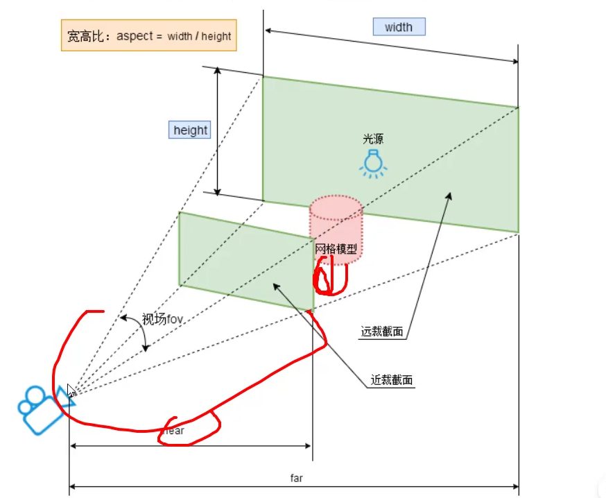

# 精灵模型


## 什么是精灵模型

````js
import * as THREE from "three";
// 创建精灵材质
const spriteMaterial = new THREE.SpriteMaterial({
  color: 0xffffff,
});
// 创建精灵模型对象
const sprite = new THREE.Sprite(spriteMaterial);
sprite.scale.set(100, 100, 100);

const group = new THREE.Group();
group.add(sprite);

export default group;

````

**THREE.Sprite (精灵模型) 的核心特点是：它是一个始终朝向摄像机的平面,也就是无论怎么调整摄像机角度，它永远会面向你。**

无论你如何旋转观察视角，精灵模型都会自动旋转，确保你看到的永远是它的正面。这个特性通常被称为“广告牌效应 (billboarding)”。

THREE.Mesh (普通几何体模型) 则不同：

它是由一个几何体 (Geometry) 和一个材质 (Material) 创建的，是一个具有固定方向的、真正的三维物体。当你从不同角度观察它时，你会看到它的不同侧面、顶部或底部。

总结一下主要区别：

1. 朝向 (Orientation):

- 精灵模型 (Sprite): 始终朝向摄像机。

- 普通模型 (Mesh): 在 3D 空间中有固定的朝向，不会自动转向摄像机。

1. 几何形状 (Geometry):

- 精灵模型 (Sprite): 本质上是一个简单的 2D 平面。

- 普通模型 (Mesh): 可以是任何复杂的 3D 形状，如立方体、球体，或者从文件加载的复杂模型。

1. 常见用途 (Use Cases):

- 精灵模型 (Sprite): 非常适合用于渲染粒子效果（如火焰、雨滴、烟雾）、需要始终清晰可见的文字标签，或者远处的、可以用一张图代替复杂模型的物体（比如远处的树），这样可以大大提升性能。

- 普通模型 (Mesh): 用于构建场景中几乎所有的实体对象，比如角色、建筑、地面等。

简单来说，当你需要一个“假”的 3D 对象，它其实是一张永远正对你的图片时，就用 Sprite。当你需要一个真实的、有体积和不同侧面的 3D 物体时，就用 Mesh。


## 正投影相机填充

我们可以利用正投影相机来使得精灵模型100%填充上下的画布，比如我们设置了精灵模型的尺寸，如果正投影相机的top和bottom范围分别是10，上下方向渲染范围是20，精灵模型我们更改了尺寸长宽也都是20，这样刚好上下100%填充画布。

```typescript
// 正投影相机
const k = width / height;
const s = 10;
const camera = new THREE.OrthographicCamera(-s * k, s * k, s, -s, 1, 8000);
camera.position.set(0, 0, 200);
camera.lookAt(0, 0, 0);

```

精灵模型的当前尺寸:
```js
import * as THREE from "three";
// 创建精灵材质
const spriteMaterial = new THREE.SpriteMaterial({
  color: 0xffffff,
});
// 创建精灵模型对象
const sprite = new THREE.Sprite(spriteMaterial);
// 设置精灵模型对象的缩放
sprite.scale.set(20, 20, 20);
// 设置精灵模型对象的位置，默认是0,0,0
sprite.position.set(0, 0, 0);

const group = new THREE.Group();
group.add(sprite);

export default group;

```


## 精灵模型标注场景(贴图)

精灵模型的.transparent默认是开启的，这有利于png贴图隐藏对应的网格背景。

精灵模型的贴图可以和颜色混合，形成新的配色，这和普通的几何模型有所不同，几何模型只能二选一:
```js
const spriteMaterial = new THREE.SpriteMaterial({
  color: 0x00ffff,
  map: texture,
});
```

标注大小，需要根据场景渲染范围尺寸或者说要标注的物体的尺寸数量级，设置sprite的大小，不用具体，先设置一个大概值，只要和要标注的物体尺寸数量级相差不大即可，再根据需求调整 `sprite.scale.set(x,y,z)`即可。

根据标注位置，设置精灵模型在三维空间中的位置坐标，基于模型对象的大小和位置调整即可，使用`sprite.position.set(x,y,z)`


# 精灵模型模拟下雨下雪

### 1. 几何体复杂度 (Vertex Count)

这是最关键的区别。

- Sprite (精灵): 本质上只是一个由 2 个三角形组成的矩形平面。它只有 4 个顶点 (Vertices)。

- Mesh (几何模型): 即使是一个最简单的 3D 雨滴模型（比如一个小球体或拉伸的椭球体），也需要数十甚至数百个顶点来构成其网格。

性能影响: GPU 的工作量与需要处理的顶点总数直接相关。假设你要渲染一个有 10,000 个雨滴的场景：

- 使用 Sprite: 10,000 (雨滴) * 4 (顶点/雨滴) = 40,000 个顶点。

- 使用 Mesh (假设每个雨滴模型有 100 个顶点): 10,000 (雨滴) * 100 (顶点/雨滴) = 1,000,000 个顶点。

GPU 需要处理的顶点数量相差了 25 倍。顶点越多，占用的显存和计算资源就越多，渲染每一帧所需的时间就越长，从而导致帧率 (FPS) 大幅下降。

### 2. 光照和着色计算 (Shading/Lighting)

- Sprite: 通常使用非常简单的 SpriteMaterial。这种材质默认不受场景中光照的影响。它的着色计算非常简单：基本上就是把贴图（纹理）画到那个平面上。

- Mesh: 通常使用 MeshStandardMaterial 或 MeshPhongMaterial 等。这些材质需要进行复杂的光照计算。对于场景中的每一个光源，GPU 都需要计算它如何与模型表面相互作用，包括漫反射、高光、阴影等。这些计算在片元着色器 (Fragment Shader) 中进行，开销非常大。

对于成千上万个快速移动的雨滴来说，精确计算它们的光照效果不仅开销巨大，而且从视觉上看几乎无法察觉，完全是性能浪费。

### 3. 视觉上的“欺骗”

从用户的视角来看，雨滴和雪花又小又快。人眼根本无法分辨出它是一个精致的 3D 模型还是一个简单的、带有半透明纹理的 2D 平面。**只要这个平面始终朝向镜头（这正是 Sprite 的特性），视觉效果就足够以假乱真了。**

这是一种典型的 “用计算成本换取视觉效果” 的优化策略。在不牺牲（或牺牲极少）视觉质量的前提下，大幅降低硬件的计算负担。

### 总结

简单来说，使用 Sprite 模拟雨雪效果，是在权衡 视觉真实度 和 性能成本 后做出的明智选择。我们用一个“看起来像那么回事”的、计算成本极低的方案，替代了一个“物理上更精确”但计算成本高到无法在实时渲染中接受的方案。这是游戏和实时 3D 应用开发中最常见和最重要的优化思想之一。


为了避免雨滴离相机太近导致看起来非常奇怪(可以看清雨滴模型)，我们需要把near设置的更加远一点。

