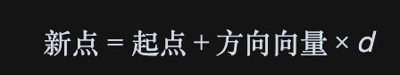

# Ray射线

```typescript
import * as THREE from 'three'

const group=new THREE.Group()

const geometry=new THREE.BoxGeometry(50,50,50)
const material=new THREE.MeshLambertMaterial({color:0x00ff00,side:THREE.DoubleSide,wireframe:true})
const mesh=new THREE.Mesh(geometry,material)
// 创建射线对象Ray
const ray=new THREE.Ray()
// 设置射线起点
ray.origin=new THREE.Vector3(0,0,0)
// 另一种设置方法
// ray.origin.set(0,0,0)

// 表示射线沿着某个方向
ray.direction=new THREE.Vector3(5,0,0).normalize()
console.log('ray',ray);


group.add(mesh)

export default group
```

ray.direction 之所以需要是单位向量（unit vector），主要有两个原因：

1. 分离方向与距离：在 3D 计算中，我们希望一个向量能够清晰地只表达方向，而不包含长度（或距离）信息。射线（Ray）从一个起点（origin）沿着一个特定方向（direction）无限延伸。如果我们想计算射线上距离起点 d 个单位长度的点，公式是：



如果方向向量的长度是 1（即单位向量），这个公式就能正确计算出新点的位置。但如果方向向量的长度是 2，那么 方向向量 * d 的结果在长度上就会是期望的 2 倍，计算就出错了。

2. 简化和标准化算法：Three.js 内部的射线拾取算法（例如 Raycaster）在设计时就假定 ray.direction 是一个单位向量。这样做可以大大简化内部的数学运算，特别是计算交点和距离的算法。例如，当 Raycaster 检测到射线与一个物体相交时，它返回的 distance 属性就是沿着这个单位向量方向的真实物理距离。如果 direction 不是单位向量，那么返回的 distance 值就需要进行额外的换算，这会使算法变得不必要地复杂和低效。

### 为什么需要 .normalize()？

.normalize() 方法的作用就是归一化。它会将一个向量的长度（模）变为 1，但保持其方向不变。

当你通过两个点来计算一个方向向量时，例如 direction = point2 - point1，得到的向量 direction 的长度通常不是 1。这时，为了满足上述两个原因，你就必须调用 .normalize() 方法，把它转换成一个单位向量，然后再赋给 ray.direction。

总结一下：

为了确保数学计算的准确性和一致性，射线（Ray）的方向向量被要求是单位向量。.normalize() 是一个便捷的工具，用来确保任意向量都能满足这个要求，而不会改变它所指向的方向。这在整个 3D 图形学中都是一个通用的约定。


