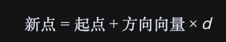

# 01 Ray 射线

## 路线图

1. 定义射线，用起点和方向确定它从哪出发、朝哪走。
2. 把上一步的方向归一化，让「方向 × 距离」得到正确的位移。
3. 用这条射线和三个顶点求交，判断有没有打中三角形。
4. 在同一组求交数据上打开背面剔除，观察为什么交点会变成 `null`。

代码按顺序放在同一个 JavaScript 模块中即可运行。完整画面见本节的 [`index.html`](./index.html) 和 [`mesh.js`](./mesh.js)。

## 1. 定义射线

**一句话结论**　`Ray` 从 `origin` 出发，沿 `direction` 无限延伸。

```js
import * as THREE from "three";

const ray = new THREE.Ray();
ray.origin.set(0, 0, 0);
ray.direction.set(1, 0, 0);
```

`(0, 0, 0)` 是场景原点。方向的 X 分量是 `1`，Y 和 Z 分量都是 `0`，所以射线沿 `+X` 前进。

**坑**　`Ray` 是用来计算的对象。示例画面中的三角形和坐标轴是用于观察的参照，射线需要另外绘制才能看见。

## 2. 方向归一化

**一句话结论**　`.normalize()` 把非零向量的长度变成 `1`，保留朝向。长度为 `1` 的向量叫单位向量。

```js
ray.direction.set(5, 0, 0).normalize();
```

`5` 是原始方向的 X 分量。这条向量长度为 `5`，归一化后每个分量除以 `5`，得到 `(1, 0, 0)`。



假设公式里的前进距离 `d` 是 `10` 个场景单位。从原点出发，直接用 `(5, 0, 0)` 会得到 `(50, 0, 0)`，归一化后用 `(1, 0, 0)` 才得到 `(10, 0, 0)`。

**坑**　方向里的 `5` 不限制射线的延伸范围。零向量归一化后仍是零向量，无法给射线指定朝向。

## 3. 三角形求交

**一句话结论**　给 `intersectTriangle()` 三个顶点和一个用于保存坐标的对象，命中就返回该对象，未命中就返回 `null`。

```js
const p1 = new THREE.Vector3(100, 25, 0);
const p2 = new THREE.Vector3(100, -25, 25);
const p3 = new THREE.Vector3(100, -25, -25);

const point = new THREE.Vector3();
const result = ray.intersectTriangle(p1, p2, p3, false, point);
console.log(result);
```

三个顶点的 X 都是 `100`，所以三角形位于 `X = 100` 的平面上。`p1` 在上方，`p2` 和 `p3` 在下方，底边两端分居 `Z = 0` 两侧。射线的 Y、Z 始终是 `0`，所以它在 `(100, 0, 0)` 穿过该平面。这个点在三角形内部。第四个参数 `false` 允许两面命中，因此函数把坐标写进 `point` 并返回它。

**坑**　穿过平面后还要检查有没有碰到三角形。把射线抬到 `Y = 50`，交点就会高于三角形最高的 `Y = 25`，两面都允许也得不到命中。

> 📷 待补截图：原射线穿过三角形内部，以及抬高后从三角形上方穿过同一平面。

## 4. 背面剔除

**一句话结论**　把第四个参数设为 `true`，函数就只接受从三角形正面射入的命中。

```js
const frontPoint = new THREE.Vector3();
const frontResult = ray.intersectTriangle(p1, p2, p3, true, frontPoint);
console.log(frontResult);
```

从 `+X` 一侧看，保持 `+Y` 朝上，`p1 → p2 → p3` 依次是上方、左下、右下，形成逆时针。因此 `+X` 一侧是正面。原例的射线从 `−X` 一侧靠近，命中被排除，返回 `null`。交换调用里的 `p2` 和 `p3` 会翻转正面，三个顶点依然在原位，此时用 `true` 也会返回 `(100, 0, 0)`。

**坑**　判断本次命中要看 `frontResult`。`frontPoint` 在调用前就存在，初始值是 `(0, 0, 0)`。命中时它被写入，并且 `frontResult === frontPoint`。未命中时它保留原值，`frontResult` 为 `null`。给两次求交分别准备 `point` 和 `frontPoint`，就能分别保存结果。

### 了解即可

- 两点相减得到的非零方向向量，也可以用 `.normalize()` 转成单位向量。
- `THREE.DoubleSide` 控制材质的双面显示。本节直接调用 `Ray.intersectTriangle()` 时，由第四个参数决定是否只接受正面命中。

## 速记表

| 想知道什么 | 看哪里 |
| --- | --- |
| 从哪出发、朝哪走 | `origin`、单位向量 `direction` |
| 接受哪一面命中 | 第四个参数，`false` 两面都接受，`true` 只接受正面 |
| 交点写在哪里 | 最后一个参数，例如 `frontPoint` |
| 本次有没有命中 | 返回值为交点对象或 `null` |

## 自测

1. 用 `(5, 0, 0)` 直接乘距离 `10` 会得到什么位移？为什么要归一化？
2. 射线穿过 `X = 100` 的平面，为什么仍可能返回 `null`？先假定两面都接受。
3. 为什么 `frontPoint` 已存在时，`frontResult` 仍可能是 `null`？
4. 为什么原例交换 `p2` 和 `p3` 后，第四个参数取 `true` 也能命中？

<details>
<summary>答案</summary>

1. 位移是 `(50, 0, 0)`。单位方向的长度为 `1`，乘以 `10` 后才会前进 `10` 个单位。
2. 平面覆盖的范围比三角形大。射线在平面上的交点可能落在三角形外。
3. `frontPoint` 是调用前创建的坐标对象。未命中时函数不写入，返回 `null`。
4. 顶点顺序反转后，原先的背面变成正面。射线和交点位置保持原样。

</details>
