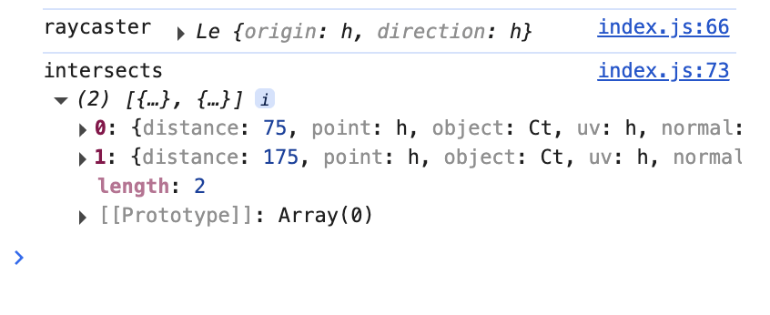
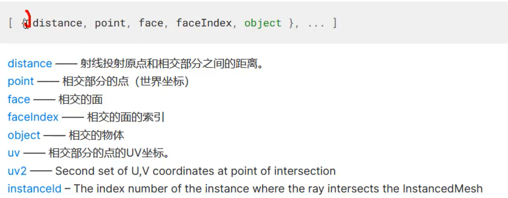

# 02 射线拾取模型

## 路线图

1. 把上一节学过的起点和方向设到 `Raycaster` 自带的射线上。
2. 用这条射线检查 `group.children`，得到按距离从近到远排列的命中记录。
3. 读取最近一条命中的模型与交点，把该模型变成绿色。

打开 [`index.html`](./index.html) 运行完整示例，控制台会输出命中记录。[`index.js`](./index.js) 在第一帧前完成拾取。下方代码可以接在同一个模块里运行，球模型来自 [`mesh.js`](./mesh.js)。

## 1. 设置射线

**一句话结论**　`Raycaster` 用自己的 `.ray` 检查模型是否被射线打中。

```js
import * as THREE from "three";
import { group } from "./mesh.js";

const rayCaster = new THREE.Raycaster();
rayCaster.ray.origin.set(-100, 0, 0);
rayCaster.ray.direction.set(1, 0, 0);
```

起点 `(-100, 0, 0)` 位于原点的 `−X` 一侧。方向 `(1, 0, 0)` 已经是单位向量，让射线沿 `+X` 前进，经过的点都满足 `Y = 0`、`Z = 0`。

**坑**　距离从 `origin` 开始算。改动射线起点后，即使交点坐标相同，`distance` 也可能改变。

## 2. 检查多个球

**一句话结论**　`intersectObjects()` 返回命中记录数组，最近的命中排在最前面。没有命中时返回空数组 `[]`。

```js
group.updateMatrixWorld(true);
const intersects = rayCaster.intersectObjects(group.children);
console.log(intersects);
```

`group.children` 是这次检查的三个球。先用 `updateMatrixWorld(true)` 更新组和子对象在场景中的位置，再调用 `intersectObjects()`。这样求交时就能使用 `mesh.js` 设置的位置，无需等第一帧渲染。

三个球的半径都是 `25`。射线经过 `Y = 0` 和 `Z = 0`，所以本例的两个交点都落在 X 轴上。

- `mesh1` 的球心在原点。沿 `+X` 先碰到球的左侧，交点 X 是 `0 − 25 = −25`。从起点到交点的距离是 `−25 − (−100) = 75`。
- `mesh2` 的球心在 `Y = 100`。射线一直在 `Y = 0`，高度差 `100` 大于半径 `25`，所以这次打不中。
- `mesh3` 的球心在 `X = 100`。先碰到它的左侧，交点 X 是 `100 − 25 = 75`。从起点到交点的距离是 `75 − (−100) = 175`。



**坑**　首帧前漏掉位置更新，模型就可能按旧位置参与求交。命中记录按 `distance` 从小到大排序，即使把检查名单倒过来，`mesh1` 仍排在 `mesh3` 前面。

## 3. 读取最近命中

**一句话结论**　先确认数组里有记录，再用 `intersects[0]` 读取最近的命中。

```js
if (intersects.length > 0) {
  const nearest = intersects[0];
  nearest.object.material.color.set(0x00ff00);
  console.log("最近命中的模型：", nearest.object);
  console.log("交点与距离：", nearest.point, nearest.distance);
}
```

`nearest.object` 是打中的模型，本例为 `mesh1`，把它的材质颜色设为绿色 `0x00ff00`。`nearest.point` 是交点在场景里的坐标 `(-25, 0, 0)`，`nearest.distance` 是射线起点到交点的距离 `75`，单位和场景坐标一致。

**坑**　空数组 `[]` 在 `if` 里也会被当成真。检查 `intersects.length > 0` 后再读第一条记录，否则没有命中时 `intersects[0]` 是 `undefined`。

> 📷 待补截图：三个球中只有最近命中的 `mesh1` 变绿。

### 了解即可

命中记录还可能包含相交的三角面 `face`、面的位置编号 `faceIndex` 等字段。本节先掌握 `object`、`point`、`distance`。



## 速记表

| 想知道什么 | 看哪里 |
| --- | --- |
| 检查了哪些模型 | `intersectObjects()` 的输入，本例是 `group.children` |
| 有无命中 | `intersects.length`，为 `0` 时没有命中 |
| 最近命中 | `intersects[0]` |
| 打中谁、在哪里、离起点多远 | `object`、`point`、`distance` |

## 自测

1. 三个球里哪个没打中？为什么？
2. 为什么 `mesh3` 的交点 X 坐标是 `75`，`distance` 却是 `175`？
3. 所有球都没打中时，`intersectObjects()` 返回什么？读取第一项前检查什么？

<details>
<summary>答案</summary>

1. `mesh2`。球心比射线高 `100` 个单位，而球的半径只有 `25`。
2. `75` 是交点在场景里的 X 坐标。距离从射线起点 `X = −100` 算起，所以是 `75 − (−100) = 175`。
3. 返回 `[]`。使用 `intersects.length > 0` 确认存在命中记录。

</details>

