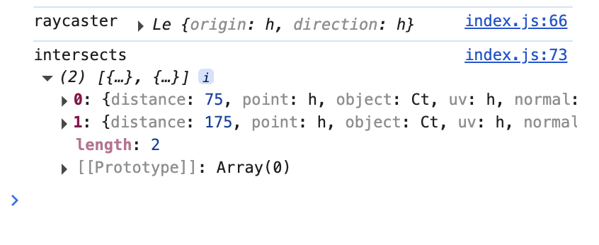
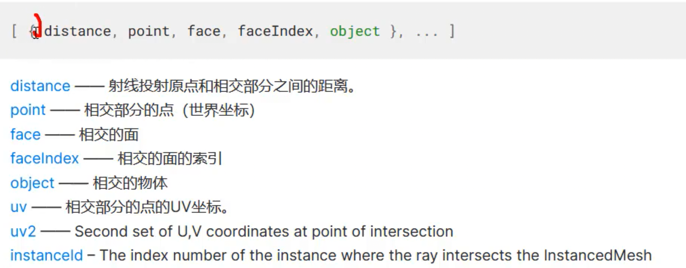

# 射线交叉计算方法

射线通过.intersectObjects()方法来计算和自身射线.ray相交的网格模型。

```typescript
// 射线交叉计算方法
const intersects=rayCaster.intersectObjects(group.children)
console.log('intersects',intersects)
```

它返回的将会是存在交叉的模型的参数，以数组形式呈现，不交叉的不会返回。





