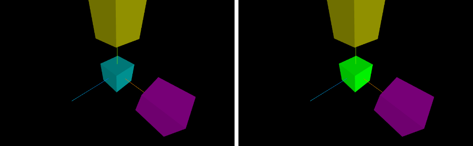
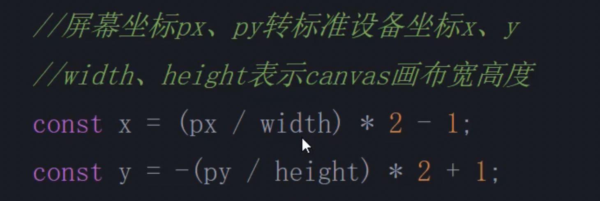

# 03 鼠标单击选中模型

## 路线图

1. **定位点击。** 把浏览器视口里的点击位置换算成画布内的像素坐标，再换成相机能用的标准设备坐标。
2. **生成射线。** 把上一步得到的二维位置和相机交给 `setFromCamera()`，得到上一节手动设置过的射线起点和方向。
3. **找到并标记模型。** 用这条射线检查三个方块，读取命中记录，给最近的两个不同模型着色。



左图是初始画面。点击原点处的青色方块后，右图中它变绿，其他两个方块保持各自的颜色。在本地静态服务中打开 [`index.html`](./index.html) 可操作。拾取代码位于 [`index.js`](./index.js)，三个方块来自 [`mesh.js`](./mesh.js)。

## 1. 屏幕坐标转换成标准设备坐标

**一句话结论**　先算鼠标在当前画布里的位置，再把 X、Y 换成 `−1` 到 `1` 的坐标，交给后面的 `setFromCamera()`。

```js
const rect = canvas.getBoundingClientRect();
const px = event.clientX - rect.left;
const py = event.clientY - rect.top;
pointer.set((px / rect.width) * 2 - 1, -(py / rect.height) * 2 + 1);
```

### 先分清三个坐标的原点

- `event.clientX`、`event.clientY` 从**浏览器可见区域的左上角**量起。`rect.left`、`rect.top` 是画布左上角在同一区域里的位置。
- `px`、`py` 从**画布左上角**量起。减去 `rect.left`、`rect.top`，就去掉了画布自己的偏移。`px` 向右增大，`py` 向下增大。
- **标准设备坐标（NDC）**用 `−1` 到 `1` 描述位置，原点在**画布中心**。X 向右增大，Y 向上增大。左上角是 `(-1, 1)`，右下角是 `(1, -1)`。

`getBoundingClientRect()` 在点击时读取画布的当前位置和显示尺寸。点击和 `rect` 都按 CSS 像素计量。渲染器可用 `devicePixelRatio` 提高实际绘制分辨率，点击换算仍用画布显示宽高。



原图的 `width`、`height` 对应当前代码的 `rect.width`、`rect.height`。

### X 的推导

`px / rect.width` 求点击点从左往右走了多大比例，结果从 `0` 到 `1`。NDC 的 X 区间总长度为 `2`，所以先乘 `2` 把范围拉到 `0` 到 `2`，再减 `1` 把左边界移到 `−1`。

```text
左边缘  px / rect.width = 0
        0 × 2 = 0
        0 − 1 = −1

右边缘  px / rect.width = 1
        1 × 2 = 2
        2 − 1 = 1
```

### Y 的推导

`py / rect.height` 求点击点从上往下走了多大比例。NDC 的顶部是 `1`，底部是 `−1`，所以乘 `−2` 让值随鼠标下移而减小，再加 `1` 让顶部从 `1` 开始。

```text
上边缘  py / rect.height = 0
        0 × (−2) = 0
        0 + 1 = 1

下边缘  py / rect.height = 1
        1 × (−2) = −2
        −2 + 1 = −1
```

**代入一次实际尺寸。** 假设画布在视口中的左上角是 `(40, 80)`，显示尺寸是 `800 × 400`。用户点击视口中的 `(240, 180)`。前两组数用于把视口坐标换算到画布内，显示宽高用于求各轴的比例。

```text
px = 240 − 40 = 200
py = 180 − 80 = 100

横向比例 = 200 ÷ 800 = 0.25
横向扩大到长度 2 = 0.25 × 2 = 0.5
NDC 的 X = 0.5 − 1 = −0.5

纵向比例 = 100 ÷ 400 = 0.25
纵向扩大并翻转 = 0.25 × (−2) = −0.5
NDC 的 Y = −0.5 + 1 = 0.5
```

`pointer.set(...)` 把 `(-0.5, 0.5)` 写进已有的 `Vector2`，下一步用它作为 `setFromCamera()` 的第一个参数。

**坑**　如果点击处理一直使用页面启动时读取的宽高，窗口缩放后就会把当前像素坐标除以旧尺寸，射线随之打偏。缩小时尤其容易看出这个问题。例如画布宽度从 `800` 变成 `400`，点击当前中心时 `px = 200`。用当前宽度算得 `X = 0`，用旧宽度会算出 `X = −0.5`。

## 2. 从二维位置生成三维射线

**一句话结论**　`setFromCamera(pointer, camera)` 根据点击位置和本例透视相机的状态，写入射线的起点和单位方向。

```js
camera.updateMatrixWorld();
raycaster.setFromCamera(pointer, camera);
```

1. `camera.updateMatrixWorld()` 更新相机在三维场景里的位置和朝向。拖动视角后，求交需要使用点击时的相机状态。
2. `setFromCamera()` 使用上一节算出的 `pointer` 确定画布上的位置，使用 `camera` 把它对应到三维场景。结果写进 `raycaster.ray`，下一步的 `intersectObjects()` 会使用这条射线。

### `setFromCamera()` 怎样得到起点和方向？

上一节手动给射线指定 `origin` 和 `direction`。本节从用户点击得到的是二维坐标。沿着相机看向同一个像素，可以有很多落在不同深度的三维点，所以点击能确定一条射线，具体打中哪里要等模型求交。

对本节的**透视相机**，Three.js `0.174.0` 按以下顺序计算。

1. **取起点。** 从 `camera.matrixWorld` 读取相机在场景中的世界位置，写入 `ray.origin`。
2. **选一个深度。** 给点击的 NDC 横纵坐标补上深度 `0.5`。这个值让 `(pointer.x, pointer.y, 0.5)` 在对应的视线上选定一个点，供下一步转换。它是 NDC 深度，单位和含义都与实际前进距离不同。原文的 `−1` 可以用来举例说明 WebGL 的近裁剪面，也能用于推导同一条透视射线。本节版本的 `setFromCamera()` 实际选的是 `0.5`。
3. **反投影。** 渲染时，相机把三维点投影到画布上。`unproject(camera)` 沿相反的转换方向，先用 `projectionMatrixInverse` 把选定的 NDC 点还原到相机坐标，再用 `matrixWorld` 转成场景中的点。这一步得到代码中的 `pointInWorld`。
4. **求单位方向。** 用 `pointInWorld` 减去 `ray.origin`，得到从相机指向这个点的向量。接上第一节的归一化，把它的长度变为 `1`，写入 `ray.direction`。

下面把透视相机分支拆成等价步骤。完整示例直接调用 `setFromCamera()`。

```js
const ray = raycaster.ray;
ray.origin.setFromMatrixPosition(camera.matrixWorld);

const pointInWorld = new THREE.Vector3(pointer.x, pointer.y, 0.5);
pointInWorld.unproject(camera);
ray.direction.subVectors(pointInWorld, ray.origin).normalize();
```

**坑**　如果把 `px`、`py` 直接传入，`setFromCamera()` 仍会把它们当成 NDC。前面例子的 `(200, 100)` 应先转换成 `(-0.5, 0.5)`，才能对准画布内的实际点击点。

## 3. 检查命中记录，给最近的模型着色

**一句话结论**　`intersectObjects()` 把命中记录按距离从近到远排列。第一条记录用于选最近模型，后面按 `object` 查找下一个不同模型。

下面是 [`index.js`](./index.js) 中整段可运行的拾取逻辑，直接使用该文件已经创建的 `canvas`、`camera`、`group` 和导入的 `THREE`。

```js
const raycaster = new THREE.Raycaster();
const pointer = new THREE.Vector2();

canvas.addEventListener("click", (event) => {
  const rect = canvas.getBoundingClientRect();
  const px = event.clientX - rect.left;
  const py = event.clientY - rect.top;
  pointer.set((px / rect.width) * 2 - 1, -(py / rect.height) * 2 + 1);

  camera.updateMatrixWorld();
  raycaster.setFromCamera(pointer, camera);
  const intersects = raycaster.intersectObjects(group.children);
  const nearest = intersects[0];
  if (!nearest) return;

  nearest.object.material.color.set(0x00ff00);
  const second = intersects.find((hit) => hit.object !== nearest.object);
  if (second) second.object.material.color.set(0x0000ff);
});
```

- `Raycaster` 和 `Vector2` 在注册点击处理前各创建一次。每次点击重写 `pointer`，再更新同一个 `raycaster` 的射线。监听器注册在 `canvas` 上，画布外的点击不会触发这段拾取逻辑。
- `intersectObjects(group.children)` 用刚生成的射线检查三个方块。每条记录的 `object` 是模型，`point` 是交点，`distance` 是从射线起点到交点的距离。记录按距离排序，所以 `intersects[0]` 是最近的一次命中。
- `if (!nearest) return;` 处理空白点击。求交返回 `[]`，取第一个元素得到 `undefined`。如果继续读取 `nearest.object`，程序会在这次点击处理里报错。提前返回后，上一帧已经呈现的颜色会保留，渲染循环照常运行。
- `nearest.object.material.color.set(0x00ff00)` 把最近模型的材质改成绿色。下一帧渲染时会读取新颜色。三个方块各有自己的材质，所以这里改一个方块的颜色，其他方块的材质不会跟着变。
- `find(...)` 沿已经排好的记录顺序查找，跳过所有与 `nearest.object` 相同的记录，返回第一条属于其他模型的记录。找到时用蓝色 `0x0000ff` 标记它。只打中一个方块时，`second` 是 `undefined`，所以跳过着色。

**坑**　一个方块的一个面由两个三角形组成。射线打在它们的公共边上时，同一方块可能占据前两条记录。浏览器验证中，把两个方块沿视线排好后，前两条记录属于近处的方块，后面的记录才属于远处方块。直接把 `intersects[1].object` 涂蓝，会把刚涂绿的近方块覆盖成蓝色。按 `object` 查找后，近方块变绿、远方块变蓝。

## 速记表

| 要解决的问题 | 看哪行 |
| --- | --- |
| 点击落在画布哪里 | `clientX/Y` 减去 `rect.left/top` |
| NDC 的 Y 为什么要翻转 | 画布 Y 向下，NDC 的 Y 向上 |
| 射线怎样得到 | `setFromCamera(pointer, camera)` 写入 `raycaster.ray` |
| 点击空白怎么处理 | `intersects[0]` 为 `undefined`，结束本次点击处理 |
| 怎样找第二个不同模型 | 按距离顺序查找第一个 `object` 与最近命中不同的记录 |

## 自测

1. 画布左上角和中心各对应什么 NDC？为什么 Y 的公式带负号？
2. 画布宽从 `800` 变到 `400`，现在点中心。继续除以 `800` 会得到什么 X？
3. 透视相机下，为什么任选点击方向上的一个深度，就能算出方向？什么时候才能知道真正的交点？
4. 点击空白时 `nearest` 是什么？如果前两条命中来自同一个方块，又怎样找到第二个模型？

<details>
<summary>答案</summary>

1. 左上角是 `(-1, 1)`，中心是 `(0, 0)`。画布 Y 向下增大，NDC 的 Y 向上增大。
2. 当前中心的 `px` 是 `200`。`200 ÷ 800 = 0.25`，乘 `2` 得 `0.5`，再减 `1` 得 `−0.5`。用当前宽 `400` 才会算出 `0`。
3. 同一个画布位置在不同深度的三维点，都沿同一条从透视相机出发的射线排列。选出其中一个点后，用它减起点并归一化即可得到方向。与模型求交后才知道真正的交点。
4. `nearest` 是 `undefined`，本次处理提前结束。命中时用 `find()` 跳过相同的 `object`，找距离最近的另一模型。

</details>
