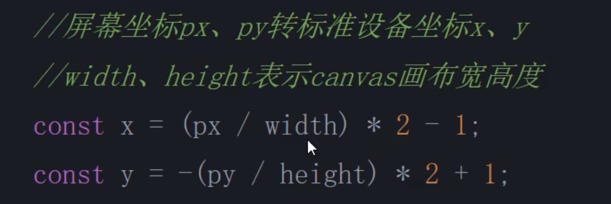

# 屏幕坐标转化标准设备坐标



这是一个在 Three.js 或 WebGL 中非常标准和关键的操作，目的是将我们在屏幕上点击的像素坐标转换为 **Three.js 内部进行射线计算时所使用的标准设备坐标** (Normalized Device Coordinates, NDC)。

我们先理解两种坐标系的区别：

1. 屏幕坐标系 (Screen Coordinates)：

- 这是浏览器 canvas 元素的坐标系。

- 原点 (0, 0) 在画布的左上角。

- X 轴向右为正，范围是 [0, width]。

- Y 轴向下为正，范围是 [0, height]。

1. 标准设备坐标系 (NDC)：

- 这是 Three.js 内部使用的坐标系，它不关心屏幕的具体像素尺寸。

- 原点 (0, 0) 在画布的中心。

- X 轴向右为正，范围是 [-1, 1]。

- Y 轴向上为正，范围是 [-1, 1]。

现在我们来一步步拆解公式：

------

### X 坐标转换： const x = (px / width) * 2 - 1;

这个公式将屏幕 X 坐标 px (范围 [0, width]) 映射到 NDC 的 X 坐标 (范围 [-1, 1])。

1. (px / width): 这一步叫做归一化。它将 px 的值从 [0, width] 的范围转换到 [0, 1] 的范围。

- 当鼠标在最左边时，px = 0，结果是 0。

- 当鼠标在最右边时，px = width，结果是 1。

1. \* 2: 将 [0, 1] 的范围乘以2，变成 [0, 2] 的范围。

1. \- 1: 将 [0, 2] 的范围减去1，就得到了 [-1, 1] 的范围。

至此，屏幕的 X 坐标就成功映射到了 NDC 的 X 坐标。

------

### Y 坐标转换： const y = -(py / height) * 2 + 1;

这个公式更巧妙一些，因为它同时处理了范围映射和 Y 轴翻转。

1. (py / height): 和 X 轴一样，将 py 的值从 [0, height] 的范围归一化到 [0, 1] 的范围。

- 当鼠标在最顶上时，py = 0，结果是 0。

- 当鼠标在最底下时，py = height，结果是 1。

1. -(...) * 2 + 1: 我们直接代入两个端点来看它的效果：

- 当鼠标在最顶上 (py = 0) 时:

y = -(0 / height) * 2 + 1 = 0 + 1 = 1。 这正好是 NDC 坐标系的顶部。

- 当鼠标在最底下 (py = height) 时:

y = -(height / height) * 2 + 1 = -1 * 2 + 1 = -2 + 1 = -1。这正好是 NDC 坐标系的底部。

通过这个公式，屏幕从上到下 (0 -> height) 的 Y 坐标，被完美地映射到了 NDC 从上到下 (1 -> -1) 的 Y 坐标。

### 总结

这两行代码的核心就是做了一个线性变换，将基于左上角原点和像素单位的屏幕坐标，转换成了基于中心原点和 [-1, 1] 范围的标准化坐标。这是后续 Raycaster (光线投射) 能准确从相机位置、穿过鼠标所指的点、并射入3D场景中进行物体拾取计算的必要前提。

# Three.js 中通过射线拾取模型详解

您提供的这段代码展示了在 Three.js 场景中，通过鼠标单击来选中一个或多个3D模型的标准流程。这在3D交互中通常被称为“射线拾取”或“射线投射”。

### 核心问题：为什么是这种方式？

是的，通过射线投射器（Raycaster）进行拾取，是目前在 3D 图形应用中实现鼠标选中模型的标准且最主流的方法。

原因是，我们的屏幕是2D的，而3D场景是立体的。我们需要一种方式，将用户在2D屏幕上的一个点击动作，精确地“翻译”成3D空间中的一个指向。射线投射就完美地解决了这个问题。它会从相机（我们的眼睛）的位置，发射一条穿过鼠标点击位置的、无限延伸的虚拟射线。这条射线在3D场景中碰到的第一个物体，通常就是我们想要选中的目标。

------

### 代码分步解析

接下来，我们把您提供的代码拆解为三个主要步骤来详细讲解。

```js
// ... existing code ...
// 射线选中模型流程全解
addEventListener('click',(event)=>{
  // 1.座标转化(屏幕坐标转标准设备坐标)
  const px=event.offsetX
  const py=event.offsetY
  // 屏幕坐标px,py转WebGL标准设备坐标x,y
  // width,height表示canvas画布宽高度
  const x=(px/width)*2-1
  const y=-(py/height)*2+1

  // 2.创建一个射线投射器Raycaster
  const raycaster=new THREE.Raycaster()
  // setFromCamera()是用于计算射线投射器Raycaster的射线属性.ray
  // 也就是在点击位置创建一条射线，用于选中拾取模型对象
  // 这种方式不用定义射线起点和射线方向
  raycaster.setFromCamera(new THREE.Vector2(x,y),camera)
  // 3.获取交叉模型并处理
  const intersects=raycaster.intersectObjects(group.children)
  if(intersects.length>0){
    // 选中的模型第一个设置为绿色
    intersects[0].object.material.color.set(0x00ff00)
    // 选中的模型第二个设置为蓝色 (这里需要注意)
    if (intersects[1]) {
      intersects[1].object.material.color.set(0x0000ff)
    }
  }
})
// ... existing code ...
```

#### 步骤 1: 坐标转化 (屏幕坐标 -> 标准设备坐标)

```typescript
const px = event.offsetX;
const py = event.offsetY;

// width,height表示canvas画布宽高度
const x = (px / width) * 2 - 1;
const y = -(py / height) * 2 + 1;
```

- event.offsetX 和 event.offsetY：这是鼠标点击位置相对于 canvas 画布左上角的像素坐标。

- 标准设备坐标 (Normalized Device Coordinates, NDC)：这是 WebGL/Three.js 内部使用的一种坐标系。它的中心点是 (0,0)，x 和 y 轴的范围都是 [-1, 1]。

- 转换公式：

- (px / width) 将 x 坐标归一化到 [0, 1] 范围。乘以 2 再减 1，就映射到了 [-1, 1]。

- y 坐标的转换类似，但多了一个负号 -(py / height)。这是因为屏幕坐标的 y 轴向下为正，而标准设备坐标的 y 轴向上为正，所以需要翻转。

#### 步骤 2: 创建并设置射线

```js
const raycaster = new THREE.Raycaster();
raycaster.setFromCamera(new THREE.Vector2(x, y), camera);
```

- new THREE.Raycaster()：实例化一个射线投射器对象。

- .setFromCamera(coords, camera)：这是一个非常方便的函数。我们只需要把上一步计算出的标准设备坐标 (x, y) 和当前场景的相机 camera 传给它，Three.js 就会自动计算出射线的起点（即相机的位置）和方向（从相机出发，穿过鼠标点击位置指向远处）。

#### 步骤 3: 执行投射并处理结果

```typescript
const intersects = raycaster.intersectObjects(group.children);

if (intersects.length > 0) {
  // 选中的模型第一个设置为绿色
  intersects[0].object.material.color.set(0x00ff00);
  // 选中的模型第二个设置为蓝色
  if (intersects[1]) {
    intersects[1].object.material.color.set(0x0000ff);
  }
}
```

- .intersectObjects(objects)：这是执行投射的核心方法。它会检测当前射线与指定的一组物体（这里是 group.children）是否相交。

- 返回值 intersects：

  - 这是一个数组，包含了所有被射线“击中”的物体。

  - 这个数组是按距离排好序的，intersects[0] 是离相机最近的物体，intersects[1] 是第二近的，以此类推。

  - 如果没击中任何物体，数组为空。

- 处理结果：

  - 代码检查 intersects 数组的长度是否大于 0，来判断是否选中了物体。

  - intersects[0].object 指向被击中的那个最近的 THREE.Mesh 对象。然后代码修改了它的材质颜色。

  - 您的原始代码 intersects[1].object.material.color.set(0x0000ff) 在只击中一个物体时会报错。我已在上面的建议代码中增加了一个 if (intersects[1]) 判断，以确保在尝试访问第二个元素前，它确实存在。

### 总结

总而言之，您代码中的流程是现代 Web 3D 开发中实现拾取交互的典范。它精确、高效，并且被 Three.js 封装得非常易于使用，是您在开发需要模型选取的项目时应该采用的标准方法。


## 三维空间向量是如何计算的？

我们的确只给 setFromCamera 函数提供了一个二维向量 new THREE.Vector2(x,y)。

那它是如何计算出三维空间中的射线的呢？

**答案是：它结合了我们传入的第二个参数——camera 对象。**

一条射线在三维空间中被定义，需要两个关键信息：

1. 起点 (Origin)：射线从哪里发射。

1. 方向 (Direction)：射线朝哪个方向发射。

setFromCamera 方法巧妙地利用 Vector2 和 camera 对象，计算出了这两个关键信息。

------

### 核心思想：结合相机信息进行“逆向工程”

您可以把这个过程想象成一个“逆向工程”。

正常的渲染流程是：

\> 3D 世界坐标 -> 通过相机矩阵变换 -> 投影到 2D 屏幕坐标

而射线拾取是反过来的：

\> 2D 屏幕坐标 -> 通过相机矩阵逆变换 -> “反投影”出 3D 世界中的一条射线

`setFromCamera(coords, camera)` 内部就执行了这个逆向过程。

### setFromCamera 的内部魔法

下面是它具体的工作步骤：

#### 1. 计算射线的 起点 (Origin)

这一点最简单。射线就是从我们的“眼睛”，也就是相机的位置发射出去的。所以，setFromCamera 直接将射线的起点设置为相机在世界坐标系中的位置。

```js
ray.origin.copy(camera.position); // 更准确地说是使用相机的世界矩阵 camera.matrixWorld
```

#### 2. 计算射线的 方向 (Direction)

这是最关键的一步，也是二维向量发挥作用的地方。

1. 升级到 3D 坐标：我们传入的 (x, y) 是标准设备坐标 (NDC)，其 x 和 y 的范围都是 [-1, 1]。为了在 3D 空间中定位这个点，setFromCamera 会给它补充一个 z 坐标。它使用 -1 作为 z 值，构成一个三维向量 (x, y, -1)。这个点代表了在相机视锥体 (Frustum) 的近裁剪平面 (Near Plane) 上，与鼠标点击位置对应的那一个点。
2. 反投影 (Unprojection)：现在我们有了一个在相机裁剪空间中的 3D 点 (x, y, -1)。setFromCamera 会使用相机提供的投影矩阵的逆矩阵 (projectionMatrixInverse) 和世界矩阵 (matrixWorld)，将这个点从“相机空间”转换回“世界空间”。
3. 计算方向向量：经过上一步，我们得到了鼠标点击位置在世界空间中近裁剪平面上的对应点 P。射线的方向，就是从相机位置（射线的起点）指向这个点 P 的向量。

```typescript
    // 伪代码
    const point_P_in_world = unproject(new THREE.Vector3(x, y, -1), camera);
    ray.direction.subVectors(point_P_in_world, ray.origin).normalize();
```

normalize() 会将这个方向向量的长度变为 1，因为它只表示方向，不表示距离。

### 总结

所以，new THREE.Vector2(x,y) 提供了射线方向的“线索”，而 camera 对象则提供了所有必要的“3D 上下文”，包括：

- 相机在世界中的位置（用于确定射线起点）。

- 相机在世界中的朝向。

- 相机的视场、宽高比、近/远裁剪平面（这些信息都包含在 projectionMatrix 中，用于精确地进行反投影计算）。

两者结合，setFromCamera 就能精确地构建出一条从相机出发、穿过鼠标点击位置、射入 3D 场景的射线。