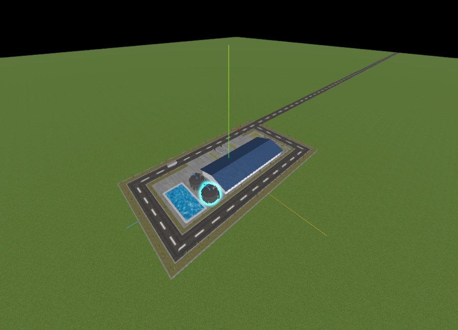

# 04 · 拾取层级模型



从本节目录用 HTTP 服务打开 `index.html`，入口按 `index.html` 的导入映射加载 Three.js `0.174.0`。点击图中靠近蓝色水池的两台储罐，观察整台设备的轮廓。浏览器实测了选中 A、切换到 B、点空白清空、改变窗口大小后重新选中。

## 路线图

1. 接上上一节的画布坐标和 `setFromCamera()`，得到一次点击对应的射线。
2. 用这条射线检查储罐分组，找出与相机最近的命中记录。
3. 用初始化时登记的从属关系，把命中的零件换成它所属的整台设备。
4. 把整台设备交给 `OutlinePass` 描边。没有命中时清空上次的选择。

## 1. 射线命中的是哪一级？

**一句话结论**　`hits[0].object` 是最近那条命中记录里的网格，`hits[0]` 的顺序由距离决定。

```js
const hits = raycaster.intersectObjects(devices, true);
if (hits.length > 0) {
  const part = hits[0].object;
  console.log(part.name);
}
```

这段用来查看本节 `index.js` 中准备好的 `raycaster` 和 `devices`。`raycaster` 在上一行 `setFromCamera(pointer, camera)` 中拿到了这次点击的射线。`devices` 来自模型中的 `存储罐.children`，摆在这个数组里的是两台设备。`true` 让 `intersectObjects()` 继续往每台设备的子节点里查。如果设成 `false`，只检查传入的设备节点，本模型的设备根节点是分组，射线到不了子网格。

两节使用的 `工厂.glb` 中，这部分结构相同。`Mesh`（网格）是有实际表面、可以被本例射线打中的零件。设备节点负责把它们组织在一起。

```text
工厂场景（gltf.scene）
└─ 存储罐
   ├─ 设备A → 14 个零件网格、设备A标注
   └─ 设备B → 14 个零件网格、设备B标注
```

可以沿用原笔记的乐高汽车比喻。射线像手指，戳中的是车身或左前轮这种具体零件。`hits` 是按碰到的距离从近到远排列的报告，第一条报告的 `.object` 就是你戳中的零件。整辆车对应的是代码想选中的那一级设备。`gltf.scene` 在本例里还包含道路、水池等其他内容，范围比单台设备大。

**坑**　把 `outlinePass.selectedObjects = [hits[0].object]` 写进回调，描边范围就只有被打到的那个零件。数组中的第一条命中也不一定来自 `devices[0]`。即使 `设备A` 写在数组前面，点击 `设备B` 时第一条命中照样可以来自 B。

## 2. 怎样从零件找到整台设备？

**一句话结论**　模型加载完成后，把「每个网格归哪台设备」登记在 `deviceByMesh` 里，点击时用命中的网格查表。

`mesh.js` 的 `loadFactory()` 异步读取同目录的 `工厂.glb`，加载完成才交回 `gltf.scene`。`index.js` 中有以下准备过程。

```js
const deviceByMesh = new Map();
let devices = [];

loadFactory().then((factory) => {
  scene.add(factory);
  const storageTanks = factory.getObjectByName("存储罐");
  if (!storageTanks) {
    console.error("工厂模型中找不到存储罐分组。");
    return;
  }

  devices = storageTanks.children;
  for (const device of devices) {
    device.traverse((part) => {
      if (part.isMesh) deviceByMesh.set(part, device);
    });
  }
  factory.updateWorldMatrix(true, true);
}).catch((error) => {
  console.error("加载工厂模型失败：", error);
});
```

1. `devices` 先是空数组。点击监听器可以提前注册，如果模型还没到，射线检查空数组就会得到空结果。原代码直接读取 `cunchu.children`，加载前点击可能访问到 `undefined.children`。
2. `factory.getObjectByName("存储罐")` 从 GLB 场景里找到设备集合。如果资源改名了，先报告缺少分组，再结束这次初始化，避免继续读取它的 `.children`。
3. `storageTanks.children` 给出选中粒度。循环每次拿到的是一台设备，例如 `设备A`。`device.traverse()` 会进入它的各级子节点，遇到网格就记录「这个网格 → 这台设备」。`Map` 是按键查值的表，这里用对象本身作键，即使零件重名也能区分。
4. `factory.updateWorldMatrix(true, true)` 刷新工厂及其后代在场景中的位置。射线求交要用各零件的场景位置，加载完成后即使第一次渲染尚未发生，这些位置也可供求交使用。

原文用自定义属性 `part.ancestors = device` 登记同一关系，然后通过 `hit.object.ancestors` 取回设备。`.ancestors` 是示例自己起的名字，和 Three.js 的 `.parent` 是两回事。`.parent` 只向上一层，登记表里的值始终是 `存储罐` 的直接子节点，模型增加一层内部组也能回到同一级设备。新版把登记集中在 `Map` 里，加载完成时做一次。

**坑**　把整座 `factory` 登记成每个网格的归属，点哪个零件都会选中整座工厂。登记时要用当前循环拿到的 `device`。

## 3. 把查到的设备交给描边

**一句话结论**　`outlinePass.selectedObjects` 接收要描边的对象数组，传入设备根节点就能覆盖它下面的网格。

```js
const hits = raycaster.intersectObjects(devices, true);
const device = hits.length > 0 ? deviceByMesh.get(hits[0].object) : undefined;
outlinePass.selectedObjects = device ? [device] : [];
```

以点击 `设备A` 的罐身为例。`intersectObjects()` 返回最近的命中记录后，`hits[0].object` 交出罐身网格，`deviceByMesh.get(...)` 用它查到 `设备A`。下一帧 `composer.render()` 执行后期处理，描边通道从 `selectedObjects` 读取 `设备A` 并描出该设备的轮廓。点到没有储罐命中的位置时，代码传入空数组清空上次结果。

本例保持原有后期处理顺序：场景画面 → 描边 → FXAA 抗锯齿 → 输出颜色。调整窗口大小时，相机比例、WebGL 画布、后期处理缓冲区和 FXAA 使用的像素尺寸一起更新。FXAA 中的 `1 / drawingBufferSize.x` 和 `1 / drawingBufferSize.y` 表示横向、纵向一个实际渲染像素的步长，供抗锯齿通道取相邻像素使用。

**坑**　只在命中时修改 `selectedObjects`，点空白就会留着上次的描边。此处给未命中的分支赋 `[]`，把「清空」也当成一次明确的选择结果。

## 复习 · 像素怎样变成射线

**一句话结论**　先把点击换成画布内的像素，再把像素换成相机投影约定的 NDC，最后由相机把二维位置对应到三维射线。

```js
const rect = canvas.getBoundingClientRect();
if (!rect.width || !rect.height) return;

const px = event.clientX - rect.left;
const py = event.clientY - rect.top;
pointer.set((px / rect.width) * 2 - 1, 1 - (py / rect.height) * 2);

camera.updateMatrixWorld();
raycaster.setFromCamera(pointer, camera);
```

`rect` 是浏览器测出来的画布矩形。`rect.left`、`rect.top` 是画布左上角在浏览器可见区域里的位置，`rect.width`、`rect.height` 是显示宽高。鼠标的 `clientX`、`clientY` 也从浏览器可见区域左上角量起。把两个位置相减，`px`、`py` 就从画布左上角量起了。画布宽或高为零时直接返回，避免下一行除以零。

**NDC（归一化设备坐标）**给画面定了一套固定刻度。画面左边 `x = −1`，右边 `x = +1`，下边 `y = −1`，上边 `y = +1`，中心是 `(0, 0)`。除以画布宽高就得到相对位置，所以画布大小变了，同一相对位置仍对应同一组 NDC。浏览器的 `y` 向下增加，NDC 的 `y` 向上增加，所以换算 `y` 时从顶部的 `+1` 开始减。

沿用上一节的例子。画布宽 `800`、高 `400`，点击从画布左上角往右 `200`、往下 `100`，这些数字都以 CSS 像素计。先除以宽高求比例，再乘以 `2`，因为 NDC 从一端到另一端跨两个单位。

```text
横向比例 = 200 ÷ 800
         = 0.25
NDC x    = 0.25 × 2 − 1
         = 0.5 − 1
         = −0.5

纵向比例 = 100 ÷ 400
         = 0.25
NDC y    = 1 − 0.25 × 2
         = 1 − 0.5
         = +0.5
```

`camera.updateMatrixWorld()` 刷新相机在场景里的位置和朝向。`setFromCamera(pointer, camera)` 随后用相机和这组 NDC 更新 `raycaster.ray`。相机转动后，点击画布同一个位置，在三维场景里对应的方向也会跟着转。

**坑**　坐标换算用画布矩形的宽高。假如画布后来放进页面里的某个区域，继续用整个窗口的宽高，算出的射线会偏离实际点击位置。

### 了解即可 · 为什么传二维向量，内部却会补一个深度？

对本例的透视相机，射线从相机位置出发。画面上同一个位置，可以投影自这条射线上近处或远处的点，所以点击的 `x`、`y` 已经确定了朝向。`pointer` 只传这两个量。下面是本例 Three.js `0.174.0` 透视相机分支的等价写法。正式入口使用 `setFromCamera()`。

```js
const ray = raycaster.ray;
ray.origin.setFromMatrixPosition(camera.matrixWorld);

const pointInWorld = new THREE.Vector3(pointer.x, pointer.y, 0.5);
pointInWorld.unproject(camera);
ray.direction.subVectors(pointInWorld, ray.origin).normalize();
```

- `ray.origin` 从 `camera.matrixWorld` 读取相机在场景里的位置，这就是射线起点。
- `0.5` 是库给参考点补的 **NDC 深度**。用在 `new THREE.Vector3(...)` 里，让 `unproject()` 能在视线上选出一个点。此时的三个分量仍然都属于 NDC。
- `unproject(camera)` 是反投影，也就是把画面位置加上选定的深度换回三维位置。它先用 `camera.projectionMatrixInverse` 换到相机坐标，再用 `camera.matrixWorld` 换到场景坐标。执行完成后，`pointInWorld` 是场景里的参考点。
- `subVectors()` 计算 `参考点 − 相机位置`，得到从相机指向参考点的位移。`.normalize()` 把位移长度变为 `1`，将单位方向写入 `ray.direction`。此时起点和方向都确定了，下一步才检查是否打中设备。

在本例的 WebGL 投影约定里，NDC 深度 `−1` 对应近裁剪面，`+1` 对应远裁剪面。近、远裁剪面是相机可见范围的前后边界。原笔记还用这两个端点推导方向。下面使用本节已导入的 `THREE`、已更新矩阵的 `camera` 和换算好的 `pointer` 复现这套推导。

```js
const nearPoint = new THREE.Vector3(pointer.x, pointer.y, -1).unproject(camera);
const farPoint = new THREE.Vector3(pointer.x, pointer.y, 1).unproject(camera);
const direction = new THREE.Vector3().subVectors(farPoint, nearPoint).normalize();
```

固定 `pointer.x`、`pointer.y`，两次反投影就会在同一条视线上分别取得近点和远点。「远点 − 近点」得到沿视线向前的位移。归一化之后，它与库里「`0.5` 对应的参考点 − 相机位置」得到的单位方向相同。**本例的射线起点取相机位置。** 如果把起点改成近点，从相机到近裁剪面之间那一段就不参与求交。

## 速记

| 要找什么 | 看哪一行 |
| --- | --- |
| 点击对应的射线 | `rect` 换量坐标的起点，`pointer` 保存 NDC，`setFromCamera()` 用相机生成射线 |
| 最近命中的零件 | `intersectObjects(devices, true)` 对设备及其后代求交，取 `hits[0].object` |
| 应描边的整台设备 | `deviceByMesh.get(mesh)` 把零件换成设备，`selectedObjects` 把设备交给描边通道 |

## 自测

1. 为什么传入 `devices` 后，`hits[0].object` 仍然可能是罐身网格？
2. 模型加载完之前点击，`devices` 是什么？这次点击会产生描边吗？
3. 如果射线打中 `设备B` 的零件，哪个对象应写进 `selectedObjects`？它是怎么找到的？
4. 为什么 `setFromCamera()` 的参数 `pointer` 只需要两个分量？

<details>
<summary>查看答案</summary>

1. 第二个参数 `true` 让射线递归检查各设备的子节点。命中记录保存实际碰到的网格。
2. `devices` 是空数组，求交结果也是空数组，本次选择会清空描边。
3. 写入 `[设备B]`。以命中的零件网格为键，从预先建立的 `deviceByMesh` 查出它所属的设备。
4. 对透视相机，横纵两项和相机一起就能确定视线。Three.js 内部另选一个 NDC 深度做反投影，得到计算方向所需的三维参考点。

</details>
