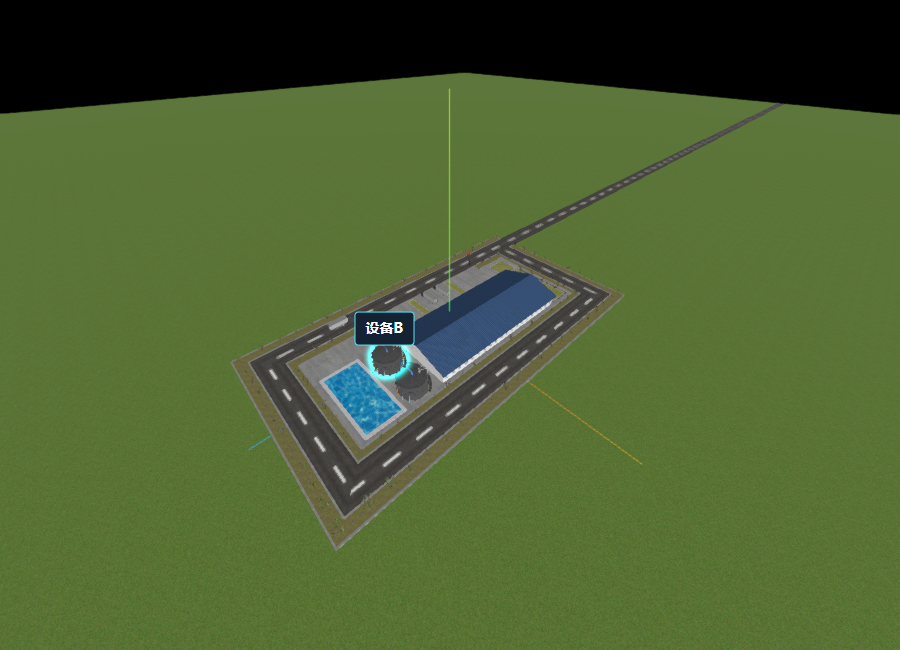

# 05 · 场景标注标签信息



从本节目录用 HTTP 服务打开 `index.html`。点击储罐，青色描边指出选中了哪台设备，名称标签显示设备叫什么。可用鼠标拖动画面切换观察角度。本节用相同的相机分别绘制场景画面和标签，标签跟随它所挂的设备标注点。Chrome 实测了 A、B 切换时的标签内容、投影位置、清空及窗口缩放。

## 路线图

1. 复用 04 的「命中零件 → 找回整台设备」，得到标签要显示的设备对象。
2. 用该设备的名称找到模型预留的标注节点，确定标签在三维场景里的位置。
3. 把显示名称的 HTML 元素包装成标签对象，挂到这个标注节点上。
4. 每帧用同一台相机绘制工厂和标签，点击另一台设备时移动标签，未命中时移除标签。

## 1. 从点击的零件拿到整台设备

**一句话结论**　先在模型加载时建好「零件 → 整台设备」映射表，点击时描边和标签都使用查表得到的同一个 `device`，这样显示的名称与被描边的设备一致。

上一节的乐高汽车比喻在这里也适用。鼠标点到的是轮子或车身，标签应写的是整辆车的名称。工厂场景包含道路、水池和设备，`存储罐.children` 限定了本例参与拾取的对象。模型加载后，每台设备递归遍历自己的网格，`deviceByMesh.set(part, device)` 把零件归到该设备。点击时执行 04 中同样的查找。

**关键参数先看清**

- `devices`：`存储罐.children`，只包含 `设备A`、`设备B`，避免点到道路、水池触发选中。
- `intersectObjects(devices, true)` 中的 `true`：递归检查开关。因为网格零件在设备分组内部，必须传 `true` 才会继续检查设备内部的零件。
- `deviceByMesh`：`Map` 映射表（相当于原笔记的 `part.ancestors` 自定义属性），作用是从命中的网格零件反查出所属的整台设备根节点。

**最小可运行代码**（位于 `index.js`，依赖 `mesh.js` 的 `loadFactory()`）

```js
// 1）模型加载后，把每台设备下的所有网格零件登记到映射表
const deviceByMesh = new Map();
let devices = [];

loadFactory().then((factory) => {
  scene.add(factory);
  const storageTanks = factory.getObjectByName("存储罐");
  if (!storageTanks) return;

  devices = storageTanks.children;
  for (const device of devices) {
    device.traverse((part) => {
      if (part.isMesh) deviceByMesh.set(part, device);
    });
  }
  factory.updateWorldMatrix(true, true);
});

// 2）点击时，按最近命中的零件反查整台设备（✅ 正例）
const hits = raycaster.intersectObjects(devices, true);
const device = hits.length > 0 ? deviceByMesh.get(hits[0].object) : undefined;
outlinePass.selectedObjects = device ? [device] : [];
```

`true` 会继续检查设备内部的零件。`hits[0]` 是离射线起点最近的一条命中记录，它的 `.object` 是被打中的网格。`deviceByMesh` 相当于原笔记的 `part.ancestors` 自定义属性，作用是从网格找到设备根节点。只给 `outlinePass` 传 `[hits[0].object]` 会只描边那一个零件，把 `hits[0].object.name` 用作标签则会显示零件名。这里先取得 `device`，再用它同时决定描边和标签。

**常见错误写法对比（❌ 反例）**

```js
// ❌ 反例 1：不查表，直接把命中的单个零件交给描边和标签
const hitMesh = hits.length > 0 ? hits[0].object : undefined;
outlinePass.selectedObjects = hitMesh ? [hitMesh] : [];
// 结果：只描边这一个零件；若用 hitMesh.name 当标签，显示的也是零件名而不是「设备B」

// ❌ 反例 2：不按实际命中结果查，直接拿 devices[0]
const device = hits.length > 0 ? devices[0] : undefined;
// 结果：点击设备B时，依然会选中并显示设备A
```

**坑**　拿 `devices[0]` 当选中设备，点击 `设备B` 时仍会显示 `设备A`。先看最近一条命中，再按命中的网格查找设备。

## 2. 标签应该挂在哪里？

**一句话结论**　模型给每台设备预留了标注点，找到它以后，标签就能用这个点的场景位置。

在本例 `工厂.glb` 中，`存储罐` 下有 `设备A` 和 `设备B`。每台设备含 14 个网格，外加一个用于定位的节点。`设备A标注` 和 `设备B标注` 就是这样的节点。可以把它理解为模型作者预先指定的「标签挂钩」。它随所属设备一起移动，能提供三维位置。

**关键参数先看清**

- `` `${device.name}标注` ``：按模型约定的命名规则拼出标注节点名（如 `设备B` → `设备B标注`）。
- `device?.getObjectByName(...)` 中的 `?.`：可选链保护。点空白时 `device` 是 `undefined`，跳过查找并安全返回 `undefined`，避免报错。

```js
const anchor = device?.getObjectByName(`${device.name}标注`);
```

以选中 `设备B` 为例。`device.name` 是 `设备B`，补上 `标注` 得到 `设备B标注`。`getObjectByName()` 从这台设备往下找该节点，结果放在 `anchor` 中。点空白时 `device` 是 `undefined`，`?.` 让查找跳过，`anchor` 也得到 `undefined`。下一步要根据它决定是否挂上标签。

**坑**　命中记录的 `hits[0].point` 会随点击位置改变。用它放标签，点同一台设备的顶部和侧面会出现两个不同的位置。本例用模型内固定的标注点作为同一台设备的标签位置。

## 3. 怎样让 HTML 标签跟着标注点走？

**一句话结论**　先把 HTML 元素包装成 `CSS2DObject`，再用 `CSS2DRenderer` 把它在场景中的位置换成屏幕上的位置。

### 创建一个可重复使用的标签

**关键参数先看清**

- `.label-layer` 的关键 CSS（位于 `index.html`）：用绝对定位铺满画布，并用 `pointer-events: none` 让鼠标事件穿透到下层画布。
- `label.center.set(0.5, 1)`：指定标签自身的对齐点，两个数都是标签自身宽高的比例（横向 `0.5` 为中点，纵向 `1` 为底边）。

```css
/* index.html */
.label-layer {
  position: absolute;
  inset: 0;
  pointer-events: none;
}
```

```js
/* index.js */
import { CSS2DObject, CSS2DRenderer } from "three/addons/renderers/CSS2DRenderer.js";

const labelRenderer = new CSS2DRenderer();
labelRenderer.domElement.className = "label-layer";
document.body.appendChild(labelRenderer.domElement);

const labelElement = document.createElement("div");
labelElement.className = "device-label";
const label = new CSS2DObject(labelElement);
label.center.set(0.5, 1);
```

- `CSS2DRenderer` 是负责摆放 HTML 标签的渲染器。它有自己的 `domElement` 容器，代码把容器加到页面。本节 `index.html` 把 `.label-layer` 定位成覆盖画布的层。
- `labelElement` 负责呈现文字和 CSS 样式。`new CSS2DObject(labelElement)` 则让这个元素有了可挂到 Three.js 场景树上的对象 `label`。每次点击复用它。
- `.center.set(0.5, 1)` 指定标签用哪个位置对齐到模型标注点。横向 `0.5` 代表标签宽度的中间，纵向 `1` 代表标签底边，所以标签的底边中点贴着标注点，文字显示在它上方。这两个数都是标签自身宽高的比例。

### 点击时挂到当前设备，下一帧显示

下面是 `index.js` 点击处理的最后一段，紧接在更新描边数组之后。

```js
const anchor = device?.getObjectByName(`${device.name}标注`);
if (anchor) {
  labelElement.textContent = device.name;
  anchor.add(label);
} else {
  label.removeFromParent();
}
```

`textContent` 更新文字。`anchor.add(label)` 把 `label` 放到标注节点下面。`label` 的局部位置默认在父节点原点，因此它的场景位置与 `anchor` 一致。切换设备时，`add()` 会把这个标签从旧父节点移到新父节点，所以同一时间显示一个名称。点击没有命中储罐的位置，或者选中的设备缺少标注节点时，`removeFromParent()` 把标签从场景树中移除。

接下来每帧跑以下代码。`composer.render()` 负责工厂画面和描边，`labelRenderer.render(scene, camera)` 用同一个场景和相机算出标签在画面中的位置。拖动相机后，下一帧就能重新计算标签位置。

```js
renderer.setAnimationLoop(() => {
  controls.update();
  composer.render();
  labelRenderer.render(scene, camera);
});
```

页面初始化以及窗口大小变化时，`resize()` 都会执行 `labelRenderer.setSize(width, height)`。这两个值是和画布对齐所需的 CSS 像素宽高。WebGL 与后期处理缓冲区使用实际渲染像素，大小还会乘设备像素比例。标签层按页面的 CSS 像素定位。

**坑**　标签层覆盖在画布上面。如果它接收鼠标事件，画布的点击和旋转操作可能收不到事件。本例的 `.label-layer` 设了 `pointer-events: none`，鼠标操作可以落到下面的画布。

### 了解即可 · 标签与遮挡

HTML 标签画在画布上面的 DOM 层。即使隔着其他建筑，标签也可能显示在它前面。本节演示选中和定位，遮挡判断属于另一个步骤。

## 复习 · 像素怎样变成射线

**一句话结论**　先把点击换成画布内的像素，再把像素换成相机投影约定的 NDC，最后由相机把二维位置对应到三维射线。

```js
const rect = canvas.getBoundingClientRect();
if (!rect.width || !rect.height) return;

const px = event.clientX - rect.left;
const py = event.clientY - rect.top;
pointer.set((px / rect.width) * 2 - 1, 1 - (py / rect.height) * 2);

camera.updateMatrixWorld();
raycaster.setFromCamera(pointer, camera);
```

`rect` 是浏览器测出来的画布矩形。`rect.left`、`rect.top` 是画布左上角在浏览器可见区域里的位置，`rect.width`、`rect.height` 是显示宽高。鼠标的 `clientX`、`clientY` 也从浏览器可见区域左上角量起。把两个位置相减，`px`、`py` 就从画布左上角量起了。画布宽或高为零时直接返回，避免下一行除以零。

**NDC（归一化设备坐标）**给画面定了一套固定刻度。画面左边 `x = −1`，右边 `x = +1`，下边 `y = −1`，上边 `y = +1`，中心是 `(0, 0)`。除以画布宽高就得到相对位置，所以画布大小变了，同一相对位置仍对应同一组 NDC。浏览器的 `y` 向下增加，NDC 的 `y` 向上增加，所以换算 `y` 时从顶部的 `+1` 开始减。

沿用上一节的例子。画布宽 `800`、高 `400`，点击从画布左上角往右 `200`、往下 `100`，这些数字都以 CSS 像素计。先除以宽高求比例，再乘以 `2`，因为 NDC 从一端到另一端跨两个单位。

```text
横向比例 = 200 ÷ 800
         = 0.25
NDC x    = 0.25 × 2 − 1
         = 0.5 − 1
         = −0.5

纵向比例 = 100 ÷ 400
         = 0.25
NDC y    = 1 − 0.25 × 2
         = 1 − 0.5
         = +0.5
```

`camera.updateMatrixWorld()` 刷新相机在场景里的位置和朝向。`setFromCamera(pointer, camera)` 随后用相机和这组 NDC 更新 `raycaster.ray`。相机转动后，点击画布同一个位置，在三维场景里对应的方向也会跟着转。

**坑**　坐标换算用画布矩形的宽高。假如画布后来放进页面里的某个区域，继续用整个窗口的宽高，算出的射线会偏离实际点击位置。

### 了解即可 · 为什么传二维向量，内部却会补一个深度？

对本例的透视相机，射线从相机位置出发。画面上同一个位置，可以投影自这条射线上近处或远处的点，所以点击的 `x`、`y` 已经确定了朝向。`pointer` 只传这两个量。下面是本例 Three.js `0.174.0` 透视相机分支的等价写法。正式入口使用 `setFromCamera()`。

```js
const ray = raycaster.ray;
ray.origin.setFromMatrixPosition(camera.matrixWorld);

const pointInWorld = new THREE.Vector3(pointer.x, pointer.y, 0.5);
pointInWorld.unproject(camera);
ray.direction.subVectors(pointInWorld, ray.origin).normalize();
```

- `ray.origin` 从 `camera.matrixWorld` 读取相机在场景里的位置，这就是射线起点。
- `0.5` 是库给参考点补的 **NDC 深度**。用在 `new THREE.Vector3(...)` 里，让 `unproject()` 能在视线上选出一个点。此时的三个分量仍然都属于 NDC。
- `unproject(camera)` 是反投影，也就是把画面位置加上选定的深度换回三维位置。它先用 `camera.projectionMatrixInverse` 换到相机坐标，再用 `camera.matrixWorld` 换到场景坐标。执行完成后，`pointInWorld` 是场景里的参考点。
- `subVectors()` 计算 `参考点 − 相机位置`，得到从相机指向参考点的位移。`.normalize()` 把位移长度变为 `1`，将单位方向写入 `ray.direction`。此时起点和方向都确定了，下一步才检查是否打中设备。

在本例的 WebGL 投影约定里，NDC 深度 `−1` 对应近裁剪面，`+1` 对应远裁剪面。近、远裁剪面是相机可见范围的前后边界。原笔记还用这两个端点推导方向。下面使用本节已导入的 `THREE`、已更新矩阵的 `camera` 和换算好的 `pointer` 复现这套推导。

```js
const nearPoint = new THREE.Vector3(pointer.x, pointer.y, -1).unproject(camera);
const farPoint = new THREE.Vector3(pointer.x, pointer.y, 1).unproject(camera);
const direction = new THREE.Vector3().subVectors(farPoint, nearPoint).normalize();
```

固定 `pointer.x`、`pointer.y`，两次反投影就会在同一条视线上分别取得近点和远点。「远点 − 近点」得到沿视线向前的位移。归一化之后，它与库里「`0.5` 对应的参考点 − 相机位置」得到的单位方向相同。**本例的射线起点取相机位置。** 如果把起点改成近点，从相机到近裁剪面之间那一段就不参与求交。

## 速记

| 要找什么             | 看哪一行                                                     |
| -------------------- | ------------------------------------------------------------ |
| 零件属于哪台设备     | `hits[0].object` 拿到零件，`deviceByMesh.get(...)` 找回设备  |
| 标签写什么、挂在哪里 | `device.name` 给出名称，`设备名 + 标注` 给出挂载节点名       |
| 标签为什么能跟随场景 | `CSS2DObject` 能挂进场景树，`CSS2DRenderer` 把它投影到画布上对应的位置 |
| 怎样切换和清空       | `anchor.add(label)` 切换父节点，`label.removeFromParent()` 清空标签 |

## 自测

1. 选中 `设备B` 的一个零件时，标签的内容和挂载节点分别是什么？
2. 为什么本节只创建一个 `label`，切换设备就能显示另一个名称？
3. `.center.set(0.5, 1)` 把标签的哪一点对到标注节点？
4. 标签明明已经挂进场景，删掉 `labelRenderer.render(scene, camera)` 后会失去哪一步？

<details>
<summary>查看答案</summary>


1. 内容是 `设备B`。通过 `设备B` 的 `getObjectByName()` 找到 `设备B标注` 作为挂载节点。
2. `textContent` 重写文字，`anchor.add(label)` 把同一个标签移到新设备的标注节点。
3. 标签底边的中点。`0.5` 表示标签宽度的一半，`1` 表示标签高度的底端。
4. HTML 标签的屏幕位置没有渲染器负责计算并显示。`composer.render()` 仍可绘制工厂和描边。

</details>