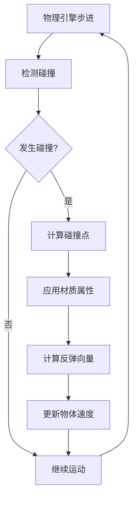

# Cannon-es物理引擎反弹原理与设计流程

## 1. Cannon-es基本概念

### 1.1 什么是Cannon-es

Cannon-es是一个轻量级的JavaScript 3D物理引擎，专门用于模拟现实世界的物理效果，如重力、碰撞、摩擦等。它是Cannon.js的ES6版本。

### 1.2 核心组件

- **World**: 物理世界容器
- **Body**: 物理碰撞体
- **Shape**: 几何形状定义
- **Material**: 物理材质
- **ContactMaterial**: 接触材质（控制碰撞特性）

## 2. 反弹原理深度解析

### 2.1 物理学基础

反弹效果基于现实世界的**弹性碰撞理论**：

```
反弹速度 = -(弹性系数) × 碰撞前速度
```

#### 关键物理参数：

- **Restitution (弹性系数)**: 0-1之间的值
  - `0`: 完全非弹性碰撞（不反弹）
  - `1`: 完全弹性碰撞（能量完全保持）
  - `0.7`: 现实中的篮球反弹效果
- **Friction (摩擦系数)**: 控制物体间的滑动阻力
  - `0`: 无摩擦（如冰面）
  - `1`: 高摩擦（如橡胶）

### 2.2 碰撞检测流程



## 3. 代码详细分析

### 3.0 同步机制原理

#### 1. 两个独立的系统

- Cannon.js (物理引擎)：负责计算物理运动（重力、碰撞、速度等）

- Three.js (渲染引擎)：负责在屏幕上显示 3D 图形

#### 2. 同步的核心逻辑

在每一帧中：

```typescript
function render() {
  // 第1步：物理世界更新（计算新的位置、速度）
  world.step(1 / 60);  // 1/60秒的物理时间步长
  
  // 第2步：将物理body的位置复制给可视化mesh
  mesh.position.copy(body.position);  // 关键的同步代码
  
  // 第3步：渲染画面
  renderer.render(scene, camera);
  
  // 第4步：循环下一帧
  requestAnimationFrame(render);
}
```


### 3.1 物理世界设置

```javascript
// 创建物理世界
const world = new CANNON.World();
// 设置重力加速度 (m/s²)
world.gravity.set(0, -9.8, 0);
```

**重力解释**：

- 地球重力约为9.8 m/s²
- 负值表示向下的方向
- Y轴向上为正方向

### 3.2 球体物理体创建

```javascript
const body = new CANNON.Body({
  mass: 0.3,                           // 质量影响惯性和碰撞效果
  position: new CANNON.Vec3(0, 100, 0), // 初始位置
  shape: new CANNON.Sphere(10),         // 球形碰撞体，半径10
  material: sphereMaterial,             // 材质定义
});
```

**质量的作用**：

- 质量越大，惯性越大，受力影响越小
- 质量为0表示静态物体（如地面）

### 3.3 地面设置

```javascript
const groundBody = new CANNON.Body({
  mass: 0,                    // 静态物体
  shape: new CANNON.Plane(),  // 无限平面
  material: groundMaterial,
});
// 旋转地面使其水平
groundBody.quaternion.setFromEuler(-Math.PI / 2, 0, 0);
```

**旋转说明**：

- Plane默认垂直于Z轴
- 绕X轴旋转-90°使其水平

### 3.4 材质交互定义

```javascript
const contactMaterial = new CANNON.ContactMaterial(
  sphereMaterial,
  groundMaterial,
  {
    friction: 0.1,      // 低摩擦力，球体易滑动
    restitution: 0.7,   // 高弹性，明显反弹效果
  }
);
world.addContactMaterial(contactMaterial);
```

## 4. 设计流程最佳实践

```tcl
1. 创建物理材质 (Material)
   ↓
2. 创建物理对象 (Body) + 绑定材质
   ↓
3. 创建物理世界 (World) + 设置重力
   ↓
4. 创建接触材质 (ContactMaterial) ← 核心！定义碰撞规则
   ↓
5. 物理计算 (world.step)
   ↓
6. 同步到视觉 (Three.js)
```


### 4.1 完整设计流程


#### 步骤详解：

**Step 1: 需求分析**

- 确定需要的物理效果
- 定义交互类型
- 设置性能目标

**Step 2: 物理世界设计**

```javascript
const world = new CANNON.World();
world.gravity.set(0, -9.8, 0);
// 设置碰撞检测算法
world.solver.iterations = 10;
world.defaultContactMaterial.friction = 0.4;
world.defaultContactMaterial.restitution = 0.3;
```

**Step 3: 创建物理体**

```javascript
// 动态物体
const dynamicBody = new CANNON.Body({
  mass: 1,
  shape: new CANNON.Sphere(radius),
});

// 静态物体
const staticBody = new CANNON.Body({
  mass: 0,
  shape: new CANNON.Plane(),
});
```

**Step 4: 材质配置**

```javascript
// 创建特定材质
const bouncyMaterial = new CANNON.Material('bouncy');
const groundMaterial = new CANNON.Material('ground');

// 定义交互
const bouncyGroundContact = new CANNON.ContactMaterial(
  bouncyMaterial,
  groundMaterial,
  {
    friction: 0.1,
    restitution: 0.9, // 高弹性
  }
);
```

**Step 5: 同步渲染**

```javascript
function animate() {
  // 物理世界步进
  world.step(1/60);
  
  // 同步Three.js网格与物理体
  mesh.position.copy(body.position);
  mesh.quaternion.copy(body.quaternion);
  
  renderer.render(scene, camera);
  requestAnimationFrame(animate);
}
```

### 4.2 反弹效果调优

#### 弹性系数调优表：

| 效果类型 | Restitution | Friction | 应用场景 |
| -------- | ----------- | -------- | -------- |
| 橡胶球   | 0.8-0.95    | 0.6-0.8  | 游戏道具 |
| 篮球     | 0.7-0.8     | 0.4-0.6  | 运动模拟 |
| 金属球   | 0.5-0.7     | 0.1-0.3  | 工业仿真 |
| 软球     | 0.2-0.4     | 0.7-0.9  | 缓冲效果 |

#### 代码示例：

```javascript
// 超级弹跳球
const superBallContact = new CANNON.ContactMaterial(
  superBallMaterial,
  groundMaterial,
  {
    friction: 0.05,     // 极低摩擦
    restitution: 0.95,  // 接近完美弹性
  }
);

// 粘性球
const stickyBallContact = new CANNON.ContactMaterial(
  stickyBallMaterial,
  groundMaterial,
  {
    friction: 0.9,      // 高摩擦
    restitution: 0.1,   // 低弹性
  }
);
```

## 🔄 完整的物理循环

```javascript
// 初始状态
body.position.y = 100
body.velocity.y = 0

// 第1帧 (0.016s 后)
world.step(1/60)
  → velocity.y = 0 + (-9.8 × 0.016) = -0.157 m/s
  → position.y = 100 + (-0.157 × 0.016) ≈ 99.997 m

// 第2帧
  → velocity.y = -0.157 + (-9.8 × 0.016) = -0.314 m/s
  → position.y = 99.997 + (-0.314 × 0.016) ≈ 99.992 m

// ... 持续下落

// 约 4.5 秒后（碰撞地面）
position.y ≈ 0
velocity.y ≈ -44.3 m/s  // 下落速度

// 碰撞发生！应用 ContactMaterial
  → 查找 sphereMaterial + groundMaterial
  → friction = 0.1, restitution = 0.7
  → velocity.y = -44.3 × (-0.7) = 31 m/s  // 向上反弹
  → velocity.x *= 0.9  // 摩擦减速

// 反弹后继续上升
  → 上升到约 49m 高度
  → 再次下落...

// 多次反弹后，能量逐渐耗尽
  → 最终静止在地面
```

## 5. 高级技巧与优化

### 5.1 性能优化

#### 碰撞检测优化：

```javascript
// 使用空间分割算法
world.broadphase = new CANNON.NaiveBroadphase();
// 或者使用更高效的算法
world.broadphase = new CANNON.SAPBroadphase(world);

// 限制求解器迭代次数
world.solver.iterations = 5;
```

#### 休眠机制：

```javascript
// 启用物体休眠以提高性能
body.allowSleep = true;
body.sleepSpeedLimit = 0.1;
body.sleepTimeLimit = 1;
```

### 5.2 复杂反弹效果

#### 可变弹性：

```javascript
// 根据碰撞速度调整弹性
world.addEventListener('beginContact', (event) => {
  const contact = event.contact;
  const relativeVelocity = contact.getImpactVelocityAlongNormal();
  
  if (relativeVelocity > 10) {
    contact.restitution = 0.9; // 高速碰撞高弹性
  } else {
    contact.restitution = 0.3; // 低速碰撞低弹性
  }
});
```

#### 方向性反弹：

```javascript
// 自定义反弹方向
world.addEventListener('postStep', () => {
  const velocity = body.velocity;
  
  // 如果向下运动且接触地面
  if (velocity.y < 0 && body.position.y <= groundLevel) {
    // 添加随机横向速度
    body.velocity.x += (Math.random() - 0.5) * 2;
    body.velocity.z += (Math.random() - 0.5) * 2;
  }
});
```


# 答疑解惑

## 1. 为什么 groundBody 使用欧拉角？

### 答案：Cannon-es 和 Three.js 的旋转 API 不同

```javascript
// ❌ Cannon-es 没有 rotation.x
groundBody.rotation.x = -Math.PI / 2;  // 不存在这个API

// ✅ Cannon-es 使用四元数（Quaternion）
groundBody.quaternion.setFromEuler(-Math.PI / 2, 0, 0);
```

### 原因

| 库            | 旋转表示方式         | API                   |
| ------------- | -------------------- | --------------------- |
| **Three.js**  | 欧拉角（Euler）      | `mesh.rotation.x/y/z` |
| **Cannon-es** | 四元数（Quaternion） | `body.quaternion`     |

### 为什么 Cannon-es 用四元数？

**物理计算需要四元数**：

- 四元数没有"万向节锁"问题
- 旋转插值更平滑
- 物理引擎计算旋转碰撞更精确

**Three.js 提供欧拉角是为了方便**：

- 欧拉角更直观（人类思维方式）
- 内部仍然用四元数计算

### 对比

```javascript
// Three.js（方便人类）
mesh.rotation.x = Math.PI / 2;  // "绕X轴转90度"

// Cannon-es（适合物理计算）
body.quaternion.setFromEuler(Math.PI / 2, 0, 0);  // 底层四元数
```

**结论**：不是不能用 `rotation.x`，而是 Cannon-es **没有提供**这个 API，只能用四元数。

------

## 2. World 类似 Scene 吗？

### 答案：✅ **完全正确！**

```javascript
// Three.js
const scene = new THREE.Scene();
scene.add(mesh);        // 添加视觉对象
scene.add(light);       // 添加光源

// Cannon-es
const world = new CANNON.World();
world.addBody(body);               // 添加物理对象
world.addContactMaterial(contact); // 添加碰撞规则
```

### 功能对比

| Three.js Scene    | Cannon-es World       | 作用     |
| ----------------- | --------------------- | -------- |
| `scene.add(mesh)` | `world.addBody(body)` | 添加对象 |
| `scene.children`  | `world.bodies`        | 对象列表 |
| 管理渲染          | 管理物理计算          | 容器职责 |

### 关键区别

```javascript
// Scene：视觉容器
scene.add(mesh);      // 渲染用
scene.add(light);     // 照明用
// 不涉及物理

// World：物理容器
world.addBody(body);              // 物理计算用
world.addContactMaterial(rule);   // 碰撞规则
world.gravity.set(0, -9.8, 0);    // 设置重力
// 不涉及渲染
```

**类比**：

- Scene = 摄影棚（管视觉）
- World = 物理实验室（管运动规律）

------

## 3. 碰撞计算是自动的吗？

### 答案：✅ **完全正确！**

```javascript
// 你只需要定义规则
const contactMaterial = new CANNON.ContactMaterial(
  sphereMaterial,
  groundMaterial,
  {
    friction: 0.1,
    restitution: 0.7,
  }
);
world.addContactMaterial(contactMaterial);

// 物理引擎自动处理一切
world.step(1/60);  // ← 内部自动：
                   //   1. 检测碰撞
                   //   2. 查找 ContactMaterial
                   //   3. 应用 friction 和 restitution
                   //   4. 计算碰撞后速度
                   //   5. 更新位置
```

### 自动执行的内容

```javascript
world.step(1/60) 内部做了：

1. 碰撞检测
   for (body1 of world.bodies) {
     for (body2 of world.bodies) {
       if (colliding(body1, body2)) {
         // 发现碰撞！
       }
     }
   }

2. 查找规则
   rule = findContactMaterial(body1.material, body2.material);

3. 应用物理
   // 法向力（防止穿透）
   applyNormalForce();
   
   // 摩擦力
   body.velocity.x *= (1 - rule.friction);
   
   // 弹性
   body.velocity.y *= -rule.restitution;

4. 更新状态
   body.position.y += body.velocity.y * dt;
```

### 你不需要做的事

```javascript
// ❌ 不需要手动检测碰撞
if (ball.y <= ground.y) { ... }

// ❌ 不需要手动计算反弹
ball.velocity.y *= -0.7;

// ❌ 不需要手动应用摩擦
ball.velocity.x *= 0.9;
```

**结论**：你只负责**定义规则**，物理引擎负责**执行规则**。

------

## 4. 物理公式推导

### 公式1：下落速度

~~~javascript
碰撞速度: v = √(2 × 9.8 × 100) ≈ 44.3 m/s
```

**公式来源**：自由落体运动
```
物理公式：v² = v₀² + 2gh

其中：
v₀ = 0 (初始速度为0)
g = 9.8 m/s² (重力加速度)
h = 100 m (下落高度)

代入：
v² = 0 + 2 × 9.8 × 100
v² = 1960
v = √1960 ≈ 44.3 m/s
~~~

### 公式2：反弹速度

~~~javascript
反弹速度: 44.3 × 0.7 ≈ 31 m/s
```

**公式来源**：恢复系数定义
```
restitution = 反弹速度 / 碰撞速度

0.7 = v_反弹 / 44.3
v_反弹 = 44.3 × 0.7 = 31 m/s
~~~

### 公式3：反弹高度

~~~javascript
反弹高度: (31²) / (2 × 9.8) ≈ 49m
```
**公式来源**：逆向使用自由落体公式
```
从 v² = 2gh 可得：
h = v² / (2g)

代入反弹速度：
h = 31² / (2 × 9.8)
h = 961 / 19.6
h ≈ 49 m
```

### 完整推导
```
步骤1：下落过程
h₁ = 100 m (初始高度)
v₁ = √(2gh₁) = √(2×9.8×100) = 44.3 m/s (碰撞速度)

步骤2：碰撞（应用 restitution）
v₂ = v₁ × restitution = 44.3 × 0.7 = 31 m/s (反弹速度)

步骤3：反弹高度
h₂ = v₂² / (2g) = 31² / (2×9.8) = 49 m

验证：
h₂ / h₁ = 49 / 100 = 0.49 = 0.7² = restitution²  ✅
```

### 核心规律
```
反弹高度 = 原高度 × restitution²

例子：
restitution = 0.7
  → 反弹高度 = 100 × 0.7² = 49 m

restitution = 0.5
  → 反弹高度 = 100 × 0.5² = 25 m

restitution = 1.0
  → 反弹高度 = 100 × 1.0² = 100 m (完全弹性)
```

---

## 📌 总结

### 问题1：欧拉角 vs rotation.x
- Cannon-es 只提供四元数 API（物理计算需要）
- Three.js 提供欧拉角 API（方便使用）
- 底层都是四元数

### 问题2：World vs Scene
- ✅ 完全类似
- World = 物理容器
- Scene = 视觉容器

### 问题3：碰撞计算
- ✅ 完全自动
- 你定义规则（ContactMaterial）
- 引擎执行计算（world.step）

### 问题4：物理公式
```
下落速度: v = √(2gh)
反弹速度: v_反弹 = v_下落 × restitution
反弹高度: h = v² / (2g)

关键规律: 反弹高度 = 原高度 × restitution²
~~~
