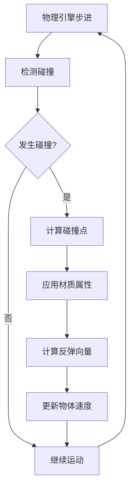
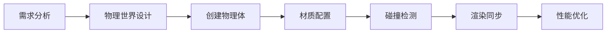

# Cannon-es物理引擎反弹原理与设计流程

## 1. Cannon-es基本概念

### 1.1 什么是Cannon-es

Cannon-es是一个轻量级的JavaScript 3D物理引擎，专门用于模拟现实世界的物理效果，如重力、碰撞、摩擦等。它是Cannon.js的ES6版本。

### 1.2 核心组件

- **World**: 物理世界容器
- **Body**: 物理碰撞体
- **Shape**: 几何形状定义
- **Material**: 物理材质
- **ContactMaterial**: 接触材质（控制碰撞特性）

## 2. 反弹原理深度解析

### 2.1 物理学基础

反弹效果基于现实世界的**弹性碰撞理论**：

```
反弹速度 = -(弹性系数) × 碰撞前速度
```

#### 关键物理参数：

- **Restitution (弹性系数)**: 0-1之间的值
  - `0`: 完全非弹性碰撞（不反弹）
  - `1`: 完全弹性碰撞（能量完全保持）
  - `0.7`: 现实中的篮球反弹效果
- **Friction (摩擦系数)**: 控制物体间的滑动阻力
  - `0`: 无摩擦（如冰面）
  - `1`: 高摩擦（如橡胶）

### 2.2 碰撞检测流程



## 3. 代码详细分析

### 3.0 同步机制原理

#### 1. 两个独立的系统

- Cannon.js (物理引擎)：负责计算物理运动（重力、碰撞、速度等）

- Three.js (渲染引擎)：负责在屏幕上显示 3D 图形

#### 2. 同步的核心逻辑

在每一帧中：

```typescript
function render() {
  // 第1步：物理世界更新（计算新的位置、速度）
  world.step(1 / 60);  // 1/60秒的物理时间步长
  
  // 第2步：将物理body的位置复制给可视化mesh
  mesh.position.copy(body.position);  // 关键的同步代码
  
  // 第3步：渲染画面
  renderer.render(scene, camera);
  
  // 第4步：循环下一帧
  requestAnimationFrame(render);
}
```


### 3.1 物理世界设置

```javascript
// 创建物理世界
const world = new CANNON.World();
// 设置重力加速度 (m/s²)
world.gravity.set(0, -9.8, 0);
```

**重力解释**：

- 地球重力约为9.8 m/s²
- 负值表示向下的方向
- Y轴向上为正方向

### 3.2 球体物理体创建

```javascript
const body = new CANNON.Body({
  mass: 0.3,                           // 质量影响惯性和碰撞效果
  position: new CANNON.Vec3(0, 100, 0), // 初始位置
  shape: new CANNON.Sphere(10),         // 球形碰撞体，半径10
  material: sphereMaterial,             // 材质定义
});
```

**质量的作用**：

- 质量越大，惯性越大，受力影响越小
- 质量为0表示静态物体（如地面）

### 3.3 地面设置

```javascript
const groundBody = new CANNON.Body({
  mass: 0,                    // 静态物体
  shape: new CANNON.Plane(),  // 无限平面
  material: groundMaterial,
});
// 旋转地面使其水平
groundBody.quaternion.setFromEuler(-Math.PI / 2, 0, 0);
```

**旋转说明**：

- Plane默认垂直于Z轴
- 绕X轴旋转-90°使其水平

### 3.4 材质交互定义

```javascript
const contactMaterial = new CANNON.ContactMaterial(
  sphereMaterial,
  groundMaterial,
  {
    friction: 0.1,      // 低摩擦力，球体易滑动
    restitution: 0.7,   // 高弹性，明显反弹效果
  }
);
world.addContactMaterial(contactMaterial);
```

## 4. 设计流程最佳实践

### 4.1 完整设计流程



#### 步骤详解：

**Step 1: 需求分析**

- 确定需要的物理效果
- 定义交互类型
- 设置性能目标

**Step 2: 物理世界设计**

```javascript
const world = new CANNON.World();
world.gravity.set(0, -9.8, 0);
// 设置碰撞检测算法
world.solver.iterations = 10;
world.defaultContactMaterial.friction = 0.4;
world.defaultContactMaterial.restitution = 0.3;
```

**Step 3: 创建物理体**

```javascript
// 动态物体
const dynamicBody = new CANNON.Body({
  mass: 1,
  shape: new CANNON.Sphere(radius),
});

// 静态物体
const staticBody = new CANNON.Body({
  mass: 0,
  shape: new CANNON.Plane(),
});
```

**Step 4: 材质配置**

```javascript
// 创建特定材质
const bouncyMaterial = new CANNON.Material('bouncy');
const groundMaterial = new CANNON.Material('ground');

// 定义交互
const bouncyGroundContact = new CANNON.ContactMaterial(
  bouncyMaterial,
  groundMaterial,
  {
    friction: 0.1,
    restitution: 0.9, // 高弹性
  }
);
```

**Step 5: 同步渲染**

```javascript
function animate() {
  // 物理世界步进
  world.step(1/60);
  
  // 同步Three.js网格与物理体
  mesh.position.copy(body.position);
  mesh.quaternion.copy(body.quaternion);
  
  renderer.render(scene, camera);
  requestAnimationFrame(animate);
}
```

### 4.2 反弹效果调优

#### 弹性系数调优表：

| 效果类型 | Restitution | Friction | 应用场景 |
| -------- | ----------- | -------- | -------- |
| 橡胶球   | 0.8-0.95    | 0.6-0.8  | 游戏道具 |
| 篮球     | 0.7-0.8     | 0.4-0.6  | 运动模拟 |
| 金属球   | 0.5-0.7     | 0.1-0.3  | 工业仿真 |
| 软球     | 0.2-0.4     | 0.7-0.9  | 缓冲效果 |

#### 代码示例：

```javascript
// 超级弹跳球
const superBallContact = new CANNON.ContactMaterial(
  superBallMaterial,
  groundMaterial,
  {
    friction: 0.05,     // 极低摩擦
    restitution: 0.95,  // 接近完美弹性
  }
);

// 粘性球
const stickyBallContact = new CANNON.ContactMaterial(
  stickyBallMaterial,
  groundMaterial,
  {
    friction: 0.9,      // 高摩擦
    restitution: 0.1,   // 低弹性
  }
);
```

## 5. 高级技巧与优化

### 5.1 性能优化

#### 碰撞检测优化：

```javascript
// 使用空间分割算法
world.broadphase = new CANNON.NaiveBroadphase();
// 或者使用更高效的算法
world.broadphase = new CANNON.SAPBroadphase(world);

// 限制求解器迭代次数
world.solver.iterations = 5;
```

#### 休眠机制：

```javascript
// 启用物体休眠以提高性能
body.allowSleep = true;
body.sleepSpeedLimit = 0.1;
body.sleepTimeLimit = 1;
```

### 5.2 复杂反弹效果

#### 可变弹性：

```javascript
// 根据碰撞速度调整弹性
world.addEventListener('beginContact', (event) => {
  const contact = event.contact;
  const relativeVelocity = contact.getImpactVelocityAlongNormal();
  
  if (relativeVelocity > 10) {
    contact.restitution = 0.9; // 高速碰撞高弹性
  } else {
    contact.restitution = 0.3; // 低速碰撞低弹性
  }
});
```

#### 方向性反弹：

```javascript
// 自定义反弹方向
world.addEventListener('postStep', () => {
  const velocity = body.velocity;
  
  // 如果向下运动且接触地面
  if (velocity.y < 0 && body.position.y <= groundLevel) {
    // 添加随机横向速度
    body.velocity.x += (Math.random() - 0.5) * 2;
    body.velocity.z += (Math.random() - 0.5) * 2;
  }
});
```

## 6. 实际应用案例

### 6.1 弹跳游戏

- 小球持续弹跳，玩家控制移动方向
- 调节restitution实现不同弹跳高度

### 6.2 物理模拟

- 真实材质模拟（玻璃、橡胶、金属）
- 教育用途的物理演示

### 6.3 粒子系统

- 大量小球的碰撞效果
- 组合不同材质创造复杂交互

## 7. 调试技巧

### 7.1 可视化调试

```javascript
// 显示物理体边界
const cannonDebugger = new CannonDebugger(scene, world);

function animate() {
  world.step(1/60);
  cannonDebugger.update(); // 更新调试可视化
  renderer.render(scene, camera);
}
```

### 7.2 数据监控

```javascript
// 监控物理参数
console.log('Position:', body.position);
console.log('Velocity:', body.velocity);
console.log('Angular Velocity:', body.angularVelocity);
```

## 8. 总结

Cannon-es的反弹原理基于真实物理学，通过以下关键要素实现：

1. **准确的碰撞检测**
2. **合理的材质参数设置**
3. **高效的物理计算步进**
4. **视觉与物理的精确同步**

掌握这些原理和流程，你就能创造出真实、流畅的物理交互效果！


