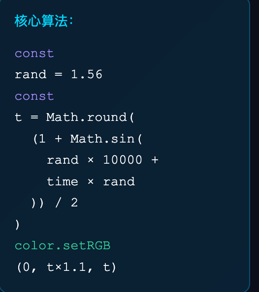
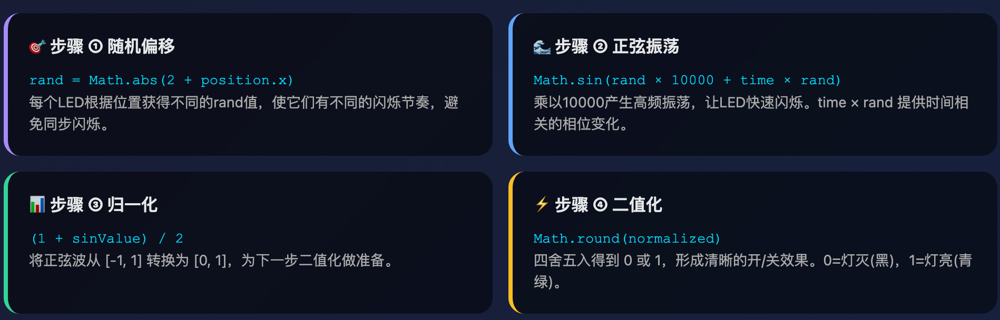

## 🎯 核心目标：让LED灯一闪一闪

想象你要做一个**闪烁的LED灯**，就像圣诞树上的彩灯那样一闪一闪的。

------

## 第一步：理解"一闪一闪"需要什么

LED灯只有两种状态：

- **亮** = 1
- **灭** = 0

所以我们需要一个数字不断在 **0 和 1 之间跳动**。

------

## 第二步：为什么用正弦函数？

### 🤔 问题：正弦函数是怎么帮我们做到的？

让我画给你看：

```
正弦函数 Math.sin() 的输出是这样的：

     1  ┃    ╱╲      ╱╲      ╱╲
        ┃   ╱  ╲    ╱  ╲    ╱  ╲
     0  ┃━━━━━━━╲━━╱━━━━╲━━╱━━━━━━  ← 中线
        ┃        ╲╱      ╲╱
    -1  ┃
        ┗━━━━━━━━━━━━━━━━━━━━━━━━━→ 时间
```

**关键点**：正弦函数会**自动上上下下**，永远循环！

------

## 第三步：把正弦波变成开关

但是！正弦函数的值在 **-1 到 1** 之间，我们需要 **0 或 1**。

### 🎬 三步变身：

#### **① 原始正弦波**（-1 到 1）

~~~javascript
Math.sin(某个数字)  // 输出：-0.8, 0.3, 0.9, -0.5 ...
~~~

```
值的范围：
-1 ━━━━━━━━━━━━━ 最低点
 0 ━━━━━━━━━━━━━ 中间
+1 ━━━━━━━━━━━━━ 最高点
```

#### **② 平移+缩放**（变成 0 到 1）

~~~javascript
(1 + Math.sin(某个数字)) / 2  // 输出：0.1, 0.65, 0.95, 0.25 ...
~~~

**为什么要这样做？**
- `1 + sin()`：把整个波形**向上推**，从 [-1,1] 变成 [0,2]
- `÷ 2`：把波形**压扁一半**，从 [0,2] 变成 [0,1]
```
变换前 [-1, 1]:        变换后 [0, 1]:
    1  ╱╲                    1  ╱╲
    0 ━━━━                   0.5━━━━
   -1    ╲╱                  0    ╲╱
```

#### **③ 四舍五入**（变成 0 或 1）

~~~javascript
Math.round(0.1)   // = 0  ← 灯灭
Math.round(0.65)  // = 1  ← 灯亮
Math.round(0.95)  // = 1  ← 灯亮
Math.round(0.25)  // = 0  ← 灯灭
~~~

**效果**：

```
原始值：  0.1   0.4   0.6   0.9   0.7   0.3   0.1
         ↓     ↓     ↓     ↓     ↓     ↓     ↓
四舍五入：  0     0     1     1     1     0     0
         ↓     ↓     ↓     ↓     ↓     ↓     ↓
LED状态： 灭    灭    亮    亮    亮    灭    灭
```

------

## 🎯 完整流程图

让我用一个**完整的例子**带你走一遍：

```javascript
时间 = 0.5 秒
rand = 1.5

// 步骤1：计算正弦值
Math.sin(1.5 × 10000 + 0.5 × 1.5)
= Math.sin(15000.75)
= -0.8234  ← 在波谷附近

// 步骤2：归一化到 [0,1]
(1 + (-0.8234)) / 2
= 0.1766 / 2
= 0.0883  ← 接近 0

// 步骤3：四舍五入
Math.round(0.0883)
= 0  ← LED 灭！

// 结果：LED显示黑色
```

再来一次，但时间不同：

```javascript
时间 = 0.51 秒（只过了0.01秒）
rand = 1.5

// 步骤1：计算正弦值
Math.sin(1.5 × 10000 + 0.51 × 1.5)
= Math.sin(15000.765)
= 0.9999  ← 突然跳到波峰！

// 步骤2：归一化
(1 + 0.9999) / 2
= 0.99995  ← 接近 1

// 步骤3：四舍五入
Math.round(0.99995)
= 1  ← LED 亮！

// 结果：LED显示青绿色
```

------

## 💡 为什么乘以 10000？

这是**关键**！让我用动画帧来解释：

### 不乘 10000（慢速）：

```javascript
时间：0秒 → sin(0) = 0
时间：1秒 → sin(1.5) = 0.997  ← 1秒才变一次
时间：2秒 → sin(3) = 0.141
```

**结果**：LED 每隔好几秒才闪一次，太慢了！

### 乘以 10000（快速）：

~~~javascript
时间：0.000秒 → sin(0) = 0
时间：0.001秒 → sin(15) = 0.65   ← 只用了千分之一秒！
时间：0.002秒 → sin(30) = -0.98
~~~

**结果**：LED 疯狂快速闪烁！

---

## 🎨 类比理解

想象你在看**跑马灯**：

1. **正弦函数** = 灯光亮度从 0% → 100% → 0% 循环
2. **乘以10000** = 让灯光变化超级快
3. **四舍五入** = 不要渐变效果，只要开/关两种状态

---

## 🔍 用你的demo理解

打开你下载的 `led-sine-wave-demo.html`，做这个实验：

### 实验步骤：

1️⃣ **把动画速度调到 0.1x（最慢）**
   - 观察：LED缓慢地 灭→亮→灭

2️⃣ **看波形图的三条线：**
```
   黄色线（正弦波）：像山峰一样上下起伏
                     ↓
   蓝色线（归一化）：把山峰搬到地面以上
                     ↓
   绿色线（二值化）：把山峰削平，变成台阶
```

3️⃣ **看左下角的数据面板：**
```
   正弦值：-0.9876 → 0.5000 → 0.9999 → ...（连续变化）
           ↓
   归一化：0.0062  → 0.7500 → 0.9999 → ...（连续变化）
           ↓
   二值化：0       → 1      → 1      → ...（跳跃变化）
           ↓
   LED：   灭      → 亮     → 亮     → ...
```

---

## 🎯 最简单总结

**整个算法就是干这事儿：**
```
时间不断流逝
    ↓
扔给正弦函数 → 得到连续的波浪
    ↓
平移压缩 → 波浪全部在 0-1 之间
    ↓
四舍五入 → 波浪变成台阶（只有0和1）
    ↓
0 = 灯灭，1 = 灯亮
```

**一句话版本：**

> 用正弦函数制造"波浪"，然后把波浪削平成"台阶"，台阶的高低控制灯的亮灭。

------

## ❓ 现在问问自己

1. **正弦函数的作用是什么？** 答：产生上下起伏的数字
2. **为什么要归一化？** 答：让数字变成 0-1，方便四舍五入
3. **四舍五入的作用？** 答：把连续的数字变成只有 0 和 1
4. **为什么乘以 10000？** 答：让正弦波震荡得超级快，产生快速闪烁
5. **为什么每个 LED 的 rand 值不同？** 答：让它们闪烁的节奏不一样，不会同步



